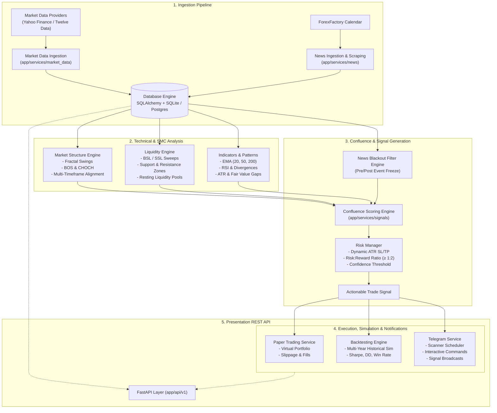

<<<<<<< HEAD
# Trade Monorepo

Welcome to the Trade project repository.

## 📂 Repository Structure

- **[`server/`](./server)**: The core backend service built with Python and FastAPI for market analysis, Smart Money Concepts (SMC), indicators, backtesting, paper trading, and Telegram signal dispatching.
  - Detailed documentation: [Server README](./server/README.md)
  - Project architecture: [Server Project Structure](./server/PROJECT_STRUCTURE.md)
  - Deployment instructions: [Server Deployment Guide](./server/DEPLOYMENT_GUIDE.md)
- **[`client/`](./client)**: "QuantView" Algorithmic Trading Dashboard built with React, TypeScript, Tailwind CSS, Recharts, and Lucide React.
  - High-performance Bloomberg terminal dark theme (#0a0a0f / #12121a)
  - Real-time 10s polling, Signal Matrix with per-pair alert toggles, Telegram alert configuration, active positions, interactive charts, and economic calendar risk monitor.

## 🚀 Getting Started with the Backend Service

1. Navigate to the server folder:
   ```bash
   cd server
   ```

2. Create and activate a virtual environment (optional but recommended):
   ```bash
   python -m venv .venv
   source .venv/bin/activate  # On Linux/macOS
   .venv\Scripts\activate     # On Windows
   ```
=======
# Project Structure: Forex Market Analysis & Telegram Signal Bot

A production-ready Forex market analysis, technical/SMC analysis, risk management, backtesting, and Telegram signal generation system built with Python and FastAPI.

---

## 📂 Visual Directory Tree

```text
signal_bot/
├── .dockerignore
├── .env                              # Environment variables (local configuration)
├── .env.example                      # Template for environment variables
├── .gitignore
├── DEPLOYMENT_GUIDE.md               # Production deployment instructions (Docker, Render, etc.)
├── Dockerfile                        # Multi-stage container definition
├── PROJECT_STRUCTURE.md              # Project structure and architecture documentation
├── README.md                         # Detailed project overview and milestone documentation
├── docker-compose.yml                # Container orchestration (FastAPI + DB)
├── render.yaml                       # Render.com deployment configuration
├── requirements.txt                  # Python dependencies
├── app/                              # Core application source code
│   ├── __init__.py
│   ├── main.py                       # FastAPI entrypoint, lifespan events, and middleware
│   ├── api/                          # REST API presentation layer
│   │   ├── __init__.py
│   │   ├── deps.py                   # Dependency injection (DB session, services)
│   │   └── v1/                       # API Version 1 route endpoints
│   │       ├── __init__.py
│   │       ├── backtest.py           # /api/v1/backtest endpoints
│   │       ├── health.py             # /api/v1/health system status & candle counts
│   │       ├── indicators.py         # /api/v1/indicators (EMA, RSI, ATR, FVG)
│   │       ├── liquidity.py          # /api/v1/liquidity (sweeps, S/R zones)
│   │       ├── market.py             # /api/v1/market (symbols, candles, sync)
│   │       ├── news.py               # /api/v1/news (calendar events, blackout check)
│   │       ├── paper.py              # /api/v1/paper (virtual trading accounts & orders)
│   │       ├── router.py             # Main v1 router aggregating all endpoints
│   │       ├── signals.py            # /api/v1/signals (confluence generation)
│   │       ├── structure.py          # /api/v1/structure (swings, BOS, CHOCH, MTF)
│   │       └── telegram.py           # /api/v1/telegram (bot status, test alerts)
│   ├── core/                         # Low-level application framework & infrastructure
│   │   ├── __init__.py
│   │   ├── config.py                 # Application settings (Pydantic BaseSettings)
│   │   ├── database.py               # SQLAlchemy database engine and session maker
│   │   ├── logging.py                # Centralized logging configuration
│   │   └── normalization.py          # Symbol and timeframe format standardizer
│   ├── models/                       # SQLAlchemy declarative ORM models
│   │   ├── __init__.py
│   │   ├── backtest.py               # BacktestRun, BacktestTrade entities
│   │   ├── base.py                   # Declarative base & timestamp mixins
│   │   ├── candle.py                 # Candle entity (OHLCV, composite indexes)
│   │   ├── liquidity.py              # LiquidityEvent, LiquidityZone entities
│   │   ├── news.py                   # NewsEvent entity (macroeconomic events)
│   │   ├── paper.py                  # PaperAccount, PaperPosition, PaperOrder entities
│   │   ├── signal.py                 # TradeSignal entity (generated signals & audit)
│   │   └── structure.py              # StructureEvent entity (swings, BOS, CHOCH)
│   ├── schemas/                      # Pydantic schemas (request/response validation)
│   │   ├── __init__.py
│   │   ├── backtesting.py            # Schemas for backtest runs and performance metrics
│   │   ├── candle.py                 # Schemas for OHLCV candles
│   │   ├── indicators.py             # Schemas for technical indicators and FVGs
│   │   ├── liquidity.py              # Schemas for liquidity sweeps and S/R levels
│   │   ├── market.py                 # Schemas for market data ingestion & queries
│   │   ├── news.py                   # Schemas for economic news events & blackout status
│   │   ├── paper_trading.py          # Schemas for paper accounts, positions, and orders
│   │   ├── signal.py                 # Schemas for trade signals & scoring breakdowns
│   │   ├── structure.py              # Schemas for swings, BOS, CHOCH, and MTF alignment
│   │   └── telegram.py               # Schemas for Telegram messages and alert configs
│   └── services/                     # Business logic and domain engines
│       ├── __init__.py
│       ├── backtesting/              # Historical backtesting & optimization engine
│       │   ├── __init__.py
│       │   ├── backtest_engine.py    # Simulates strategy execution on historical data
│       │   ├── backtest_service.py   # High-level orchestrator for backtesting
│       │   ├── optimization.py       # Parameter grid search & strategy optimizer
│       │   └── performance_metrics.py# Computes Sharpe ratio, Max Drawdown, Win Rate, etc.
│       ├── indicators/               # Technical indicator calculators
│       │   ├── __init__.py
│       │   ├── atr_calculator.py     # ATR volatility & pip conversions
│       │   ├── ema_calculator.py     # Multi-period EMA (20, 50, 200) & stack detection
│       │   ├── indicator_service.py  # Composite indicator aggregator & confluence scorer
│       │   ├── price_action.py       # Detects Pin Bars, Engulfing patterns, FVGs
│       │   └── rsi_calculator.py     # RSI calculation & regular/hidden divergences
│       ├── liquidity/                # Smart Money Concepts (SMC) liquidity engines
│       │   ├── __init__.py
│       │   ├── liquidity_service.py  # High-level coordinator for sweeps and S/R analysis
│       │   ├── sr_detector.py        # Dynamic Support/Resistance & Equal Highs/Lows
│       │   └── sweep_detector.py     # Detects institutional Buy/Sell-side liquidity sweeps
│       ├── market_data/              # Data ingestion and normalization pipeline
│       │   ├── __init__.py
│       │   ├── base.py               # Abstract base provider interface
│       │   ├── ingestion.py          # Cleans, deduplicates, and sorts candle streams
│       │   ├── mock_provider.py      # Deterministic synthetic candle generator
│       │   ├── twelvedata_provider.py# Twelve Data API client integration
│       │   └── yfinance_provider.py  # Yahoo Finance API client integration
│       ├── news/                     # Macroeconomic news calendar & blackout window
│       │   ├── __init__.py
│       │   ├── base.py               # Abstract news provider interface
│       │   ├── filter_engine.py      # Pre/post high-impact news trading blackout checks
│       │   ├── forexfactory_provider.py # ForexFactory economic calendar scraper/fetcher
│       │   ├── ingestion.py          # News ingestion and database persistence
│       │   └── mock_provider.py      # Deterministic mock economic calendar
│       ├── paper_trading/            # Virtual trading simulation & execution
│       │   ├── __init__.py
│       │   ├── account_manager.py    # Manages virtual account balance and equity
│       │   ├── order_executor.py     # Executes market/limit orders with slippage
│       │   ├── paper_service.py      # High-level coordinator for paper trading
│       │   └── position_manager.py   # Manages open positions, SL/TP execution, trailing stops
│       ├── signals/                  # Confluence scoring & trade signal generation
│       │   ├── __init__.py
│       │   ├── confluence_engine.py  # Combines structure, indicators, liquidity, and news
│       │   ├── evaluators.py         # Sub-evaluators for specific market conditions
│       │   ├── risk_manager.py       # Dynamic ATR-based SL/TP & position sizing
│       │   ├── scoring_engine.py     # Normalizes multi-factor scores into confidence values
│       │   └── signal_generator.py   # Produces final actionable BUY/SELL signals
│       ├── structure/                # Market structure & price action trend classification
│       │   ├── __init__.py
│       │   ├── bos_choch_detector.py # Break of Structure & Change of Character detection
│       │   ├── multi_timeframe.py    # Multi-timeframe (HTF/ITF/LTF) alignment engine
│       │   ├── structure_engine.py   # Swing point classification (HH, HL, LH, LL)
│       │   └── swing_detector.py     # N-bar fractal swing point detection algorithm
│       └── telegram/                 # Notification and background market scanner
│           ├── __init__.py
│           ├── client.py             # Telegram Bot API wrapper
│           ├── command_handler.py    # Interactive Telegram commands (/status, /analyze, etc.)
│           ├── message_formatter.py  # Rich Markdown signal templates
│           ├── scanner.py            # Automated periodic market scanning loop
│           ├── scheduler.py          # APScheduler background task manager
│           └── telegram_service.py   # Dispatcher for alerts, trade signals, and reports
├── scripts/                          # Diagnostic, benchmarking, and verification tools
│   ├── baseline_results.json         # Benchmark execution results
│   ├── diagnose_strategy.py          # In-depth strategy diagnostics and metric validation
│   ├── diagnostic_results.json       # Diagnostic engine output cache
│   ├── inspect_trades.py             # Detailed trade-by-trade breakdown inspection
│   ├── oos_validation_results.json   # Out-of-sample backtest validation results
│   ├── run_baseline_benchmark.py     # Runs baseline performance benchmarks
│   ├── validate_oos.py               # Out-of-sample walk-forward validation script
│   ├── verify_backtest.py            # Verification script for backtesting engine
│   ├── verify_indicators.py          # Verification script for technical indicators
│   ├── verify_liquidity.py           # Verification script for liquidity detection
│   ├── verify_news.py                # Verification script for news calendar engine
│   ├── verify_paper_trading.py       # Verification script for paper trading engine
│   ├── verify_pipeline.py            # Verification script for data ingestion pipeline
│   ├── verify_signals.py             # Verification script for signal generation
│   ├── verify_structure.py           # Verification script for market structure engine
│   └── verify_telegram.py            # Verification script for Telegram alerts
└── tests/                            # Pytest test suite
    ├── __init__.py
    ├── conftest.py                   # Pytest fixtures and mock DB sessions
    ├── test_api.py                   # Core API root & health tests
    ├── test_backtest_api.py          # REST API tests for backtesting
    ├── test_backtesting.py           # Unit tests for backtest simulation engine
    ├── test_bos_choch.py             # Unit tests for BOS and CHOCH detectors
    ├── test_duplicate_integrity.py   # Ingestion deduplication and database integrity tests
    ├── test_indicators.py            # Unit tests for EMA, RSI, ATR, and FVG calculators
    ├── test_indicators_api.py        # REST API tests for indicator endpoints
    ├── test_ingestion_pipeline.py    # Unit tests for market data ingestion and cleaning
    ├── test_liquidity.py             # Unit tests for liquidity sweeps and S/R detectors
    ├── test_liquidity_api.py         # REST API tests for liquidity endpoints
    ├── test_market_data_provider.py  # Unit tests for Yahoo Finance and mock providers
    ├── test_models.py                # Database ORM model creation & constraint tests
    ├── test_news.py                  # Unit tests for news provider and blackout filter
    ├── test_news_api.py              # REST API tests for news endpoints
    ├── test_paper_trading.py         # Unit tests for virtual order/position management
    ├── test_paper_trading_api.py     # REST API tests for paper trading endpoints
    ├── test_price_action.py          # Unit tests for price action patterns (Pin bar, Engulfing)
    ├── test_production_parity.py     # Parity validation between mock and real data logic
    ├── test_scanner_scheduler.py     # Unit tests for automated scanner and scheduler
    ├── test_signals.py               # Unit tests for signal generation & confluences
    ├── test_signals_api.py           # REST API tests for signal endpoints
    ├── test_structure.py             # Unit tests for swing detection & trend classification
    ├── test_structure_api.py         # REST API tests for structure endpoints
    ├── test_telegram.py              # Unit tests for Telegram formatting & client
    └── test_telegram_api.py          # REST API tests for Telegram webhook/alert endpoints
```

---

## 🏛️ Architectural Layers & Data Flow



---

## 🧩 Detailed Module Guide

### 1. Root & Deployment Files
| File | Description |
| :--- | :--- |
| `Dockerfile` | Multi-stage Docker build recipe for containerizing the FastAPI service. |
| `docker-compose.yml` | Container orchestration configuration for local and server deployment. |
| `render.yaml` | Infrastructure as Code (IaC) configuration for deploying directly to Render.com. |
| `requirements.txt` | Python package dependencies (`fastapi`, `sqlalchemy`, `pydantic`, `yfinance`, etc.). |
| `DEPLOYMENT_GUIDE.md`| Comprehensive step-by-step production deployment manual. |
| `README.md` | Core project specification, milestone checklists, and math/logic documentation. |

---

### 2. `app/core/` (Framework & Infrastructure)
- **`config.py`**: Configuration management using Pydantic Settings. Manages environment variables, DB connection strings, Telegram bot credentials, risk thresholds, and scanner intervals.
- **`database.py`**: Initializes the SQLAlchemy engine, session maker, and scoped session bindings.
- **`logging.py`**: Configures formatted console and file logging.
- **`normalization.py`**: Standardizes currency symbols (e.g. `EURUSD` $\to$ `EUR/USD`) and timeframes (`15m`, `1h`, `4h`).

---

### 3. `app/models/` (Database ORM Entities)
- **`candle.py`**: `Candle` table representing OHLCV data with composite unique constraint `(symbol, timeframe, timestamp)`.
- **`structure.py`**: `StructureEvent` table recording Swing Points, Break of Structure (BOS), and Change of Character (CHOCH).
- **`liquidity.py`**: `LiquidityEvent` and `LiquidityZone` tables tracking Buy/Sell sweeps and S/R clusters.
- **`news.py`**: `NewsEvent` table storing macroeconomic events, impact tiers, and schedule timestamps.
- **`signal.py`**: `TradeSignal` table storing generated trade alerts and confluence telemetry.
- **`paper.py`**: `PaperAccount`, `PaperOrder`, and `PaperPosition` tables managing virtual portfolio balances and trade states.
- **`backtest.py`**: `BacktestRun` and `BacktestTrade` tables recording historical simulation runs and trade metrics.

---

### 4. `app/schemas/` (Data Transfer Objects & Validation)
Pydantic schemas ensuring request validation and JSON serialization across all REST API endpoints:
- `candle.py`, `market.py`: OHLCV queries, ingestion requests, sync responses.
- `structure.py`: Swing points, BOS/CHOCH details, and multi-timeframe summaries.
- `liquidity.py`: Liquidity sweeps and support/resistance zones.
- `indicators.py`: Technical indicators, divergences, and Fair Value Gaps.
- `news.py`: Economic calendar events and blackout status.
- `signal.py`: Signal payload, entry, SL, TP, and confluence breakdown.
- `paper_trading.py`: Account status, order creation, and position history.
- `backtesting.py`: Backtest run parameters and performance metrics.
- `telegram.py`: Outbound alert payloads and bot status responses.

---

### 5. `app/services/` (Core Trading Engines)

#### `market_data/`
- **`base.py`**: Abstract base class defining market data provider contracts.
- **`yfinance_provider.py`**: Yahoo Finance data provider for real-time and historical candles.
- **`twelvedata_provider.py`**: Twelve Data REST API provider integration.
- **`mock_provider.py`**: Deterministic synthetic OHLCV generator for testing and offline environments.
- **`ingestion.py`**: Ingestion pipeline that performs price invariant validation ($High \ge Low$), deduplication, and gap detection.

#### `structure/`
- **`swing_detector.py`**: Pure fractal swing detection using configurable $N$-bar left and right lookback windows.
- **`structure_engine.py`**: Categorizes swing points into Higher Highs (HH), Higher Lows (HL), Lower Highs (LH), Lower Lows (LL), and classifies trends (`BULLISH`, `BEARISH`, `RANGING`).
- **`bos_choch_detector.py`**: Detects Break of Structure (BOS) for trend continuation and Change of Character (CHOCH) for market reversals.
- **`multi_timeframe.py`**: Evaluates confluence across Higher Timeframe (4h), Intermediate Timeframe (1h), and Lower Timeframe (15m).

#### `liquidity/`
- **`sweep_detector.py`**: Identifies institutional Buy-Side Liquidity (BSL) and Sell-Side Liquidity (SSL) sweeps (false breakouts/stop-runs).
- **`sr_detector.py`**: Clusters swing points into dynamic Support & Resistance zones and Equal Highs / Equal Lows pools.
- **`liquidity_service.py`**: High-level coordinator combining sweeps, zones, and institutional market state classification.

#### `indicators/`
- **`ema_calculator.py`**: Calculates EMA 20, 50, and 200, detecting directional stack alignment.
- **`rsi_calculator.py`**: Computes Wilder's RSI (14) and detects regular and hidden divergences.
- **`atr_calculator.py`**: Calculates 14-period ATR for volatility measurement and pip-based SL/TP sizing.
- **`price_action.py`**: Detects Pin Bars (Hammers / Shooting Stars), Engulfing patterns, and Fair Value Gaps (FVG).
- **`indicator_service.py`**: Orchestrates indicators and computes a normalized technical confluence score ($-100$ to $+100$).

#### `news/`
- **`forexfactory_provider.py`**: Scrapes and parses high/medium impact economic events from ForexFactory.
- **`mock_provider.py`**: Mock news calendar for predictable test simulations.
- **`filter_engine.py`**: Evaluates active blackout windows (blocks signals within $X$ minutes before or after high-impact news).
- **`ingestion.py`**: Coordinates fetching and persisting macroeconomic news items.

#### `signals/`
- **`evaluators.py`**: Rule-based conditions for individual technical confluences.
- **`confluence_engine.py`**: Evaluates and weights multi-dimensional confluences across structure, liquidity, indicators, and news.
- **`scoring_engine.py`**: Calculates net confidence percentage and validates minimum threshold for trade triggers.
- **`risk_manager.py`**: Dynamic ATR-based Stop Loss and Take Profit (minimum 1:2 R:R ratio) calculator.
- **`signal_generator.py`**: Top-level coordinator that analyzes the market and produces complete trade signals.

#### `paper_trading/`
- **`account_manager.py`**: Tracks account balance, margin, and equity.
- **`order_executor.py`**: Handles simulated market and limit order execution with spread/slippage modeling.
- **`position_manager.py`**: Manages open positions, checks for SL/TP hits on new incoming candles, and tracks realized PnL.
- **`paper_service.py`**: High-level facade for virtual trading.

#### `backtesting/`
- **`backtest_engine.py`**: Historical event-driven or vector-based backtester iterating through historical candles.
- **`performance_metrics.py`**: Computes Sharpe Ratio, Profit Factor, Win Rate, Max Drawdown, and expectancy.
- **`optimization.py`**: Grid search optimization for confluence weights and risk parameters.
- **`backtest_service.py`**: High-level manager to initiate, save, and query backtest runs.

#### `telegram/`
- **`client.py`**: Telegram Bot API wrapper for sending messages and handling HTTP communications.
- **`message_formatter.py`**: Builds clean, readable Markdown signal templates for Telegram alerts.
- **`command_handler.py`**: Interactive Telegram bot command listener (`/start`, `/status`, `/scan`, `/help`).
- **`scheduler.py`**: Background job scheduler (`APScheduler`) executing automated market scanning routines.
- **`scanner.py`**: Automated scan routine fetching new candles, running analysis, and broadcasting qualified signals.
- **`telegram_service.py`**: High-level facade orchestrating telegram messaging and scheduler state.

---

### 6. `app/api/` (Presentation Layer)
- **`deps.py`**: FastAPI dependency injection functions (`get_db`, service initializers).
- **`v1/router.py`**: Aggregator combining all sub-routers:
  - `health.py` (`/api/v1/health`)
  - `market.py` (`/api/v1/market`)
  - `structure.py` (`/api/v1/structure`)
  - `liquidity.py` (`/api/v1/liquidity`)
  - `indicators.py` (`/api/v1/indicators`)
  - `news.py` (`/api/v1/news`)
  - `signals.py` (`/api/v1/signals`)
  - `paper.py` (`/api/v1/paper`)
  - `backtest.py` (`/api/v1/backtest`)
  - `telegram.py` (`/api/v1/telegram`)
>>>>>>> b824e91a8970415ca477e4fea136db60741e4bf8

3. Install dependencies:
   ```bash
   pip install -r requirements.txt
   ```

<<<<<<< HEAD
4. Run database setup / start the API:
   ```bash
   uvicorn app.main:app --reload --port 8000
   ```

5. Run test suite:
   ```bash
   python -m pytest tests/
   ```

## 💻 Getting Started with the Client (QuantView)

1. Navigate to the client folder:
   ```bash
   cd client
   ```

2. Install dependencies:
   ```bash
   npm install
   ```

3. Start the development server:
   ```bash
   npm run dev
   ```

4. Build for production:
   ```bash
   npm run build
   ```

=======
### 7. `scripts/` (Benchmarking & Diagnostics)
- Verification scripts (`verify_*.py`) for all milestones from data pipeline to backtesting and Telegram.
- Strategy benchmarking and diagnostic tools (`run_baseline_benchmark.py`, `diagnose_strategy.py`, `validate_oos.py`, `inspect_trades.py`).
- JSON benchmark and walk-forward validation outputs (`baseline_results.json`, `oos_validation_results.json`, `diagnostic_results.json`).

---

### 8. `tests/` (Automated Pytest Suite)
Over 25 test modules ensuring full coverage of:
- Candle ingestion, data deduplication, invariant checking, and gap detection.
- Mathematical accuracy for indicators (Wilder's RSI, EMA, ATR).
- SMC logic (fractal swings, BOS displacement, CHOCH reversal, liquidity sweeps).
- Signal scoring, dynamic SL/TP calculation, and news blackout enforcement.
- Paper trading position tracking and backtesting metrics calculation.
- REST API endpoint contracts and Telegram message formatting.
>>>>>>> b824e91a8970415ca477e4fea136db60741e4bf8
