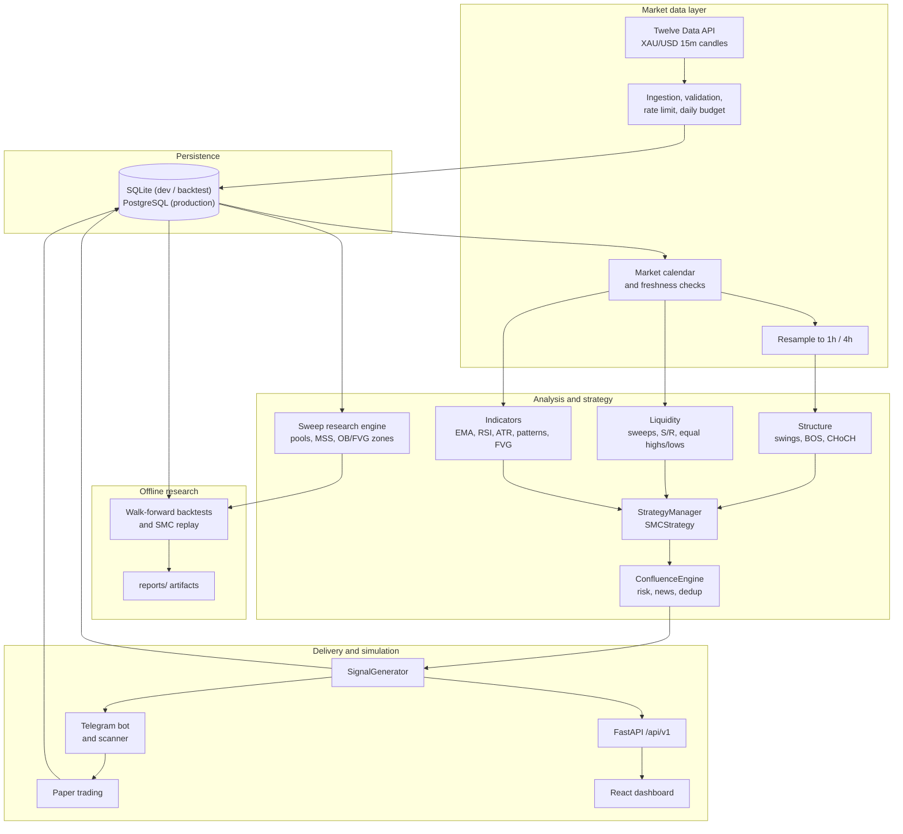

# QuantView — SMC Signal Bot

QuantView (repository: [`signal_bot`](https://github.com/dina-seng/signal_bot)) is a self-hosted market-analysis and signal-generation system for a single instrument: **spot gold (XAU/USD)**. It ingests 15-minute candles from Twelve Data, derives higher timeframes locally, evaluates Smart Money Concepts (SMC) structure and liquidity, scores setups, and exposes the result through a FastAPI API, a React dashboard, and an optional Telegram bot.

The project is **SMC-only** as of PR [#16](https://github.com/dina-seng/signal_bot/pull/16). The former CRT (Candle Range Theory) and Range Sniper strategies have been removed from the active application.

> **Status:** research and signal-generation system. It is not financial advice, it does not guarantee profitable trades, and it has no broker integration. Performance results are provisional until the backtesting audit described in [Backtesting and Research Status](#k-backtesting-and-research-status) is complete.

---

## A. Project Overview

### What the system does

Discretionary SMC analysis requires repeatedly locating swing structure, liquidity pools, sweeps, fair value gaps, and higher-timeframe alignment. QuantView automates that detection and scoring for one instrument and one strategy, then surfaces qualified setups to operators and to a paper-trading account.

The pipeline is:

1. Fetch **15m XAU/USD candles** from Twelve Data through a budgeted, rate-limited provider.
2. Store candles, dropping synthetic closed-market bars at read time.
3. Derive 1h and 4h candles locally with UTC-anchored resampling.
4. Run structure, liquidity, indicator, and price-action analysis.
5. Score BUY and SELL hypotheses with the SMC strategy and apply risk/news/duplicate gates.
6. Persist signals and expose them via REST, Telegram, and the dashboard.
7. Optionally mirror qualified signals into a virtual paper-trading account.

### Current focus

- Single asset: **XAU/USD** (enforced by `ACTIVE_SYMBOLS` in `server/app/core/config.py`).
- Single active strategy: **SMC** (`SMCStrategy`).
- Timeframes: **15m** (source), with **1h** and **4h** derived by resampling.
- Automated scanning, alerting, and paper trading.

### Capability boundaries

| Capability | Status in this repository |
| :--- | :--- |
| Market data ingestion | Implemented; Twelve Data is the only permitted provider |
| SMC analysis and signal generation | Implemented; production path via `SMCStrategy` and `SignalGenerator` |
| Telegram alerting and scanner | Implemented, optional |
| Paper trading | Implemented (virtual account, orders, positions, performance) |
| Live broker order execution | **Not implemented**; there are no broker connectors or live order routes |
| Historical replay and backtesting | Implemented as separate offline tooling; correctness audit pending |
| Dashboard | Implemented; React SPA with a landing page and a live dashboard |

---

## B. Key Features

Only behaviours present in the current code are listed.

### Market structure

- Fractal swing detection with configurable lookback (`server/app/services/structure/swing_detector.py`).
- Swing classification (HH, HL, LH, LL), trend direction, and trend strength (`structure_engine.py`).
- Break of Structure (BOS) and Change of Character (CHoCH / MSS) detection using body closes (`bos_choch_detector.py`).
- Multi-timeframe structure and alignment analysis across 15m, 1h, and 4h (`multi_timeframe.py`).
- Lower-timeframe confirmation of a higher-timeframe direction (`ltf_confirmation.py`).

### Liquidity and SMC context

- Buy-side (BSL) and sell-side (SSL) sweep / stop-hunt detection (`server/app/services/liquidity/sweep_detector.py`).
- Dynamic support/resistance zones and equal-highs / equal-lows liquidity pools (`sr_detector.py`).
- Supply/demand zone and active FVG retracement scoring in the production signal strategy.
- A separate, pure research engine (`server/app/services/sweep/`) that additionally models:
  - fractal pivots with strict confirmation delay;
  - equal highs/lows, previous-day high/low, and session pools (Asia/London);
  - kill-zone windows;
  - sweep rejection, MSS/displacement, premium/discount;
  - FVG and order-block entry-zone construction;
  - stop-loss, take-profit, and risk/reward geometry;
  - setup state machine and grading.

### Indicators and price action

- EMA stack (fast/mid/slow), RSI, and ATR (`server/app/services/indicators/`).
- Fair value gap detection and active/mitigated state (`price_action.py`).
- Pin bar, engulfing, and inside-bar pattern detection.

### Signal generation and qualification

- Pluggable strategy interface and manager (`server/app/services/strategies/`).
- Three-pillar SMC scoring: structure and MTF alignment, liquidity/SMC, and price-action confirmation (`smc_strategy.py`, `evaluators.py`).
- Directional-conflict and lower-timeframe penalties rather than unconditional vetoes; minimum price-action and structure/liquidity floors still apply.
- Configurable minimum score and risk/reward floors.
- News blackout filter using an economic calendar.
- Deterministic signal fingerprints and a cooldown to suppress duplicates.
- Risk calculation: ATR/structure-based stop, TP1/TP2, R:R, and lot size (`risk_manager.py`).
- Path validation that checks for structural obstacles between entry and target (`path_validator.py`).
- Persistent signal records; the backtest harness additionally persists signal-candidate records for every evaluated setup.

### Delivery and simulation

- FastAPI REST API with generated OpenAPI documentation.
- Automated background scanner aligned to 15-minute candle closes.
- Telegram command handling, broadcasts, and optional automatic paper trades.
- Paper-trading accounts, market/limit/stop orders, position modification, closure, monitoring, and performance reporting.
- React dashboard showing quotes, signals, positions, news risk, scanner/Telegram status, and performance.

### Research and replay

- Walk-forward sweep backtesting with purged/embargoed time splits, a pre-registered parameter grid, bootstrap confidence intervals, and a random-entry baseline (`server/app/services/sweep/backtest/`).
- Bar-by-bar SMC replay through the production strategy path (`server/scripts/smc_replay.py`) with a shared outcome simulator (`server/scripts/replay_harness.py`).
- Portfolio-constrained replay research scripts (`server/scripts/smc_portfolio*.py`).
- Idempotent historical data backfill CLI with rate limiting and daily budget enforcement.

> The research sweep engine in `server/app/services/sweep/` is **not wired into the production API or scanner**. Production signals come from `SMCStrategy`; the sweep engine is used by backtesting scripts and tests.

---

## C. System Architecture

### Component responsibilities

| Layer | Location | Responsibility |
| :--- | :--- | :--- |
| Frontend | `client/` | React/TypeScript single-page app. `/` is a landing page; `/dashboard` polls the backend for quotes, signals, positions, news, scanner, and Telegram status. Vite proxies `/api` to the backend in development. |
| API | `server/app/main.py`, `server/app/api/v1/` | FastAPI application, lifespan-managed HTTP client, CORS, static route groups, generated `/docs` and `/openapi.json`. |
| Strategy | `server/app/services/strategies/` | `StrategyManager` runs the registered strategy; `SMCStrategy` composes the three pillar evaluators and an LTF confirmation filter. |
| Signal orchestration | `server/app/services/signals/` | `ConfluenceEngine` validates data, runs the strategy, applies news/risk/path gates, builds `SignalResponse` objects, and generates deterministic fingerprints; `SignalGenerator` handles scanning, duplicate checks, and persistence. |
| Analysis | `server/app/services/structure/`, `liquidity/`, `indicators/` | Pure market-structure, liquidity, indicator, pattern, and FVG analysis. |
| Research sweep engine | `server/app/services/sweep/` | Pure sweep/MSS/zone/state-machine analysis plus a walk-forward backtest harness. Used offline and by tests. |
| Market data | `server/app/services/market_data/` | Twelve Data provider, token-bucket rate limit, persisted daily call budget, ingestion/deduplication, resampling, market calendar, freshness semantics. |
| Persistence | `server/app/models/`, `server/alembic/` | SQLAlchemy models and Alembic migrations. SQLite for development/backtests; PostgreSQL (for example Neon) for production. |
| Background processing | `server/app/services/telegram/scheduler.py`, `scanner.py` | APScheduler job fires at 10 seconds past each 15-minute candle close, runs ingestion/analysis, broadcasts signals, and optionally creates paper trades. |
| Telegram | `server/app/services/telegram/` | Bot client, command handler, message formatter, scanner, and scheduler. |
| Paper trading | `server/app/services/paper_trading/` | Virtual accounts, order execution, position monitoring, and performance metrics. |
| Offline research | `server/app/services/backtesting/`, `server/scripts/` | Legacy API backtest engine plus SMC replay and portfolio research CLIs. |

### Architecture diagram



### Data-flow notes

- Only 15m bars are fetched. 1h and 4h bars are always derived locally; incomplete buckets are omitted.
- Twelve Data fills market closures with synthetic flat bars. The calendar filter removes them before analysis without mutating stored rows.
- Freshness distinguishes an open market with stale data from a legitimately closed market.
- Analysis functions accept candle sequences and an explicit `as_of`; they do not read the wall clock during scoring.
- Signals are persisted with a deterministic fingerprint; the scanner seeds its deduplication cache from the database on startup.

---

## D. SMC Strategy Overview

This section describes concepts and data flow, not proprietary thresholds. For exact parameters, read the referenced modules.

### Market structure

The structure layer confirms fractal swing points only after the required right-hand bars have closed. Those swings are labelled into higher highs, higher lows, lower highs, and lower lows. Trend direction and strength are derived from the label sequence, and a body-close break of a prior swing is classified as BOS (continuation) or CHoCH/MSS (potential reversal).

### Liquidity

Liquidity is treated as resting orders around prior extremes. The production detector identifies buy-side and sell-side sweeps: price wicks through a level and then closes back inside it. The liquidity service also derives dynamic support/resistance zones and equal-highs/equal-lows pools. The research sweep engine extends this with previous-day levels, session ranges, kill zones, and pool eligibility rules.

### Order blocks and fair value gaps

Fair value gaps are detected in `server/app/services/indicators/price_action.py` and are scored when price retraces into an active, unmitigated gap. Order-block construction, including fallback from an FVG to an order-block entry zone, lives in the research sweep engine (`server/app/services/sweep/detector.py`). The production strategy scores fresh supply/demand zones and FVG retracements but does not itself construct order-block entry zones.

### Multi-timeframe confirmation

The source series is 15m. Higher timeframes are resampled, structure is evaluated across timeframes, and a lower-timeframe confirmation engine checks whether the 15m series supports the higher-timeframe direction. A missing lower-timeframe confirmation is applied as a score penalty in `SMCStrategy`, not as an absolute veto.

### Signal qualification

Each direction is scored independently across three pillars: structure/MTF alignment, liquidity/SMC, and price action. A consensus filter combines the pillars, applies directional-conflict penalties and minimum pillar floors, and compares the result against a configurable minimum. If neither direction qualifies, the output is `WAIT`.

After qualification, `ConfluenceEngine` applies:

- market-open and candle-freshness checks;
- news blackout checks;
- risk/reward and path validation;
- deterministic fingerprinting (the scanner applies a duplicate cooldown);
- optional paper-trade creation.

The active implementation is `SMCStrategy` (`server/app/services/strategies/smc_strategy.py`). The legacy `SignalScoringEngine` is retained only for backward-compatible tests and is marked deprecated in its docstring.

---

## E. Technology Stack

### Backend

| Technology | Version / role |
| :--- | :--- |
| Python | 3.11+ (Docker image uses 3.11; the repository has also been run on 3.14) |
| FastAPI | `>=0.115.0` — HTTP API and OpenAPI generation |
| Uvicorn | `>=0.30.0` — ASGI server |
| Pydantic / pydantic-settings | `>=2.8.0` / `>=2.4.0` — schemas and environment configuration |
| SQLAlchemy | `>=2.0.30` — ORM |
| Alembic | `>=1.13.0` — schema migrations |
| pandas / NumPy | `>=2.2.0` / `>=1.26.0` — metrics and data handling |
| httpx | `>=0.27.0` — shared async HTTP client |
| APScheduler | `>=3.10.4` — background scanner |
| pytest / pytest-asyncio | `>=8.3.0` / `>=0.24.0` — tests |
| psycopg2-binary / psycopg | PostgreSQL drivers |

Dependencies are declared in [`server/requirements.txt`](server/requirements.txt).

### Frontend

| Technology | Version / role |
| :--- | :--- |
| React / React DOM | `^19.2` |
| TypeScript | `~6.0` |
| Vite | `^8.2` with `@vitejs/plugin-react` |
| Tailwind CSS | `^3.4` |
| React Router | `^7.18` |
| lightweight-charts | `^5.3` — candlestick charting |
| Recharts | `^3.10` — landing-page equity chart |
| framer-motion | `^14.14` — landing-page motion |
| lucide-react | icons |
| clsx / tailwind-merge | class utilities |

Dependencies are declared in [`client/package.json`](client/package.json).

### Data and persistence

- **Market data:** Twelve Data REST API, 15m XAU/USD only.
- **Development database:** SQLite (`sqlite:///./trade.db`).
- **Backtest database:** local SQLite file, typically `backtest.db`.
- **Production database:** PostgreSQL-compatible URL (the Render configuration references a Neon URL).

### Infrastructure and deployment

- **Docker:** `server/Dockerfile` and `server/docker-compose.yml`.
- **Render:** `server/render.yaml` (build runs migrations, then starts Uvicorn).
- **Netlify:** root `netlify.toml` and `client/netlify.toml` publish the built SPA with rewrite rules.
- **GitHub Actions:** `.github/workflows/render-keepalive.yml` pings a deployed `/ping` endpoint during market hours.

---

## F. Repository Structure

```text
.
├── client/                     React + TypeScript + Vite dashboard
│   ├── src/
│   │   ├── pages/              Landing and Dashboard routes
│   │   ├── components/         Charts, signal matrix, positions, telemetry, news, settings
│   │   ├── services/api.ts     Typed backend client
│   │   ├── data/               Initial/fallback dashboard data
│   │   └── types/              Shared frontend types
│   ├── assets/                 Static brand assets
│   └── netlify.toml            SPA build and rewrite configuration
├── server/                     FastAPI backend
│   ├── app/
│   │   ├── main.py             Application entrypoint and lifespan
│   │   ├── api/                Dependency wiring and v1 routers
│   │   ├── core/               Settings, database, logging, time utilities
│   │   ├── models/             SQLAlchemy tables
│   │   ├── schemas/            Pydantic request/response schemas
│   │   ├── services/
│   │   │   ├── market_data/    Twelve Data, ingestion, resampling, calendar, freshness
│   │   │   ├── structure/      Swings, BOS/CHoCH, MTF, LTF confirmation
│   │   │   ├── liquidity/      Sweeps, S/R zones, equal highs/lows
│   │   │   ├── indicators/     EMA, RSI, ATR, patterns, FVGs
│   │   │   ├── signals/        Scoring, consensus, risk, path validation, generation
│   │   │   ├── strategies/     Base strategy, SMC strategy, strategy manager
│   │   │   ├── sweep/          Pure liquidity-sweep research engine and backtester
│   │   │   ├── news/           Economic calendar ingestion and blackout filter
│   │   │   ├── paper_trading/  Virtual accounts, orders, positions, performance
│   │   │   ├── telegram/       Bot, commands, formatter, scanner, scheduler
│   │   │   └── backtesting/    Legacy API backtest engine and walk-forward harness
│   │   └── scripts/            Backfill, import, cleanup, and sweep backtest CLIs
│   ├── alembic/                Migration environment and revisions
│   ├── scripts/                SMC replay, portfolio research, and shared replay harness
│   ├── tests/                  Hermetic pytest suite
│   ├── requirements.txt
│   ├── .env.example            Documented environment template
│   ├── Dockerfile
│   ├── docker-compose.yml
│   └── render.yaml
├── app/scripts/                Thin wrappers that re-exec the real server scripts
├── docs/                       Architecture, services, testing, and SMC research documents
├── reports/                    Generated replay/backtest artifacts and historical reports
├── package.json                Root scripts: run backend and frontend together
├── netlify.toml                Netlify build configuration for the client
└── RAYU.md                     Repository working conventions
```

### Documentation map

| Document | Contents |
| :--- | :--- |
| [docs/ARCHITECTURE.md](docs/ARCHITECTURE.md) | Detailed architecture and data-flow notes. Written before PR #16 and still references removed strategies in places. |
| [docs/SERVICES.md](docs/SERVICES.md) | Module-by-module backend service documentation. Predates PR #16 in parts. |
| [docs/TESTING_AND_VALIDATION.md](docs/TESTING_AND_VALIDATION.md) | Historical testing map and validation notes. Contains pre-refactor material. |
| [docs/GAPS_AND_FINDINGS.md](docs/GAPS_AND_FINDINGS.md) | Prioritized gap analysis against the original SMC/ICT vision. Historical. |
| [docs/SMC_EXPERIMENT_LOG.md](docs/SMC_EXPERIMENT_LOG.md) | Pre-registered SMC experiment protocol (v1). |
| [docs/SMC_EXPERIMENT_LOG_V2.md](docs/SMC_EXPERIMENT_LOG_V2.md) | Pre-registered SMC experiment protocol (v2, calibration-only). |
| [docs/SMC_FREEZE.md](docs/SMC_FREEZE.md) | SMC parameter freeze and holdout specification (v1). |
| [docs/SMC_FREEZE_V2.md](docs/SMC_FREEZE_V2.md) | SMC production and portfolio protocol freeze (v2). |

The `docs/` set is research history, not current API documentation. The generated OpenAPI schema is authoritative for endpoints.

---

## G. Getting Started

### Prerequisites

- **Python 3.11+** and `pip`.
- **Node.js 20.19+** (Vite 8 requirement) and npm.
- A **Twelve Data API key** for live quotes, ingestion, and scanning.
- Optional: a Telegram bot token and chat ID for alerting.
- Optional: Docker, if you prefer the container workflow.

Without a Twelve Data key the application still imports and the test suite still runs (tests use mock providers), but live market endpoints and the scanner cannot fetch data.

### 1. Clone the repository

```bash
git clone https://github.com/dina-seng/signal_bot.git
cd signal_bot
```

### 2. Create and activate a virtual environment

Windows (PowerShell or cmd):

```powershell
python -m venv .venv
.venv\Scripts\activate
```

Windows (Git Bash):

```bash
python -m venv .venv
source .venv/Scripts/activate
```

macOS/Linux:

```bash
python3 -m venv .venv
source .venv/bin/activate
```

### 3. Install backend dependencies

```bash
pip install -r server/requirements.txt
```

### 4. Configure the backend environment

```bash
cp server/.env.example server/.env
```

Edit `server/.env` and set at minimum:

```dotenv
TWELVE_DATA_API_KEY=your_twelve_data_key_here
```

Optional Telegram settings:

```dotenv
TELEGRAM_BOT_TOKEN=your_bot_token_here
TELEGRAM_CHAT_ID=your_chat_id_here
```

`server/.env` is gitignored. Never commit real credentials. See [Environment Variables](#h-environment-variables) for the full list.

### 5. Initialize the database

From the repository root, with the virtual environment active:

```bash
cd server
alembic upgrade head
```

The default `DATABASE_URL` is `sqlite:///./trade.db`, so this creates `server/trade.db`. The application also calls `init_db()` on startup, which creates any missing tables; migrations remain the recommended path.

### 6. Install frontend dependencies

```bash
cd ../client
npm install
```

The root `dev` script also needs its own dependency:

```bash
cd ..
npm install
```

### 7. Start the development servers

From the repository root, with the Python virtual environment active:

```bash
npm run dev
```

This starts:

- FastAPI at `http://localhost:8000`
- Vite at `http://localhost:3000`

Verify:

- API documentation: `http://localhost:8000/docs`
- API health: `http://localhost:8000/api/v1/health`
- Dashboard: `http://localhost:3000/dashboard`

To run one side only, use separate terminals:

```bash
# Terminal 1 — backend
cd server
python -m uvicorn app.main:app --reload --port 8000

# Terminal 2 — frontend
cd client
npm run dev
```

The Vite dev server proxies `/api` requests to `http://localhost:8000`. Set `VITE_API_URL` in `client/.env` if the backend lives elsewhere.

---

## H. Environment Variables

All backend settings are defined in `server/app/core/config.py` and documented in `server/.env.example`. Names are case-sensitive.

### Backend (`server/.env`)

| Variable | Purpose | Required? | Safe example / placeholder |
| :--- | :--- | :--- | :--- |
| `TWELVE_DATA_API_KEY` | Authenticates Twelve Data requests. Without it, live market-data calls fail. | Required for live data | `your_twelve_data_key_here` |
| `DATABASE_URL` | SQLAlchemy connection string. | Optional | `sqlite:///./trade.db` |
| `APP_ENV` | Environment label used in logs. | Optional | `development` |
| `LOG_LEVEL` | Python log level. | Optional | `INFO` |
| `MODE` | Operating mode label; the app refuses `live` with the mock provider. | Optional | `paper` |
| `MARKET_DATA_PROVIDER` | Provider selection. Only `twelvedata` is accepted; `mock`/Yahoo are rejected by the production factory. | Optional | `twelvedata` |
| `NEWS_PROVIDER` | Economic calendar source. | Optional | `forexfactory` |
| `SUPPORTED_SYMBOLS` | Allowed instruments; filtered to `ACTIVE_SYMBOLS`. | Optional | `["XAU/USD"]` |
| `SUPPORTED_TIMEFRAMES` | Supported analysis timeframes. | Optional | `["15m","1h","4h"]` |
| `SWING_LOOKBACK` | Swing fractal lookback. | Optional | `2` |
| `SR_TOLERANCE_PERCENT` | Support/resistance grouping tolerance. | Optional | `0.1` |
| `EMA_FAST`, `EMA_MID`, `EMA_SLOW` | EMA periods. | Optional | `20`, `50`, `200` |
| `RSI_PERIOD`, `ATR_PERIOD` | Indicator periods. | Optional | `14` |
| `MIN_SETUP_SCORE` | Minimum composite score to qualify a setup. | Optional | `<float 0-100>` |
| `MIN_RR`, `MIN_RR_TP1`, `MIN_RR_TP2` | Risk/reward floors for the trade plan. | Optional | `<float >= 1.0>` |
| `MAX_RISK_PERCENT` | Maximum account risk per order. | Optional | `<float percentage>` |
| `XAUUSD_SPREAD`, `XAUUSD_SLIPPAGE` | Execution-cost assumptions in USD per ounce for simulated fills. | Optional | `0.30`, `0.10` |
| `NEWS_BLACKOUT_BEFORE_MINUTES`, `NEWS_BLACKOUT_AFTER_MINUTES` | Blackout window around high-impact events. | Optional | `30`, `15` |
| `TELEGRAM_BOT_TOKEN` | Telegram bot authentication. | Optional; required for Telegram | `your_bot_token_here` |
| `TELEGRAM_CHAT_ID` | Destination chat for broadcasts. | Optional; required for Telegram | `your_chat_id_here` |
| `USER_TIMEZONE` | IANA timezone used in notifications and display. | Optional | `UTC` |
| `SCANNER_ENABLED` | Enables the background scanner. | Optional | `true` |
| `SCANNER_TIMEFRAMES` | Timeframes evaluated by the scanner. | Optional | `["1h","15m"]` |
| `SCANNER_AUTO_TRADE_PAPER` | Creates paper trades from qualified signals. | Optional | `true` |
| `SCANNER_INTERVAL_MINUTES` | Reported in scanner status. The scheduler itself fires at 15-minute candle closes. | Optional | `15` |
| `SIGNAL_COOLDOWN_HOURS` | Duplicate-signal cooldown window. | Optional | `2` |
| `PAPER_TRADING` | Enables paper-trading behaviour in the scanner. | Optional | `true` |
| `QUOTE_POLL_SECONDS` | Dashboard quote polling interval. | Optional | `15` |
| `QUOTE_CACHE_TTL_SECONDS`, `QUOTE_IDLE_CACHE_TTL_SECONDS`, `QUOTE_PRESENCE_TTL_SECONDS` | Quote caching and dashboard-presence logic. | Optional | `60`, `300`, `60` |
| `QUOTE_STALE_AFTER_SECONDS`, `QUOTE_MAX_DEVIATION_PCT` | Quote staleness and deviation guards. | Optional | `180`, `0.05` |
| `ALPHA_VANTAGE_API_KEY`, `NEWS_API_KEY` | Declared in settings but not used by the current code paths. | Optional, unused | leave empty |
| `YAHOO_GOLD_SYMBOL` | Legacy setting; Yahoo is not a permitted provider. | Optional, unused | leave empty |

### Frontend (`client/.env`)

| Variable | Purpose | Required? | Safe example |
| :--- | :--- | :--- | :--- |
| `VITE_API_URL` | Base URL for backend requests. Defaults to `/api/v1`. | Optional | `http://localhost:8000/api/v1` |

### Secrets

- `server/.env`, `client/.env`, and all local databases are gitignored.
- The example values above are placeholders only. Do not commit real API keys, bot tokens, chat IDs, or database URLs.
- `GET /api/v1/config` deliberately exposes only non-secret settings.

---

## I. API Documentation

Interactive documentation is generated by FastAPI:

- Swagger UI: `http://localhost:8000/docs`
- ReDoc: `http://localhost:8000/redoc`
- OpenAPI JSON: `http://localhost:8000/openapi.json`

The current schema exposes 50 paths under `/api/v1`, plus `/`, `/ping`, and the documentation routes. Route groups:

| Group | Prefix | Representative endpoints |
| :--- | :--- | :--- |
| Health and configuration | `/api/v1` | `GET /health`, `GET /config` |
| Market data | `/api/v1/market` | `GET /symbols`, `GET /quote`, `GET /{symbol}/quote`, `GET /{symbol}/candles`, `POST /sync`, `POST /presence` |
| Market structure | `/api/v1/structure` | `GET /{symbol}`, `GET /{symbol}/multi-timeframe`, `POST /analyze` |
| Liquidity and SMC | `/api/v1/liquidity` | `GET /{symbol}/analysis`, `GET /{symbol}/sweeps`, `GET /{symbol}/zones`, `POST /analyze` |
| Indicators | `/api/v1/indicators` | `GET /{symbol}`, `GET /{symbol}/fvg`, `GET /{symbol}/divergences`, `POST /analyze` |
| Signals and scanner | `/api/v1/signals` | `GET /api/v1/signals`, `GET /scan`, `GET /unified`, `POST /evaluate` |
| Economic news | `/api/v1/news` | `GET /calendar`, `GET /check/{symbol}`, `POST /sync` |
| Backtesting | `/api/v1/backtest` | `POST /run`, `POST /execute`, `POST /optimize`, `GET /runs`, `GET /runs/{run_id}`, `DELETE /runs/{run_id}` |
| Paper trading | `/api/v1/paper` | `GET /account`, `POST /account/create`, `POST /account/deposit`, `POST /account/reset`, `POST /orders`, `POST /orders/from-signal`, `GET /positions`, `GET /trades`, `PUT /positions/{id}/modify`, `POST /positions/{id}/close`, `POST /monitor/sync`, `GET /performance` |
| Telegram and scanner | `/api/v1/telegram` | `POST /broadcast`, `POST /command`, `POST /webhook`, `GET /status`, `POST /scanner/trigger`, `GET /scanner/status` |

The API has no authentication layer. Deploy it behind a trusted network boundary or a reverse proxy if it is reachable from the internet.

---

## J. Testing and Validation

### Running tests

Tests are hermetic: `server/tests/conftest.py` forces in-memory SQLite, hard-fails if `DATABASE_URL` points to PostgreSQL, disables the background scanner, and pins symbols to XAU/USD.

```bash
cd server
python -m pytest tests/
```

Single file or test:

```bash
python -m pytest tests/test_sweep_engine.py
python -m pytest tests/test_sweep_engine.py -k test_name
```

Slow statistical/control tests are opt-in via the `slow` marker:

```bash
python -m pytest -m slow
```

The default `pytest.ini` excludes the `slow` marker.

### SMC-specific suites

The SMC and data-integrity behaviour is covered mainly by:

- `server/tests/test_sweep_engine.py` — pure sweep engine, zero lookahead, prefix invariance.
- `server/tests/test_sweep_backtest.py` — walk-forward harness, fills, friction, baseline.
- `server/tests/test_window_invariance.py` — truncated versus padded-future invariance.
- `server/tests/test_strategies.py` — strategy interface and SMC scoring.
- `server/tests/test_signals.py` — confluence, risk, and signal response assembly.
- `server/tests/test_ltf_confirmation.py` — lower-timeframe confirmation.
- `server/tests/test_bos_choch.py` — BOS/CHoCH detection.
- `server/tests/test_market_calendar.py`, `server/tests/test_resample.py`, `server/tests/test_phase1_data_layer.py` — market-data layer.
- `server/tests/test_smc_regime_filter.py`, `server/tests/test_control_random_walk.py`, `server/tests/test_walk_forward_harness.py` — research controls.
- `server/tests/test_production_parity.py` — production-path parity checks.

### Current status (2026-11-21)

The suite was executed on this checkout with Python 3.14.5:

- **275 tests collected**, 1 deselected slow test.
- **270 passed, 5 failed**, total runtime about 6 minutes 18 seconds.

Failing tests:

1. `server/tests/test_api.py::test_health_endpoint` — expects `healthy`, receives `degraded` because the hermetic test database has no fresh 15m candle.
2. `server/tests/test_data_freshness.py::test_check_data_staleness_weekend_awareness` — expected message text no longer matches the implementation.
3. `server/tests/test_signals.py::test_risk_manager_gold_structural_distance` — `risk_pips` unit expectation (`1600`) does not match the implementation (`160`).
4. `server/tests/test_scanner_scheduler.py::test_health_check_contains_scanner_fields` — same missing-fresh-candle expectation.
5. `server/tests/test_control_random_walk.py::test_random_walk_control_shows_no_positive_edge` — the random-walk control produced a positive expectancy on a two-trade sample and tripped its leak threshold.

These are pre-existing failures in this environment. Some are stale assertions; the random-walk control result is a genuine signal that the backtesting path needs review. Do not describe the suite as green until they are triaged.

### Frontend verification

`cd client && npm run build` completed successfully on this checkout (TypeScript compilation plus Vite production build). The build reports a bundle-size warning for the main JavaScript chunk.

### Coverage

No coverage tool or minimum coverage threshold is configured in the repository. No coverage percentage is claimed here.

---

## K. Backtesting and Research Status

### Existing backtesting functionality

The repository contains several distinct, non-equivalent tools:

| Tool | Location | What it does |
| :--- | :--- | :--- |
| Sweep walk-forward backtest | `server/app/services/sweep/backtest/` | Bar-by-bar simulation of the research sweep engine. Limit fills require price to trade through the zone; same-bar SL/TP assumes SL first; configurable spread/slippage friction; one open position with cooldown; purged/embargoed 60/20/20 splits; pre-registered 18-combination grid; bootstrap confidence intervals; random-entry baseline. |
| Sweep backtest CLI | `server/app/scripts/run_sweep_backtest.py` | Loads 15m bars from a local SQLite file, drops closed-market bars, runs the grid on train, confirms on validation, evaluates test once, and writes a Markdown report. |
| SMC replay | `server/scripts/smc_replay.py` | Replays the production SMC path bar by bar with a shared outcome simulator, optional date windows, calibration-only mode, checkpointing, and an experimental regime filter. |
| Portfolio research | `server/scripts/smc_portfolio.py`, `smc_portfolio_2025.py`, `run_step*.py` | Applies portfolio constraints and experiment protocols on top of replay checkpoints. |
| Legacy API backtest | `server/app/services/backtesting/` and `/api/v1/backtest/*` | Older engine, service, optimizer, and walk-forward harness retained for API compatibility and tests. |
| Backfill | `server/app/scripts/backfill_twelvedata.py` | Rate-limited, idempotent historical 15m candle backfill. |

### Performance results: provisional only

- **No performance result in this repository has been independently verified.**
- The backtesting engine is scheduled for a dedicated correctness audit (issue [#25](https://github.com/dina-seng/signal_bot/issues/25)).
- Until that audit passes, all reported win rates, expectancy values, R-multiples, profit factors, and equity curves are **provisional** and must not be treated as evidence of profitability.
- The repository contains generated artifacts under `reports/` (for example `reports/exp_2025_smc/`, `reports/exp_2025_smc_portfolio/`, `reports/exp_regime_filter_calibration.md`). They document prior experiments; they are not audited results.
- The dashboard landing page contains marketing copy with historical performance numbers. Treat those numbers as unverified copy, not as validated research output.
- Older CRT and Range reports under `reports/` describe strategies that have been removed from the active application. They are retained as historical artifacts only.
- The random-walk control failure described in [Testing and Validation](#j-testing-and-validation) reinforces that results should be treated cautiously.

### Reproducibility

To reproduce a research run you need a local 15m candle database. The provided CLIs read SQLite and do not call Twelve Data by default:

```bash
# Backfill a date range (uses the live API and the persisted daily budget)
cd server
python -m app.scripts.backfill_twelvedata --start 2023-03-01 --end 2026-05-20 --db-path ../backtest.db

# Run the sweep walk-forward backtest
python -m app.scripts.run_sweep_backtest --db-path ../backtest.db --output-dir ../reports

# Bar-by-bar SMC replay
python scripts/smc_replay.py --db-path ../backtest.db --calibration-only
```

The backfill commands consume the Twelve Data quota. Review the provider budget logic before running them repeatedly.

---

## L. Project Roadmap

The active research and engineering roadmap is tracked in GitHub issues:

| Issue | Title | Focus |
| :--- | :--- | :--- |
| [#17](https://github.com/dina-seng/signal_bot/issues/17) | research: establish SMC strategy improvement roadmap | Overall direction |
| [#18](https://github.com/dina-seng/signal_bot/issues/18) | research: establish XAU/USD SMC performance baseline | Reproducible baseline |
| [#19](https://github.com/dina-seng/signal_bot/issues/19) | research: audit and formalize existing SMC trading rules | Rule specification |
| [#20](https://github.com/dina-seng/signal_bot/issues/20) | research: evaluate SMC market structure detection | BOS/CHoCH quality |
| [#21](https://github.com/dina-seng/signal_bot/issues/21) | research: evaluate liquidity sweep detection and validation | Sweep accuracy |
| [#22](https://github.com/dina-seng/signal_bot/issues/22) | research: investigate order block and fair value gap validity | Zone quality |
| [#23](https://github.com/dina-seng/signal_bot/issues/23) | research: evaluate SMC multi-timeframe confirmation | MTF/LTF value |
| [#24](https://github.com/dina-seng/signal_bot/issues/24) | engineering: validate SMC execution costs and risk management | Friction and risk |
| [#25](https://github.com/dina-seng/signal_bot/issues/25) | engineering: improve reproducible SMC backtesting and validation | Backtest audit |

---

## M. Current Scope and Limitations

### Supported

- XAU/USD analysis on 15m, 1h, and 4h.
- SMC signal generation with structure, liquidity, indicators, and price-action scoring.
- Configurable risk rules, news blackout, duplicate suppression, and path validation.
- REST API, React dashboard, Telegram alerts, and an automated scanner.
- Paper trading with virtual accounts and performance reporting.
- Offline replay, sweep backtesting, and historical data backfill.

### Not supported or incomplete

- **No live execution.** There is no broker integration, order routing, or real-money trading.
- **Single asset, single strategy.** Multi-asset and multi-strategy operation is not part of the current scope.
- **Backtesting is unaudited.** Results are provisional; the random-walk control has produced a failing result.
- **No API authentication.** The API and CORS configuration are permissive; do not expose them publicly without protection.
- **Twelve Data dependency.** Live data is constrained by the provider's free-tier budget and availability. There is no fallback provider by design.
- **News data is a public feed.** The ForexFactory provider reads a public JSON calendar; it is not an official, guaranteed API.
- **Dashboard fallback data.** The dashboard initializes from sample data and overlays live responses. If the backend is unavailable or a request fails, displayed values may be sample fallback values rather than live state.
- **Legacy code paths remain.** The legacy backtest API and deprecated `SignalScoringEngine` are retained for compatibility even though production signal generation uses `SMCStrategy`. The Alembic history also retains a CRT-era `crt_sweep_events` revision whose model was removed in PR #16.
- **Documentation drift.** Several documents under `docs/` predate the SMC-only refactor and still mention removed strategies.

### Disclaimer

This software is for research and educational use. It does not provide financial advice, does not guarantee any outcome, and should not be used to make live trading decisions without independent validation and appropriate risk controls.

---

## N. Contributing

There is no separate `CONTRIBUTING.md`; the following workflow matches the repository's existing conventions.

1. Branch from the latest `master` using a descriptive prefix (`feat/`, `fix/`, `docs/`, `chore/`, `exp/`, `improve/`).
2. Keep changes focused and avoid mixing refactors with behaviour changes.
3. Preserve the project's correctness invariants:
   - **Zero lookahead.** Analysis functions take an explicit `as_of`; never read the wall clock inside scoring or backtest logic. Pivots become visible only after their right-hand confirmation bars close.
   - **Hermetic tests.** Do not weaken the PostgreSQL guards in `server/tests/conftest.py`, and never let tests touch production databases or the live API.
   - **API budget.** Twelve Data calls are rate-limited and budgeted. Do not add unbudgeted fetch loops.
   - **Data hygiene.** Fetch 15m only, derive higher timeframes by resampling, and filter closed-market placeholder bars before analysis.
   - **Migrations.** Use Alembic for schema changes; do not run ad-hoc DDL.
4. Add or update tests for behaviour changes and run the relevant suites.
5. Do not commit `.env` files, local databases, credentials, or generated secrets.
6. Describe the problem and the verification performed in the pull request.

For an AI-assisted workflow in this repository, read [`RAYU.md`](RAYU.md) first. It documents commands and hard project rules; some branch references in it may lag behind the current `master`.

---

## O. License

No `LICENSE` file is present in this repository. The project therefore does not grant an explicit open-source license at this time. Contact the repository owner before redistributing or reusing the code.

The previous README displayed an MIT badge, but no corresponding license file exists in the repository.
