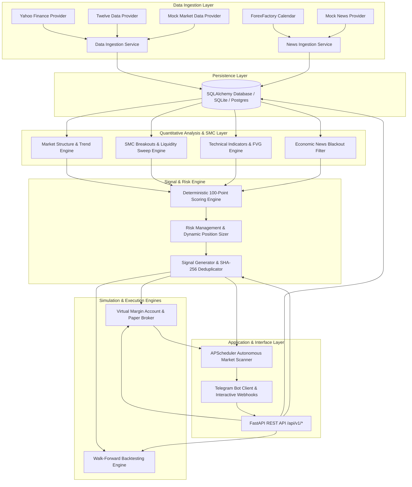

# Forex & Commodities Quantitative Market Analysis, Multi-Pillar Signal Engine & Telegram Bot

[](https://python.org)
[](https://fastapi.tiangolo.com)
[](https://www.sqlalchemy.org)
[](https://pytest.org)
[](https://www.docker.com)
[](https://opensource.org/licenses/MIT)

An institutional-grade, multi-timeframe quantitative market analysis, signal generation, and virtual broker platform engineered for major Forex currency pairs (`EUR/USD`, `GBP/USD`, `USD/JPY`) and Commodities (`XAU/USD` / Gold). 

The platform combines **Smart Money Concepts (SMC)**, **Fractal Market Structure**, **Multi-Timeframe Confluence**, **Momentum Indicator Suites**, **Candlestick Price Action Confirmation**, and **Macroeconomic News Blackout Filters** into a 100% deterministic 100-point scoring matrix. It also provides a high-fidelity **event-driven backtesting engine**, a **virtual margin paper trading broker**, and an **autonomous background market scanner** with **interactive Telegram bot distribution**.

> ⚠️ **Scope & Operating Model**: This software is designed for **quantitative analysis, educational research, signal generation, and simulated paper execution**. It does not place real-money trades directly with custodial brokers.

---

## 📑 Table of Contents

- [1. Executive Summary](#1-executive-summary)
- [2. System Architecture](#2-system-architecture)
- [3. Key Platform Capabilities](#3-key-platform-capabilities)
- [4. Quantitative Analysis Engines](#4-quantitative-analysis-engines)
  - [4.1 Market Data Ingestion Pipeline](#41-market-data-ingestion-pipeline)
  - [4.2 Market Structure & Trend Classification](#42-market-structure--trend-classification)
  - [4.3 Smart Money Concepts & Institutional Liquidity](#43-smart-money-concepts--institutional-liquidity)
  - [4.4 Technical Indicators & Momentum Confluence](#44-technical-indicators--momentum-confluence)
  - [4.5 Price Action Patterns & Fair Value Gaps (FVG)](#45-price-action-patterns--fair-value-gaps-fvg)
  - [4.6 Macroeconomic News & Volatility Blackout Filter](#46-macroeconomic-news--volatility-blackout-filter)
- [5. Signal Scoring & Execution Framework](#5-signal-scoring--execution-framework)
  - [5.1 Multi-Pillar 100-Point Scoring Matrix](#51-multi-pillar-100-point-scoring-matrix)
  - [5.2 Directional Conflict Resolution](#52-directional-conflict-resolution)
  - [5.3 Signal Fingerprinting & Cooldown Mechanism](#53-signal-fingerprinting--cooldown-mechanism)
  - [5.4 Precision Risk Management & Dynamic Lot Sizing](#54-precision-risk-management--dynamic-lot-sizing)
- [6. Event-Driven Backtesting & Strategy Optimization](#6-event-driven-backtesting--strategy-optimization)
- [7. Paper Trading Virtual Broker Engine](#7-paper-trading-virtual-broker-engine)
- [8. Telegram Bot & Autonomous Market Scanner](#8-telegram-bot--autonomous-market-scanner)
- [9. REST API Reference](#9-rest-api-reference)
- [10. Supported Instruments & Contract Specifications](#10-supported-instruments--contract-specifications)
- [11. Repository & Codebase Structure](#11-repository--codebase-structure)
- [12. Quickstart & Installation](#12-quickstart--installation)
- [13. Production Deployment Guide](#13-production-deployment-guide)
- [14. License & Disclaimer](#14-license--disclaimer)

---

## 1. Executive Summary

Traditional retail trading systems often rely on single-indicator signals or black-box machine learning models that lack interpretability, struggle with market regime shifts, and suffer from high drawdowns during news spikes. 

This platform solves these problems through an **explainable, deterministic, multi-pillar quantitative architecture**:

```text
┌────────────────────────────────────────────────────────────────────────────────────────┐
│                                 MULTI-PILLAR CONFLUENCE                                │
│                                                                                        │
│   ┌───────────────────────┐   ┌───────────────────────┐   ┌────────────────────────┐   │
│   │ 1. Market Structure   │   │ 2. SMC & Liquidity    │   │ 3. Momentum Indicators │   │
│   │ • Swings (HH/HL/LH/LL)│   │ • BOS & CHOCH/MSS     │   │ • EMA 20/50/200 Stack  │   │
│   │ • MTF Alignment (4h-1h)│  │ • Stop Hunt Sweeps    │   │ • RSI 14 & Divergences │   │
│   │ • Dynamic S/R Zones   │   │ • FVG Imbalances      │   │ • ATR 14 Volatility    │   │
│   └───────────┬───────────┘   └───────────┬───────────┘   └───────────┬────────────┘   │
│               │                           │                           │                │
│               └───────────────────────────┼───────────────────────────┘                │
│                                           ▼                                            │
│                         ┌───────────────────────────────────┐                          │
│                         │ 4. Price Action Trigger (15m/1h)  │                          │
│                         │ • Pin Bars (Rejection Wicks >55%) │                          │
│                         │ • Bullish / Bearish Engulfing     │                          │
│                         └─────────────────┬─────────────────┘                          │
│                                           ▼                                            │
│                         ┌───────────────────────────────────┐                          │
│                         │ 5. Macro News Blackout Gate       │                          │
│                         │ (Blocks entries ±30m of High News)│                          │
│                         └─────────────────┬─────────────────┘                          │
│                                           ▼                                            │
│                 ┌───────────────────────────────────────────────────┐                  │
│                 │ Score Threshold Check (≥ 75.0 / 100.0)            │                  │
│                 │ • Entry, Stop Loss (Swing + ATR buffer)           │                  │
│                 │ • TP1 (2.0R) & TP2 (3.0R)                         │                  │
│                 │ • Position Sizing (0.5% Account Risk Parity)      │                  │
│                 └─────────────────┬─────────────────────────────────┘                  │
│                                   ▼                                                    │
│         ┌─────────────────────────┴─────────────────────────┐                          │
│         ▼                                                   ▼                          │
│  ┌───────────────────────────────┐                 ┌─────────────────────────────────┐ │
│  │ Virtual Paper Trading Engine  │                 │ Telegram Real-Time Broadcast    │ │
│  │ • Live Order Execution        │                 │ • Rich Markdown Trade Signals   │ │
│  │ • Auto TP1 Close & BE SL      │                 │ • Interactive /scan & /signal   │ │
│  │ • Runner TP2 Profit Taking    │                 │ • Daily Performance Reports     │ │
│  └───────────────────────────────┘                 └─────────────────────────────────┘ │
└────────────────────────────────────────────────────────────────────────────────────────┘
```

---

## 2. System Architecture

The platform is designed following **Clean Architecture** and **Domain-Driven Design (DDD)** principles, separating core domain models, mathematical services, persistence layers, and transport adapters.



---

## 3. Key Platform Capabilities

| Module | Core Responsibility | Key Highlights |
| :--- | :--- | :--- |
| **Market Data Pipeline** | Ingestion & Sanitation | Automated cleaning, chronological sorting, deduplication, weekend/gap validation, and multi-provider failover (`YahooFinance`, `TwelveData`, `Mock`). |
| **Market Structure** | Directional Trend Bias | $N$-bar fractal swing detection ($N_L, N_R$), HH/HL/LH/LL labeling, trend classification (`BULLISH`, `BEARISH`, `RANGING`), normalized trend strength scoring, and Multi-Timeframe Confluence (4h HTF $\to$ 1h ITF $\to$ 15m LTF). |
| **SMC & Liquidity** | Institutional Footprint | Break of Structure (BOS), Change of Character (CHOCH/MSS), Buy-Side/Sell-Side Liquidity Sweeps (BSL/SSL), Rejection Wick Ratio analysis ($\ge 25\%$), dynamic S/R zones, and Equal Highs/Lows pools. |
| **Indicator Confluence** | Momentum & Volatility | Fast EMA 20/50/200 stacks, Wilder's smoothed RSI (14) with Regular & Hidden Divergences, Wilder's ATR (14) pip volatility, Fair Value Gaps (FVG) with mitigation tracking, and composite confluence scoring ($-100$ to $+100$). |
| **News Blackout Gate** | Event-Risk Protection | Live economic calendar integration, scheduled event categorization (`HIGH`, `MEDIUM`, `LOW`), cross-currency isolation (e.g. Gold linked to USD macro events), and pre/post news blackout window enforcement. |
| **Signal Engine** | Deterministic Decisioning | 100-point multi-pillar scoring rubric, minimum score threshold gate ($\ge 75.0$), directional conflict invalidation, and SHA-256 fingerprint deduplication. |
| **Risk Management** | Capital Preservation | ATR-buffered structural swing Stop Loss, multi-tier Take Profits (TP1 at $2.0R$, TP2 at $3.0R$), and exact lot sizing based on $0.5\%$ risk parity per trade. |
| **Backtesting Engine** | Strategy Validation | Event-driven, candle-by-candle historical simulation with spread/slippage friction, 50% partial TP1 close with Break-Even SL trailing, Sharpe/Sortino/Calmar metrics, and hyperparameter grid optimization. |
| **Paper Broker** | Execution Ledger | Multi-account margin simulation ($1:100$ leverage), `MARKET`/`LIMIT`/`STOP` order types, auto-execution from strategy signals, live price tick sync, and margin call stop-out protection ($< 50\%$). |
| **Telegram Bot & Scanner** | Distribution & Control | Autonomous background scanning loop (every 15m), rich Markdown & emoji signal broadcast, real-time trade lifecycle updates (TP1, TP2, SL), and interactive command interface (`/scan`, `/signal`, `/news`, `/account`, `/performance`). |
| **REST API** | Integration & Control | 10 comprehensive REST sub-routers with OpenAPI/Swagger documentation, stateless analysis endpoints, database persistence, and system health monitoring. |

---

## 4. Quantitative Analysis Engines

### 4.1 Market Data Ingestion Pipeline

The market data layer manages the intake, normalization, and validation of OHLCV time-series across multiple timeframes (`15m`, `1h`, `4h`) for all supported currency pairs and commodities.

- **Data Integrity Enforcement**: Every incoming candle is strictly validated against mathematical pricing invariants:
  $$\text{High} \ge \max(\text{Open}, \text{Close}, \text{Low}) \quad \text{and} \quad \text{Low} \le \min(\text{Open}, \text{Close}, \text{High})$$
- **Deduplication & Sorting**: Out-of-order data streams are chronologically ordered, intra-batch duplicates removed, and database entries enforced via composite unique constraints on `(symbol, timeframe, timestamp)`.
- **Forex Holiday & Weekend Gap Handling**: Discontinuous time jumps over Forex weekend closures (Friday 22:00 UTC to Sunday 21:00 UTC) are correctly parsed without generating false missing-data alerts.

### 4.2 Market Structure & Trend Classification

The structural engine identifies turning points and market regimes based on pure price geometry.

- **$N$-Bar Fractal Swing Detection**: Identifies local peaks and troughs using configurable left and right lookbacks ($N_L = 2, N_R = 2$):
  - **Swing High**: Candle $i$ satisfies $\text{High}_i \ge \text{High}_{i-k}$ for all $k \in [1, N_L]$ and $\text{High}_i > \text{High}_{i+k}$ for all $k \in [1, N_R]$.
  - **Swing Low**: Candle $i$ satisfies $\text{Low}_i \le \text{Low}_{i-k}$ for all $k \in [1, N_L]$ and $\text{Low}_i < \text{Low}_{i+k}$ for all $k \in [1, N_R]$.
- **Swing Point Classification**:
  - **Higher High (HH)**: $\text{High}_n > \text{High}_{n-1} \times (1 + \epsilon)$
  - **Higher Low (HL)**: $\text{Low}_n > \text{Low}_{n-1} \times (1 + \epsilon)$
  - **Lower High (LH)**: $\text{High}_n < \text{High}_{n-1} \times (1 - \epsilon)$
  - **Lower Low (LL)**: $\text{Low}_n < \text{Low}_{n-1} \times (1 - \epsilon)$
  - **Equal Highs/Lows (EH / EL)**: Swings matching within tolerance threshold $\epsilon = 0.1\%$.
- **Trend State & Normalized Strength**:
  - `BULLISH`: Consistent progression of Higher Highs and Higher Lows.
  - `BEARISH`: Consistent progression of Lower Highs and Lower Lows.
  - `RANGING`: Equal highs/lows or conflicting structural progressions.
  - **Trend Strength Score ($0.0 \to 1.0$)**: Quantifies trend continuity based on swing consistency and momentum streaks.
- **Multi-Timeframe (MTF) Alignment Matrix**:
  - Evaluates confluence across **4h HTF** (macro bias), **1h ITF** (intermediate structural order flow), and **15m LTF** (execution timing).
  - Classifications: `BULLISH_ALIGNED`, `BEARISH_ALIGNED`, `HTF_BULLISH_PULLBACK`, `HTF_BEARISH_PULLBACK`, `MIXED`.

### 4.3 Smart Money Concepts & Institutional Liquidity

- **Break of Structure (BOS)**:
  - **Bullish BOS**: Candle body closes strictly above the prior swing Higher High in an established uptrend (Trend Continuation).
  - **Bearish BOS**: Candle body closes strictly below the prior swing Lower Low in an established downtrend (Trend Continuation).
  - Calculates candle displacement momentum score ($0.0 \to 1.0$) to filter out low-volume breakout attempts.
- **Change of Character / Market Structure Shift (CHOCH / MSS)**:
  - **Bullish CHOCH**: Candle body closes above the most recent Lower High in a downtrend or consolidation (Structural Reversal to Bullish).
  - **Bearish CHOCH**: Candle body closes below the most recent Higher Low in an uptrend or consolidation (Structural Reversal to Bearish).
- **Institutional Liquidity Sweeps (Stop Hunts)**:
  - **Buy-Side Liquidity Sweep (BSL)**: Price wicks above key swing resistance/liquidity pool triggering retail stop orders, rejects, and closes back below the level.
  - **Sell-Side Liquidity Sweep (SSL)**: Price wicks below key swing support/liquidity pool triggering retail stop orders, rejects, and closes back above the level.
  - **Rejection Wick Ratio**:
    $$\text{Wick Ratio}_{\text{BSL}} = \frac{\text{High} - \max(\text{Open}, \text{Close})}{\text{High} - \text{Low}} \ge 0.25$$
- **Dynamic S/R Zones & Resting Liquidity Pools**:
  - Swings are dynamically clustered into structural supply/demand zones and resting equal high/low pools (`EQUAL_HIGHS`, `EQUAL_LOWS`).
  - Zones are scored based on touch count, freshness, and reaction displacement.

### 4.4 Technical Indicators & Momentum Confluence

- **Exponential Moving Averages (EMA 20, 50, 200)**:
  - Recursive exponential smoothing tracking short-, medium-, and long-term trends.
  - Identifies `BULLISH_STACK` ($\text{Price} > \text{EMA}_{20} > \text{EMA}_{50} > \text{EMA}_{200}$), `BEARISH_STACK`, Golden Crosses ($\text{EMA}_{50} \times \uparrow \text{EMA}_{200}$), and Death Crosses.
- **Wilder's Relative Strength Index (RSI 14) & Divergence Engine**:
  - Overbought ($\ge 70$) and Oversold ($\le 30$) regime identification.
  - **Regular Bullish Divergence**: Price makes Lower Low while RSI makes Higher Low $\to$ High-probability Long Reversal.
  - **Regular Bearish Divergence**: Price makes Higher High while RSI makes Lower High $\to$ High-probability Short Reversal.
  - **Hidden Bullish Divergence**: Price makes Higher Low while RSI makes Lower Low $\to$ Trend Continuation Long.
  - **Hidden Bearish Divergence**: Price makes Lower High while RSI makes Higher High $\to$ Trend Continuation Short.
- **Wilder's Average True Range (ATR 14)**:
  - True range calculation with automated pip conversion:
    $$\text{TR}_t = \max(\text{High}_t - \text{Low}_t, \, |\text{High}_t - \text{Close}_{t-1}|, \, |\text{Low}_t - \text{Close}_{t-1}|)$$
  - Dynamically classifies volatility regimes (`HIGH`, `NORMAL`, `LOW`) and sizes risk buffers.
- **Fair Value Gaps (FVG / Imbalances)**:
  - **Bullish FVG**: $\text{Low}_{\text{bar } i} > \text{High}_{\text{bar } i-2}$ (unfilled buy imbalance).
  - **Bearish FVG**: $\text{High}_{\text{bar } i} < \text{Low}_{\text{bar } i-2}$ (unfilled sell imbalance).
  - Actively tracks subsequent price retests, mitigation levels, and unfilled gaps.

### 4.5 Price Action Patterns

- **High-Conviction Rejection Pin Bars (Hammers & Shooting Stars)**:
  - Rejection wick ratio exceeding $55\%$ of total candle range, showing aggressive rejection at key levels.
- **Engulfing Bars**:
  - Bullish / Bearish engulfing candles whose bodies fully envelope the prior candle body.
- **Inside Bars**:
  - Narrow-range consolidation bars bounded by the mother bar's range.

### 4.6 Macroeconomic News & Volatility Blackout Filter

- **Economic Calendar Integration**: Automatically ingests scheduled macroeconomic events (NFP, FOMC, CPI, Interest Rate Decisions, GDP).
- **Impact Tiering**: Classifies events into `HIGH`, `MEDIUM`, and `LOW` across `USD`, `EUR`, `GBP`, `JPY`.
- **Volatility Blackout Windows**: Automatically disables trade signal issuance during dangerous high-impact volatility windows (default: **30 minutes before** release to **15 minutes after** release).
- **Cross-Currency & Commodity Mapping**: Automatically maps Gold (`XAU/USD`) to USD macroeconomic events and currency pairs to both base and quote currencies.

---

## 5. Signal Scoring & Execution Framework

### 5.1 Multi-Pillar 100-Point Scoring Matrix

Signals are generated through an additive, multi-pillar deterministic consensus scoring model. Every candidate setup is scored independently for `BUY` and `SELL` across 4 core pillars:

```text
┌─────────────────────────────────────────────────────────────┬────────────┐
│ Scoring Pillar                                              │ Max Points │
├─────────────────────────────────────────────────────────────┼────────────┤
│ 🏛️ Pillar 1: Market Structure & MTF Alignment               │   30 pts   │
│    • Base Trend Direction (+10 pts)                         │            │
│    • Multi-Timeframe Alignment (4h HTF + 1h ITF) (+10 pts)  │            │
│    • Confirmed BOS or CHOCH/MSS (+10 pts)                   │            │
├─────────────────────────────────────────────────────────────┼────────────┤
│ 💧 Pillar 2: Institutional Liquidity & SMC                  │   25 pts   │
│    • Institutional BSL / SSL Stop Hunt Sweep (+15 pts)      │            │
│    • Fresh Structural S/R Zone Reaction (+10 pts)           │            │
├─────────────────────────────────────────────────────────────┼────────────┤
│ 📊 Pillar 3: Technical Indicators & Confluence              │   25 pts   │
│    • EMA 20/50/200 Stack Alignment (+10 pts)                │            │
│    • RSI Momentum Zone or Regular/Hidden Divergence (+10)   │            │
│    • Active Fair Value Gap (FVG) Retest (+5 pts)            │            │
├─────────────────────────────────────────────────────────────┼────────────┤
│ 🎯 Pillar 4: Price Action Trigger                           │   20 pts   │
│    • Rejection Pin Bar (>55% Wick) or Engulfing Bar (+20)   │            │
├─────────────────────────────────────────────────────────────┼────────────┤
│ 🏆 TOTAL MAXIMUM SCORE                                      │  100 pts   │
└─────────────────────────────────────────────────────────────┴────────────┘
```

- **Minimum Setup Threshold**: A total composite score of $\ge \mathbf{75.0 / 100}$ is required for a signal to qualify as `BUY` or `SELL`. Setups scoring $< 75.0$ are classified as `WAIT`.

### 5.2 Directional Conflict Resolution

If high-level technical indicators strictly contradict the SMC structural direction (e.g. attempting to score a `BUY` while price is trading below a descending Bearish EMA 200 stack with Bearish RSI divergence), the consensus filter applies penalty deductions or immediately invalidates the trade setup.

### 5.3 Signal Fingerprinting & Cooldown Mechanism

- **Cryptographic SHA-256 Fingerprinting**: Every qualified signal is assigned a unique deterministic hash computed from its key parameters:
  $$\text{Fingerprint} = \text{SHA256}(\text{symbol} + \text{timeframe} + \text{direction} + \text{round}(\text{entry}, 5) + \text{round}(\text{SL}, 5) + \text{timestamp})$$
- **Signal Deduplication & Cooldown**: Prevents alert spamming during prolonged consolidations. Once a signal is broadcast, identical signals are suppressed during a configurable cooldown window (default: 2 hours), unless an opposing structural Break of Structure (BOS) or CHOCH resets the state.

### 5.4 Precision Risk Management & Dynamic Lot Sizing

Every qualified trade signal contains mathematically calculated risk parameters:

```text
                                        [ TP2: 3.0R ] (Full Runner Exit)
                                              ▲
                                              │ (+1.0R Extension)
                                        [ TP1: 2.0R ] (Close 50% Lots & Move SL to BE)
                                              ▲
                                              │ (+2.0R Reward)
  [ Entry Price ] ────────────────────────────┼──────────────────────────────
                                              │ (-1.0R Risk)
                                              ▼
                                        [ Stop Loss ] (Swing Point ± 0.5×ATR Buffer)
```

1. **Stop Loss (SL)**:
   - **BUY**: $\text{SL} = \text{Key Support Low} - (0.5 \times \text{ATR}_{14})$
   - **SELL**: $\text{SL} = \text{Key Resistance High} + (0.5 \times \text{ATR}_{14})$
2. **Take Profit Targets**:
   - **TP1**: $\text{Entry} \pm (\text{Risk Distance} \times 2.0)$ (Target: $\ge 2.0R$)
   - **TP2**: $\text{Entry} \pm (\text{Risk Distance} \times 3.0)$ (Target: $3.0R$)
3. **Exact Lot Size Calculation (0.5% Account Risk Parity)**:
   $$\text{Risk Amount (\$) } = \text{Account Balance} \times \left(\frac{\text{Risk \%}}{100}\right) = \$10,000 \times 0.005 = \$50.00$$
   $$\text{Lot Size} = \frac{\text{Risk Amount (\$) }}{\text{Risk Pips} \times \text{Pip Value per Lot}}$$

---

## 6. Event-Driven Backtesting & Strategy Optimization

The backtesting suite provides deterministic historical strategy validation with realistic order execution mechanics.

### Backtest Engine Features
- **Zero Lookahead Bias**: Simulates historical price progression sequentially candle-by-candle with an indicator warmup buffer.
- **Execution Friction**: Configurable spread and slippage applied at entry, take-profit, and stop-loss fills.
- **Intra-Bar High/Low Verification**: Evaluates high and low extremes within each candle to verify whether SL or TP was touched first.
- **Two-Stage Trade Management**:
  1. When price reaches **TP1**, **50% of the position is closed** to lock in profit.
  2. The Stop Loss for the remaining 50% position is automatically moved to **Break-Even (Entry Price)**.
  3. The remaining runner position continues until **TP2** is reached, the trailing stop is triggered, or the backtest ends.

### Quantitative Metrics Suite
- **Profitability**: Net Total PnL (\$, %), Gross Profit, Gross Loss, Profit Factor ($\frac{\text{Gross Profit}}{\text{Gross Loss}}$), Average Win/Loss, Payoff Ratio.
- **Risk & Drawdowns**: Peak Equity, Maximum Drawdown (\$, %), Max Drawdown Duration (bars), Sharpe Ratio, Sortino Ratio, Calmar Ratio.
- **Trade Statistics**: Total Trades, Win Rate %, Loss Rate %, Break-Even Trades %, Expected Value per Trade (\$), Expected R-Multiple ($R$).

### Strategy Hyperparameter Optimizer
The optimizer performs a grid search across multiple strategy parameter combinations:
- Minimum Setup Scores ($65, 70, 75, 80$)
- Account Risk Percentages ($0.5\%, 1.0\%, 1.5\%$)
- Risk:Reward Multipliers ($1.5, 2.0, 2.5, 3.0$)
- Returns ranked performance summaries sorted by Sharpe Ratio, Net PnL, and Profit Factor.

---

## 7. Paper Trading Virtual Broker Engine

The paper trading engine provides a complete multi-account simulated brokerage environment.

- **Virtual Margin Account Management**:
  - Tracks **Balance**, **Floating Equity**, **Margin Used**, **Free Margin**, and **Margin Level %**.
  - Standard default leverage of $1:100$ with USD denomination.
- **Order Types & Lifecycle**:
  - `MARKET`: Instant simulated fill with realistic spread and slippage.
  - `LIMIT`: Buy Limit (below market) and Sell Limit (above market).
  - `STOP`: Buy Stop (above market) and Sell Stop (below market).
- **Auto-Execution from Signals**: Qualified strategy signals can be automatically converted into active paper positions with dynamic position sizing and SL/TP targets.
- **Live Auto-Monitoring (`sync_prices`)**:
  - Continuously evaluates open positions against live market ticks.
  - Executes automatic TP1 partial closures (50% lot reduction), adjusts SL to Break-Even, executes TP2 runner exits, and fills pending limit/stop orders.
  - **Margin Call & Stop Out Protection**: Automatically liquidates positions if the margin level falls below $50\%$.

---

## 8. Telegram Bot & Autonomous Market Scanner

The Telegram subsystem delivers real-time notifications and allows interactive management through Telegram.

```
┌──────────────────────────────────────────────────────────┐
│  🟢 HIGH CONFLUENCE BUY SIGNAL                           │
│  EUR/USD • 15m                                           │
├──────────────────────────────────────────────────────────┤
│  ⚡ Direction: BUY (LONG)                                │
│  📊 Quality Score: 85.0 / 100.0                          │
│                                                          │
│  🎯 Entry: 1.08500                                       │
│  🛑 Stop Loss: 1.08300 (-20.0 pips)                      │
│  🎯 TP1: 1.08900 (+40.0 pips • 2.0R)                     │
│  🏆 TP2: 1.09100 (+60.0 pips • 3.0R)                     │
│                                                          │
│  💼 Risk Amount: $50.00 (0.50% of $10,000)               │
│  📦 Suggested Position: 0.25 Lots                        │
│                                                          │
│  🔍 Confluence Factors:                                  │
│  • Structure: Bullish BOS Breakout confirmed             │
│  • Liquidity: Sell-Side Liquidity (SSL) swept            │
│  • Indicators: Bullish EMA 20/50/200 Stack               │
│  • Price Action: Bullish Pin Bar (>60% Wick)             │
│  • News: All clear (No high-impact events)               │
└──────────────────────────────────────────────────────────┘
```

### Interactive Telegram Commands

| Command | Description |
| :--- | :--- |
| `/start` or `/help` | Displays the interactive command menu and system guide. |
| `/scan` | Triggers a live multi-market scan across all monitored pairs (`EUR/USD`, `GBP/USD`, `USD/JPY`, `XAU/USD`). |
| `/signal <symbol>` | Evaluates and displays a deep-dive multi-pillar analysis for a specific pair (e.g. `/signal EUR/USD` or `/signal XAU/USD`). |
| `/news` | Lists today's scheduled high-impact economic news events and live blackout clearance. |
| `/account` or `/paper` | Displays virtual paper trading account balance, floating equity, margin level %, and open PnL. |
| `/positions` | Lists all active and pending paper trading positions. |
| `/performance` | Shows cumulative paper trading statistics (Win Rate %, Profit Factor, Net Return). |
| `/backtest <symbol>` | Runs an on-demand historical backtest on the specified instrument and returns performance metrics. |

### Autonomous Background Scanner
The background scanner runs on a scheduled interval (default: every 15 minutes via APScheduler):
1. Ingests fresh candle data for all configured symbols and timeframes.
2. Synchronizes the economic calendar and verifies news blackout clearance.
3. Evaluates 100-point multi-pillar confluences across all pairs.
4. Broadcasts qualified signals to the configured Telegram channel.
5. In paper trading mode, converts signals into virtual positions and manages active trades.

---

## 9. REST API Reference

The FastAPI service exposes 10 modular sub-routers under `/api/v1/*`. Interactive Swagger documentation is available at `http://localhost:8000/docs`.

### 🩺 Health & System Diagnostics
- `GET /api/v1/health`: Overall system status, database connection, candle counts, and background scanner status.

### 📈 Market Data Pipeline
- `GET /api/v1/market/symbols`: List of supported currency pairs, commodities, and metadata.
- `GET /api/v1/market/{symbol}/candles`: Query historical OHLCV candles with limit and date filters.
- `POST /api/v1/market/sync`: Trigger ingestion sync for one or all instruments.

### 🏛️ Market Structure & Trend
- `GET /api/v1/structure/{symbol}`: Full market structure analysis, swings, HH/HL/LH/LL labels, trend, and S/R levels.
- `GET /api/v1/structure/{symbol}/multi-timeframe`: Multi-timeframe trend alignment matrix (4h HTF, 1h ITF, 15m LTF).
- `POST /api/v1/structure/analyze`: Stateless on-demand structure analysis for any custom candle array.

### 💧 Smart Money Concepts & Liquidity
- `GET /api/v1/liquidity/{symbol}/analysis`: Comprehensive SMC report (BOS, CHOCH, BSL/SSL sweeps, S/R zones, pools).
- `GET /api/v1/liquidity/{symbol}/sweeps`: Active and historical Buy-Side and Sell-Side sweeps.
- `GET /api/v1/liquidity/{symbol}/zones`: Dynamic S/R zones and liquidity pools.
- `POST /api/v1/liquidity/analyze`: Stateless on-demand SMC analysis.

### 📊 Technical Indicators & Price Action
- `GET /api/v1/indicators/{symbol}`: Full technical indicator analysis (EMA 20/50/200, RSI 14, ATR 14, Candlestick patterns).
- `GET /api/v1/indicators/{symbol}/fvg`: Fair Value Gaps (FVG) and mitigation retest tracking.
- `GET /api/v1/indicators/{symbol}/divergences`: Detected regular and hidden RSI divergences.
- `POST /api/v1/indicators/analyze`: Stateless on-demand indicator calculation.

### 📰 Economic News & Calendar
- `GET /api/v1/news/calendar`: Scheduled macroeconomic news events with currency, impact, and date filters.
- `GET /api/v1/news/check/{symbol}`: Check live news blackout clearance and trading permission.
- `POST /api/v1/news/sync`: Trigger synchronization of the macroeconomic calendar.

### 🎯 Quantitative Signals & Risk Management
- `GET /api/v1/signals`: Query historical and active trade signals.
- `GET /api/v1/signals/scan`: Trigger full multi-market scanner across all instruments.
- `POST /api/v1/signals/evaluate`: Stateless on-demand signal scoring and risk calculation.

### 📉 Backtesting & Optimization
- `POST /api/v1/backtest/run`: Run historical backtest from database candles and persist results.
- `POST /api/v1/backtest/execute`: Stateless in-memory backtest on custom candles.
- `POST /api/v1/backtest/optimize`: Run hyperparameter grid search across candidate strategy settings.
- `GET /api/v1/backtest/runs`: Query historical backtest runs.
- `GET /api/v1/backtest/runs/{run_id}`: Detailed performance report, equity curve, and trade log for a run.
- `DELETE /api/v1/backtest/runs/{run_id}`: Delete a backtest run and its trade records.

### 💼 Paper Trading Broker
- `GET /api/v1/paper/account`: Virtual account balance, floating equity, margin used, free margin, margin level %.
- `POST /api/v1/paper/account/create`: Create a new named virtual trading account.
- `POST /api/v1/paper/account/deposit`: Deposit or adjust virtual funds.
- `POST /api/v1/paper/account/reset`: Reset account balance and close all open positions.
- `POST /api/v1/paper/orders`: Place a manual / algorithmic paper order (`MARKET`, `LIMIT`, `STOP`).
- `POST /api/v1/paper/orders/from-signal`: Auto-execute a virtual trade directly from a strategy signal.
- `GET /api/v1/paper/positions`: Query open and pending positions.
- `GET /api/v1/paper/trades`: Query historical closed paper trades.
- `GET /api/v1/paper/trades/{trade_id}`: Retrieve specific paper trade details.
- `PUT /api/v1/paper/positions/{trade_id}/modify`: Modify SL and TP targets.
- `POST /api/v1/paper/positions/{trade_id}/close`: Close position (full or partial).
- `POST /api/v1/paper/monitor/sync`: Trigger price synchronization and SL/TP auto-monitoring.
- `GET /api/v1/paper/performance`: Cumulative virtual portfolio performance and win rate statistics.

### 🤖 Telegram & Scanner Management
- `POST /api/v1/telegram/broadcast`: Send custom formatted message to Telegram channel.
- `POST /api/v1/telegram/command`: Process an interactive bot command.
- `POST /api/v1/telegram/webhook`: Webhook endpoint for Telegram server events.
- `GET /api/v1/telegram/status`: Connectivity and operational mode (LIVE or MOCK).
- `POST /api/v1/telegram/scanner/trigger`: Manually trigger market scanner cycle.
- `GET /api/v1/telegram/scanner/status`: Operational status and scanning interval.

---

## 10. Supported Instruments & Contract Specifications

| Symbol | Asset Class | Base / Quote | Pip Size | Pip Value / Lot | Standard Lot Size | Notes |
| :--- | :--- | :--- | :--- | :--- | :--- | :--- |
| `EUR/USD` | Major Forex | EUR / USD | `0.0001` | `$10.00` | 100,000 EUR | Highest global liquidity |
| `GBP/USD` | Major Forex | GBP / USD | `0.0001` | `$10.00` | 100,000 GBP | High volatility pair |
| `USD/JPY` | Major Forex | USD / JPY | `0.01` | `~$6.70 - $10.00` | 100,000 USD | JPY pip convention ($0.01$) |
| `XAU/USD` | Commodity / Metal | XAU / USD | `0.01` | `$1.00` | 100 oz Gold | 1 lot = 100 oz Gold; \$0.01 move = \$1.00 |

---

## 11. Repository & Codebase Structure

```text
trade/
├── app/
│   ├── main.py                     # FastAPI application entrypoint & lifecycle events
│   ├── api/                        # HTTP Transport Layer
│   │   ├── deps.py                 # Dependency injection (Database sessions)
│   │   └── v1/                     # API v1 sub-routers
│   │       ├── health.py           # Health checks & diagnostics
│   │       ├── market.py           # Market data ingestion & candle queries
│   │       ├── structure.py        # Market structure & MTF analysis
│   │       ├── liquidity.py        # SMC breakouts & liquidity sweeps
│   │       ├── indicators.py       # Technical indicators & price action
│   │       ├── news.py             # Economic news calendar & blackout check
│   │       ├── signals.py          # Quantitative signal scoring & scanner
│   │       ├── backtest.py         # Backtest runs & hyperparameter optimization
│   │       ├── paper.py            # Paper trading virtual broker
│   │       ├── telegram.py         # Telegram bot commands & scanner control
│   │       └── router.py           # Master v1 router aggregator
│   ├── core/                       # Core configuration & infrastructure
│   │   ├── config.py               # Pydantic Settings & environment validation
│   │   ├── database.py             # SQLAlchemy engine & session factory
│   │   └── logging.py              # Structured logging configuration
│   ├── models/                     # SQLAlchemy ORM Database Entities
│   │   ├── base.py                 # Declarative base model
│   │   ├── candle.py               # OHLCV candle records
│   │   ├── structure.py            # Market structure events (BOS, CHOCH, Swings)
│   │   ├── liquidity.py            # Liquidity sweeps and S/R zones
│   │   ├── news.py                 # Macroeconomic news events
│   │   ├── signal.py               # Generated trading signals
│   │   ├── backtest.py             # Backtest runs & individual trade logs
│   │   └── paper.py                # Virtual accounts, paper trades & transactions
│   ├── schemas/                    # Pydantic validation & response schemas
│   │   ├── candle.py, market.py, structure.py, liquidity.py, indicators.py,
│   │   ├── news.py, signal.py, backtesting.py, paper_trading.py, telegram.py
│   └── services/                   # Core Business Logic & Quantitative Engines
│       ├── market_data/            # Ingestion pipeline & providers (Yahoo, TwelveData, Mock)
│       ├── structure/              # SwingDetector, StructureEngine, BOSCHOCHDetector, MultiTimeframe
│       ├── liquidity/              # SweepDetector, SupportResistanceDetector, LiquidityService
│       ├── indicators/             # EMACalculator, RSICalculator, ATRCalculator, PriceActionDetector
│       ├── news/                   # ForexFactoryProvider, MockNewsProvider, NewsFilterEngine
│       ├── signals/                # SignalScoringEngine, RiskManager, SignalGenerator, Evaluators
│       ├── backtesting/            # BacktestEngine, PerformanceMetricsCalculator, ParameterOptimizer
│       ├── paper_trading/          # VirtualAccountManager, PaperOrderExecutor, PositionManager
│       └── telegram/               # TelegramClient, MessageFormatter, CommandHandler, Scanner
├── scripts/                        # Verification & diagnostic test runners
│   ├── verify_pipeline.py          # Verify Market Data ingestion
│   ├── verify_structure.py         # Verify Market Structure engine
│   ├── verify_liquidity.py         # Verify SMC & Liquidity sweep engine
│   ├── verify_indicators.py        # Verify Indicators & Price Action
│   ├── verify_news.py              # Verify Economic News blackout engine
│   ├── verify_signals.py           # Verify Signal Scoring & Risk Manager
│   ├── verify_backtest.py          # Verify Backtest simulation & metrics
│   ├── verify_paper_trading.py     # Verify Paper Trading broker & margin
│   └── verify_telegram.py          # Verify Telegram bot & scanner
├── tests/                          # Comprehensive Pytest Suite (116 passing tests)
├── .env.example                    # Environment variables template
├── Dockerfile                      # Production Docker container image
├── docker-compose.yml              # Multi-container Docker deployment
├── render.yaml                     # Cloud deployment configuration
├── requirements.txt                # Python package dependencies
└── README.md                       # Project Description & Documentation
```

---

## 12. Quickstart & Installation

### Prerequisites
- **Python 3.11+**
- **pip** package manager
- Optional: **Docker & Docker Compose**

### 1. Clone & Install Dependencies

```bash
# Clone the repository
git clone https://github.com/dina-seng/signal_bot.git
cd signal_bot

# Create and activate virtual environment
python -m venv venv
# On Linux/macOS:
source venv/bin/activate
# On Windows:
.\venv\Scripts\activate

# Install dependencies
pip install -r requirements.txt
```

### 2. Configure Environment Variables

```bash
cp .env.example .env
```

Edit `.env` to configure your settings:

```dotenv
# Core Settings
PROJECT_NAME="Forex Market Analysis & Signal System"
APP_ENV=development
LOG_LEVEL=INFO

# Database (SQLite for development, PostgreSQL for production)
DATABASE_URL=sqlite:///./trade.db

# Market Data
MARKET_DATA_PROVIDER=yfinance
SUPPORTED_SYMBOLS=["EUR/USD", "GBP/USD", "USD/JPY", "XAU/USD"]
SUPPORTED_TIMEFRAMES=["15m", "1h", "4h"]

# Strategy & Risk Rules
MIN_SETUP_SCORE=75.0
MIN_RR=2.0
MAX_RISK_PERCENT=0.5

# News Filter
NEWS_BLACKOUT_BEFORE_MINUTES=30
NEWS_BLACKOUT_AFTER_MINUTES=15

# Telegram Bot (Leave blank for Mock mode)
TELEGRAM_BOT_TOKEN=
TELEGRAM_CHAT_ID=

# Background Scanner
SCANNER_ENABLED=true
SCANNER_INTERVAL_MINUTES=15
SCANNER_AUTO_TRADE_PAPER=true
```

### 3. Run Automated Tests

Execute the full test suite (116 unit & integration tests):

```bash
python -m pytest tests/ -v
```

### 4. Run Module Verification Scripts

Run the standalone verification scripts to validate any specific subsystem:

```bash
python scripts/verify_pipeline.py        # Test Market Data Ingestion
python scripts/verify_structure.py       # Test Market Structure & Swings
python scripts/verify_liquidity.py       # Test SMC Breakouts & Sweeps
python scripts/verify_indicators.py      # Test Indicators & Price Action
python scripts/verify_news.py            # Test News Blackout Engine
python scripts/verify_signals.py         # Test Signal Scoring & Risk
python scripts/verify_backtest.py        # Test Backtest Engine & Metrics
python scripts/verify_paper_trading.py   # Test Virtual Broker & Margin
python scripts/verify_telegram.py        # Test Telegram Bot & Scanner
```

### 5. Launch the FastAPI Application

```bash
python app/main.py
```

The server will start at `http://localhost:8000`.
- **Interactive Swagger UI**: [http://localhost:8000/docs](http://localhost:8000/docs)
- **ReDoc Documentation**: [http://localhost:8000/redoc](http://localhost:8000/redoc)
- **System Health Endpoint**: [http://localhost:8000/api/v1/health](http://localhost:8000/api/v1/health)

---

## 13. Production Deployment Guide

### Option A: Docker & Docker Compose (Recommended)

1. Build and start the container:
   ```bash
   docker compose up -d --build
   ```
2. Check container logs:
   ```bash
   docker compose logs -f forex-bot
   ```
3. Verify container health:
   ```bash
   curl http://localhost:8000/api/v1/health
   ```

### Option B: Production Cloud Deployment (Render / VPS)

The repository includes a ready-to-use [`render.yaml`](render.yaml) configuration for one-click deployment:

1. Connect your GitHub repository to [Render.com](https://render.com).
2. Create a new **Web Service** using `render.yaml`.
3. Set your environment variables (`DATABASE_URL`, `TELEGRAM_BOT_TOKEN`, `TELEGRAM_CHAT_ID`) in the Render Dashboard.
4. Render will automatically build using Python 3.11+, run database migrations, and launch `uvicorn app.main:app`.

### Option C: Telegram Bot Live Webhook Setup

To receive real-time interactive user commands via Telegram:

1. Obtain your Bot Token from [@BotFather](https://t.me/BotFather).
2. Set your webhook URL using Telegram's API:
   ```bash
   curl -F "url=https://your-domain.com/api/v1/telegram/webhook" https://api.telegram.org/bot<YOUR_BOT_TOKEN>/setWebhook
   ```
3. Set `TELEGRAM_BOT_TOKEN` and `TELEGRAM_CHAT_ID` in `.env`. The system will automatically switch from `MOCK` mode to `LIVE` mode.

---

## 14. License & Disclaimer

### License
This project is licensed under the **MIT License** - see the LICENSE file for details.

### Disclaimer
> ⚠️ **Financial Risk Warning**: Foreign exchange and commodities trading carry a high level of risk and may not be suitable for all investors. The high degree of leverage can work against you as well as for you. Before deciding to trade foreign exchange, you should carefully consider your investment objectives, level of experience, and risk appetite. 
> 
> This software is provided strictly for **informational, educational, and research purposes**. No content generated by this system constitutes financial, investment, or trading advice. The authors and contributors accept no liability for any financial loss or damage incurred as a result of using this software.
