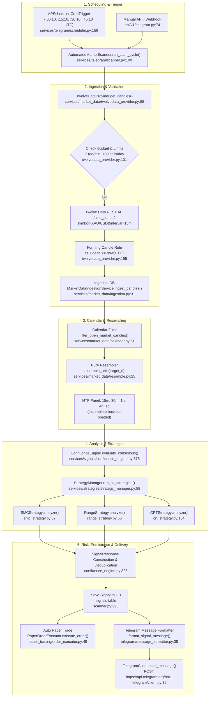
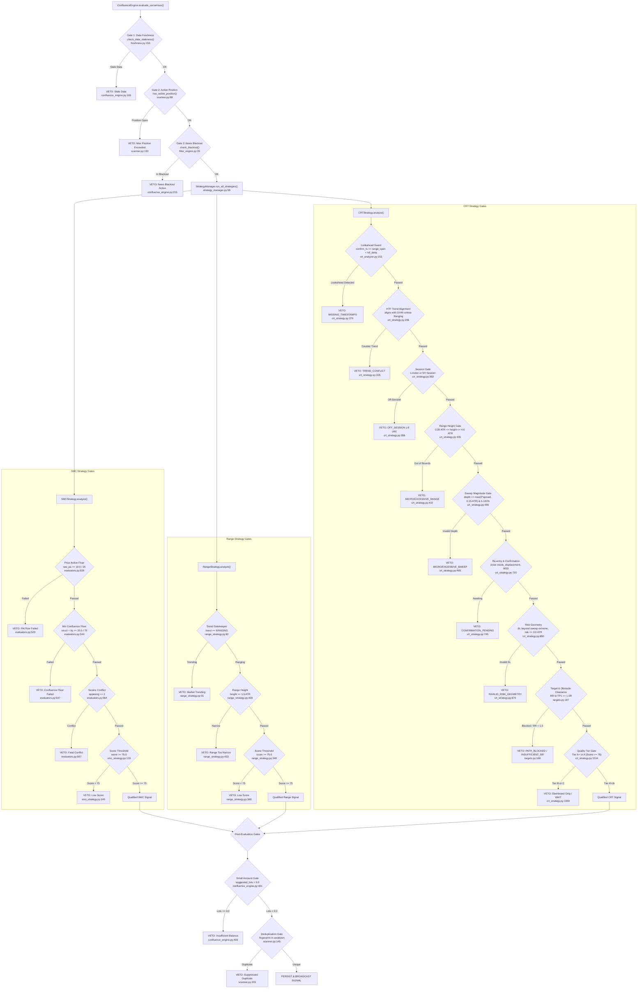
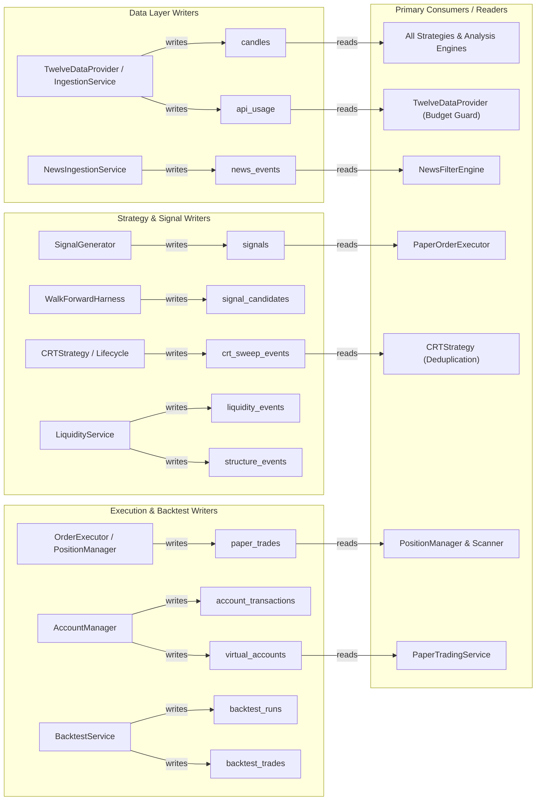

# QuantView Architecture Documentation

This document provides architectural documentation of QuantView as implemented on November 17, 2026. All descriptions, flowcharts, tables, and thresholds cite verified source file paths and line numbers.

---

## Table of Contents

1. [A. End-to-End Data Flow](#a-end-to-end-data-flow)
2. [B. Signal Pipeline & Stage Veto Gates](#b-signal-pipeline--stage-veto-gates)
3. [C. Strategy Comparison (SMC vs Range vs CRT)](#c-strategy-comparison-smc-vs-range-vs-crt)
4. [H. Persistence Architecture & Database Schema](#h-persistence-architecture--database-schema)
5. [I. Configuration & Secrets Audit](#i-configuration--secrets-audit)
6. [K. Operations & Deployment Runbook](#k-operations--deployment-runbook)
7. [L. Duplication & Overlap Map](#l-duplication--overlap-map)

---

## A. End-to-End Data Flow

The data flow connects raw market data ingestion from Twelve Data to Telegram alerts and automated paper execution.

### Architecture Flowchart



### Numbered Step-by-Step Flow

1. **Trigger Phase**:
   - `services/telegram/scheduler.py:154-167`: APScheduler fires an `AsyncIOScheduler` job using `CronTrigger(minute="0,15,30,45", second=10, timezone=timezone.utc)`.
   - The 10-second offset ensures Twelve Data has completed persisting the closed bar before the scanner queries it (`scheduler.py:81-85`).
   - Alternative trigger: HTTP `POST /api/v1/telegram/webhook` or `POST /api/v1/telegram/scanner/trigger` receives `/scan` and dispatches `AutomatedMarketScanner.run_scan_cycle()` (`api/v1/telegram.py:136, 178`).
2. **Rate Limit & Budget Guard**:
   - `services/market_data/twelvedata_provider.py:101-108`: Queries `api_usage` table via `get_daily_usage(db)`. If daily calls $\ge 780$, raises `TwelveDataBudgetExceededError`.
   - Token bucket limiter delays execution if request rate exceeds 7 calls per minute (`twelvedata_provider.py:45`).
3. **Data Acquisition**:
   - `services/market_data/twelvedata_provider.py:115-180`: Calls Twelve Data HTTP endpoint `https://api.twelvedata.com/time_series?symbol=XAU/USD&interval=15m&outputsize=300`.
   - Handles HTTP 429 with 60-second backoff and up to 3 retries.
4. **Closed-Candle Rule**:
   - `services/market_data/twelvedata_provider.py:195-205`: Drops forming candle using the strict timestamp rule:
     $$\text{candle.timestamp} + \text{timeframe\_delta} \le \text{now(UTC)}$$
   - Any bar whose close timestamp is in the future is dropped before persistence.
5. **Database Storage**:
   - `services/market_data/ingestion.py:31-105`: `MarketDataIngestionService.ingest_candles()` writes raw 15m bars to the `candles` table using upsert (`ON CONFLICT (symbol, timeframe, timestamp) DO UPDATE`).
6. **Market Calendar Filtering**:
   - `services/market_data/calendar.py:21-63`: `filter_open_market_candles()` filters out closed-market bars:
     - Friday: Closes at 17:00 America/New_York (`calendar.py:41-43`).
     - Saturday: Closed all day (`calendar.py:45-47`).
     - Sunday: Opens at 18:00 America/New_York (`calendar.py:49-51`).
     - Daily break: Closed Monday–Thursday 17:00 to 18:00 America/New_York (`calendar.py:53-56`).
   - Synthetic placeholder bars inserted by Twelve Data during closures are dropped at memory load time without mutating database rows.
7. **Higher Timeframe (HTF) Pure Resampling**:
   - `services/market_data/resample.py:25-190`: `resample_ohlc()` aggregates 15m candles into 30m, 1h, 4h, and 1d buckets:
     - 30m, 1h, 4h are anchored to UTC midnight (`resample.py:70-85`).
     - 1d is anchored to 17:00 America/New_York (`resample.py:87-105`).
     - Incomplete buckets (fewer than required bars or still forming) are dropped when `closed_only=True` (`resample.py:150-165`).
8. **Economic Calendar Check**:
   - `services/news/filter_engine.py:35-175`: `NewsFilterEngine.check_blackout()` queries the `news_events` table for high-impact USD events within `NEWS_BLACKOUT_BEFORE_MINUTES` (30m) and `NEWS_BLACKOUT_AFTER_MINUTES` (15m). If active, sets signal state to `WAIT` (`confluence_engine.py:200-225`).
9. **Multi-Timeframe Analysis**:
   - `services/indicators/indicator_service.py:35-148`: Computes ATR(14), EMA(20, 50, 200), RSI(14), FVGs, and candlestick patterns.
   - `services/structure/structure_engine.py:35-362`: Detects swing points, BOS/CHoCH, and trend direction.
   - `services/liquidity/liquidity_service.py:40-150`: Detects S/R zones and liquidity sweeps.
10. **Strategy Execution**:
    - `services/signals/confluence_engine.py:575-680`: `ConfluenceEngine.evaluate_consensus()` dispatches to `StrategyManager.run_all_strategies()` (`services/strategies/strategy_manager.py:58-117`), executing `SMCStrategy`, `RangeStrategy`, and `CRTStrategy`.
11. **Risk Management & Position Sizing**:
    - `services/signals/confluence_engine.py:360-400`: For CRT, incorporates custom SL/TP geometry, or calls `RiskManager.calculate_trade_risk()` (`services/signals/risk_manager.py:36-141`) to compute lots, pips, and R:R ratios.
12. **Signal Deduplication & Persistence**:
    - `services/telegram/scanner.py:225-245`: Generates a SHA-256 fingerprint from `(symbol, timeframe, direction, entry, sl, timestamp)`. Checks `_recent_fingerprints` and DB cooldown to suppress duplicates (`scanner.py:145-160`). Persists qualified setups to `signals` table.
13. **Paper Execution & Telegram Broadcast**:
    - If `SCANNER_AUTO_TRADE_PAPER=True`: Calls `PaperTradingService.execute_order_from_signal()` (`services/paper_trading/order_executor.py:220-380`), creating `PaperTrade` and `AccountTransaction` entries.
    - `services/telegram/message_formatter.py:35-250`: Formats HTML signal notification.
    - `services/telegram/client.py:35-125`: Transmits message via HTTPS to Telegram Bot API.

---

## B. Signal Pipeline & Stage Veto Gates

Every stage in the signal evaluation pipeline has explicit coded conditions that can veto or disqualify a setup.



### Complete Veto Catalog and Coded Thresholds

| Pipeline Stage | Veto Reason Code | Coded Condition / Expression | Threshold / Parameter | Citation |
| :--- | :--- | :--- | :--- | :--- |
| **Data Ingestion** | `DATA_STALE` | `(as_of - candle.timestamp) > max_age_allowed` | $> 37.5\text{m}$ (15m), $> 120\text{m}$ (1h), $> 360\text{m}$ (4h) | `freshness.py:185-188` |
| **Data Ingestion** | `TWELVEDATA_BUDGET` | `daily_calls >= budget_limit` | $\ge 780\text{ calls/day}$ | `twelvedata_provider.py:101` |
| **Scanner** | `POSITION_ACTIVE` | `has_active_position(db, symbol) == True` | $\ge 1$ open trade in `paper_trades` | `scanner.py:88, 128` |
| **News Filter** | `NEWS_BLACKOUT` | High-impact event within buffer | 30 min before, 15 min after event | `filter_engine.py:55-56` |
| **SMC Strategy** | `PA_FLOOR_FAILED` | `price_action_score < 10.0` | Minimum 10.0 / 25.0 PA points | `evaluators.py:526` |
| **SMC Strategy** | `CONFLUENCE_FAILED`| `structure_score + liquidity_score < 20.0` | Minimum 20.0 / 75.0 structural pts | `evaluators.py:544` |
| **SMC Strategy** | `FATAL_CONFLICT` | `len(opposing_signals) >= 2` | $\ge 2$ contradictory pillar directions | `evaluators.py:564` |
| **SMC Strategy** | `SCORE_BELOW_MIN` | `total_score < min_score_threshold` | Score $< 75.0 / 100.0$ | `smc_strategy.py:129` |
| **Range Strategy**| `MARKET_TRENDING` | `structure.trend != TrendDirection.RANGING` | Trend is BULLISH or BEARISH | `range_strategy.py:82` |
| **Range Strategy**| `MICRO_RANGE` | `price_diff > 1.5 * atr` | Range height $< 1.5\text{ ATR}$ | `range_strategy.py:430` |
| **Range Strategy**| `SCORE_BELOW_MIN` | `total_score < min_score_threshold` | Score $< 75.0 / 100.0$ | `range_strategy.py:348` |
| **CRT Strategy**  | `MISSING_TIMESTAMPS`| `confirm_ts < range_open + htf_delta` | Bar inside HTF formation window | `crt_analyzer.py:153` |
| **CRT Strategy**  | `TREND_CONFLICT` | Strategy direction counter to 1h/4h trend | Trend not aligned and not RANGING | `crt_strategy.py:295` |
| **CRT Strategy**  | `OFF_SESSION` | Outside London (03-07 NY) & NY (08-12 NY) | Formed outside trading sessions | `crt_strategy.py:62-87` |
| **CRT Strategy**  | `MICRO_RANGE` | `range_height < 0.35 * atr` | Height $< 0.35\text{ ATR}$ | `crt_strategy.py:405` |
| **CRT Strategy**  | `EXCESSIVE_RANGE`| `range_height > 4.0 * atr` | Height $> 4.0\text{ ATR}$ | `crt_strategy.py:415` |
| **CRT Strategy**  | `MICRO_SWEEP` | `sweep_depth < max(3*spread, 0.15*atr)` | Depth $< \max(3 \times \text{spread}, 0.15\text{ ATR})$ | `crt_strategy.py:455` |
| **CRT Strategy**  | `EXCESSIVE_MANIP` | `manip_depth_pct > 1.0` | Depth $> 100\%$ range height (breakout) | `crt_strategy.py:480` |
| **CRT Strategy**  | `CONFIRM_PENDING` | `not has_mss` or awaiting re-entry | Missing MSS or outside range | `confirmation.py:79` |
| **CRT Strategy**  | `INVALID_RISK` | BUY `sl >= entry` or SELL `sl <= entry` | SL on wrong side of entry | `crt_strategy.py:855` |
| **CRT Strategy**  | `EXCESSIVE_RISK` | `risk_distance > 3.0 * atr` | Risk distance $> 3.0\text{ ATR}$ | `crt_strategy.py:885` |
| **CRT Strategy**  | `PATH_BLOCKED` | `rr_tp1 < min_rr` after obstacle cap | Capped TP1 produces $RR < 1.0\text{R}$ | `targets.py:188` |
| **CRT Strategy**  | `INSUFFICIENT_RR` | `raw_rr_tp1 < min_rr` | Uncapped TP1 produces $RR < 1.0\text{R}$ | `targets.py:188` |
| **CRT Strategy**  | `TIER_B_OR_C` | `quality_tier in ("B", "C")` | Telegram alert suppressed (score $< 75$) | `tiers.py:26-35` |
| **Post-Strategy** | `INSUFFICIENT_BAL`| `suggested_lot_size == 0.0` | Balance cannot support 0.01 lot | `confluence_engine.py:401` |
| **Post-Strategy** | `DUPLICATE_SIG` | Fingerprint in memory or DB cooldown | Same key within `SIGNAL_COOLDOWN_HOURS` (2h) | `scanner.py:145` |

---

## C. Strategy Comparison (SMC vs Range vs CRT)

| Attribute | Strategy A (SMC Sniper) | Strategy C (Range Sniper) | Candle Range Theory (CRT) |
| :--- | :--- | :--- | :--- |
| **Implementation File** | `services/strategies/smc_strategy.py` [L29] | `services/strategies/range_strategy.py` [L44] | `services/strategies/crt_strategy.py` [L93] |
| **Target Market Regime** | Trending markets (continuation & reversal) | Ranging / sideways markets only | Liquidity sweep reversal (AMD cycle) |
| **Required Inputs** | Candles, indicators, structure, MTF, 15m candles | Candles, indicators, structure | Candles, indicators, structure, MTF, 15m candles |
| **HTF Context** | MTF 1h & 4h trend agreement scored | None (vetos if trending) | Strictly enforced: must align with 1h/4h |
| **Entry Logic** | Market entry at candle close | Market entry at S/R boundary | Limit order in retracement zone (FVG/OB/50%) |
| **Stop Loss Logic** | Delegated to `RiskManager`: S/R $\pm 0.5\text{ ATR}$ | Delegated to `RiskManager`: S/R $\pm 0.5\text{ ATR}$ | Sweep extreme $\pm \max(\text{spread}, 0.10\text{ ATR})$ |
| **Take Profit Logic** | Delegated: $TP_1 = 2.0R$, $TP_2 = 3.0R$ | Delegated: $TP_1 = 2.0R$, $TP_2 = 3.0R$ | $TP_1 = \text{Range Midpoint}$, $TP_2 = \text{Range Extreme}$ |
| **Obstacle Treatment** | Informational advisory; does not veto | Informational advisory; does not veto | Capped before barrier; vetos if $RR < 1.0$ |
| **Scoring Model** | Structure (35), Liquidity (40), PA (25) | Struct (30), Liq (25), Ind (25), PA (20) | Struct/MTF (35), Liq/POI (40), PA (25) |
| **Score Threshold** | $\ge 75.0$ (`settings.MIN_SETUP_SCORE`) | $\ge 75.0$ (`settings.MIN_SETUP_SCORE`) | $\ge 75.0$ (A tier), $\ge 85.0$ (A+ tier) |
| **Mandatory Floor Gates**| PA $\ge 10/25$, Struct+Liq $\ge 20/75$, LTF confirm | Trend == RANGING, Range width $\ge 1.5\text{ ATR}$ | Range $0.35\text{--}4\text{ ATR}$, Sweep $\ge 0.15\text{ ATR}$, MSS |
| **Session Rules** | None (active 24/7) | None (active 24/7) | London (03-07 NY), NY (08-12 NY); Asia tracked |
| **Position Sizing** | Clamped 0.01 to 100.0 lots | Clamped 0.01 to 100.0 lots | Clamped 0.01; flags `RISK EXCEEDS LIMIT` |
| **Production Status** | **ACTIVE** (runs in `StrategyManager`) | **ACTIVE** (runs in `StrategyManager`) | **ACTIVE** (runs in `StrategyManager`) |

---

## H. Persistence Architecture & Database Schema

The database persistence layer consists of 13 SQLAlchemy models mapped to tables in SQLite (`trade.db`) or PostgreSQL (Neon).

### Database Model & Table Mapping

| Table Name | Model Class | Defining File | Primary Key | Indexes & Unique Constraints | Migration Revision |
| :--- | :--- | :--- | :--- | :--- | :--- |
| `candles` | `Candle` | `models/candle.py:12` | `id` (Integer) | `UQ: (symbol, timeframe, timestamp)`<br/>`IX: (symbol, timeframe, timestamp)`<br/>`IX: source` | `46a42123bdb1` [L26] |
| `liquidity_events` | `LiquidityEvent` | `models/liquidity.py:10` | `id` (Integer) | `UQ: (symbol, timeframe, event_type, timestamp)`<br/>`IX: (symbol, timeframe, timestamp)` | `46a42123bdb1` [L42], `8c3fca88f849` [L35] |
| `structure_events` | `StructureEvent` | `models/structure.py:10` | `id` (Integer) | `UQ: (symbol, timeframe, event_type, timestamp)`<br/>`IX: (symbol, timeframe, timestamp)` | `46a42123bdb1` [L86] |
| `signals` | `Signal` | `models/signal.py:10` | `id` (Integer) | `IX: (symbol, status, timestamp)` | `46a42123bdb1` [L72] |
| `signal_candidates`| `SignalCandidate` | `models/signal_candidate.py:17`| `id` (Integer) | `IX: (symbol, timeframe, timestamp)`<br/>`IX: (session, qualified)` | `46a42123bdb1` [L56] |
| `virtual_accounts` | `VirtualAccount` | `models/paper.py:15` | `id` (Integer) | None | `46a42123bdb1` [L101] |
| `account_transactions`| `AccountTransaction`| `models/paper.py:84` | `id` (Integer) | `IX: (account_id, created_at)` | `46a42123bdb1` [L117] |
| `paper_trades` | `PaperTrade` | `models/paper.py:35` | `id` (Integer) | `UQ: (account_id, signal_id)`<br/>`IX: (symbol, status, opened_at)` | `46a42123bdb1` [L147] |
| `backtest_runs` | `BacktestRun` | `models/backtest.py:12` | `id` (Integer) | `IX: (symbol, timeframe, created_at)` | `46a42123bdb1` [L11] |
| `backtest_trades` | `BacktestTrade` | `models/backtest.py:53` | `id` (Integer) | `IX: (run_id, entry_time)` | `46a42123bdb1` [L130] |
| `news_events` | `NewsEvent` | `models/news.py:10` | `id` (Integer) | `UQ: (currency, event_name, scheduled_time)`<br/>`IX: (currency, scheduled_time)` | `46a42123bdb1` [L47] |
| `api_usage` | `ApiUsage` | `models/api_usage.py:9` | `id` (Integer) | `IX: date (unique)` | `8c3fca88f849` [L26] |
| `crt_sweep_events` | `CRTSweepEvent` | `models/crt_sweep_event.py:11`| `id` (Integer) | `IX: (sweep_key, cooldown_until)`<br/>`IX: (symbol, current_state)` | `9d1f3b8e4a2c` [L25] |

### Table Readers and Writers



### Alembic Migration Integrity Audit

- Running `alembic heads` on the codebase returned revision `9d1f3b8e4a2c (head)`.
- **Migration History**:
  1. `46a42123bdb1_initial_schema.py`: Initial migration creating 11 core tables (`candles`, `liquidity_events`, `structure_events`, `signals`, `signal_candidates`, `virtual_accounts`, `account_transactions`, `paper_trades`, `backtest_runs`, `backtest_trades`, `news_events`).
  2. `8c3fca88f849_add_api_usage_table.py`: Adds `api_usage` table with unique date index; adds index on `candles.source`; adds unique constraint `uq_liquidity_symbol_tf_type_ts`. (Contains auto-generated artifact `op.drop_table('playing_with_neon')` from Neon DB).
  3. `9d1f3b8e4a2c_add_crt_sweep_events_table.py`: Adds `crt_sweep_events` table with indexes on `(sweep_key, cooldown_until)` and `(symbol, current_state)`.
- **Audit Result**: Every single database model in `server/app/models/` has a corresponding Alembic migration. No unmigrated models exist in the codebase.

---

## I. Configuration & Secrets Audit

All settings are centralized in `server/app/core/config.py` in the `Settings` class (lines 29–163).

### Settings Inventory

| Setting Name | Default Value | Required? | Read By (Application Modules) | Status / Notes |
| :--- | :--- | :---: | :--- | :--- |
| `PROJECT_NAME` | `"Forex Market Analysis..."` | No | `app.main` [L22, L51, L74] | ACTIVE |
| `APP_ENV` | `"development"` | No | `app.main` [L22] | ACTIVE |
| `LOG_LEVEL` | `"INFO"` | No | `app/core/logging.py:16`, `core/database.py:23` | ACTIVE |
| `DATABASE_URL` | `"sqlite:///./trade.db"` | No | `app/core/database.py:20`, `scripts/backtest_report.py:28` | ACTIVE |
| `MODE` | `"paper"` | No | `app.main:22, 25`, `core/database.py:25`, `api/v1/config.py:23` | ACTIVE |
| `PAPER_TRADING` | `True` | No | `services/telegram/scanner.py:31` | ACTIVE |
| `MARKET_DATA_PROVIDER`| `"twelvedata"` | No | `app.main:25`, `api/v1/config.py:24`, `telegram/command_handler.py:33` | ACTIVE |
| `TWELVE_DATA_API_KEY`| `None` | **Yes (in prod)** | `services/market_data/twelvedata_provider.py:53`, `services/market_data/__init__.py:23` | ACTIVE (Secret) |
| `ALPHA_VANTAGE_API_KEY`| `None` | No | None | **UNUSED** |
| `YAHOO_GOLD_SYMBOL` | `"XAUUSD=X"` | No | None | **UNUSED** |
| `QUOTE_MAX_AGE_SECONDS`| `120` | No | `api/v1/config.py:29`, `api/v1/market.py:182`, `twelvedata_provider.py:270` | ACTIVE |
| `QUOTE_POLL_SECONDS` | `10` | No | `api/v1/config.py:28` | ACTIVE |
| `QUOTE_MAX_DEVIATION_PCT`| `0.05` | No | `api/v1/market.py:195` | ACTIVE |
| `NEWS_PROVIDER` | `"forexfactory"` | No | `api/deps.py:46`, `telegram/command_handler.py:38`, `telegram/scanner.py:33` | ACTIVE |
| `NEWS_API_KEY` | `None` | No | None | **UNUSED** |
| `NEWS_BLACKOUT_BEFORE_MINUTES`| `30` | No | `api/deps.py:48`, `api/v1/config.py:30`, `services/news/filter_engine.py:55` | ACTIVE |
| `NEWS_BLACKOUT_AFTER_MINUTES` | `15` | No | `api/deps.py:49`, `api/v1/config.py:31`, `services/news/filter_engine.py:56` | ACTIVE |
| `MAX_RISK_PERCENT` | `0.5` | No | `api/v1/config.py:32`, `signals/confluence_engine.py:362`, `signals/risk_manager.py:50` | ACTIVE |
| `MIN_RR` / `MIN_RR_TP1` | `2.0` | No | `api/v1/config.py:33`, `signals/risk_manager.py:51` | ACTIVE |
| `MIN_RR_TP2` | `3.0` | No | `api/v1/config.py:34`, `signals/risk_manager.py:52` | ACTIVE |
| `MIN_SETUP_SCORE` | `75.0` | No | `api/deps.py:50`, `signals/confluence_engine.py:79`, `strategies/smc_strategy.py:42` | ACTIVE |
| `SIGNAL_COOLDOWN_HOURS`| `2` | No | `api/v1/config.py:36`, `services/signals/signal_generator.py:245` | ACTIVE |
| `SR_TOLERANCE_PERCENT`| `0.1` | No | `api/deps.py:51`, `services/liquidity/liquidity_service.py:32` | ACTIVE |
| `SWING_LOOKBACK` | `2` | No | `api/deps.py:52`, `services/structure/structure_engine.py:55` | ACTIVE |
| `EMA_FAST` | `20` | No | None | **UNUSED** (hardcoded in `ema_calculator.py`) |
| `EMA_MID` | `50` | No | None | **UNUSED** (hardcoded in `ema_calculator.py`) |
| `EMA_SLOW` | `200` | No | None | **UNUSED** (hardcoded in `ema_calculator.py`) |
| `RSI_PERIOD` | `14` | No | None | **UNUSED** (hardcoded in `rsi_calculator.py`) |
| `ATR_PERIOD` | `14` | No | None | **UNUSED** (hardcoded in `atr_calculator.py`) |
| `CRT_MIN_SWEEP_ATR_MULT`| `0.15` | No | None | **UNUSED** (hardcoded in `crt_strategy.py`) |
| `CRT_MIN_RANGE_ATR_MULT`| `0.35` | No | None | **UNUSED** (hardcoded in `crt_strategy.py`) |
| `CRT_MAX_RANGE_ATR_MULT`| `4.0` | No | None | **UNUSED** (hardcoded in `crt_strategy.py`) |
| `CRT_MAX_RISK_ATR_MULT` | `3.0` | No | None | **UNUSED** (hardcoded in `crt_strategy.py`) |
| `CRT_MIN_RR_TP1` | `1.0` | No | None | **UNUSED** (hardcoded in `crt_strategy.py`) |
| `CRT_ENTRY_EXPIRY_BARS` | `8` | No | None | **UNUSED** (hardcoded in `crt_strategy.py`) |
| `SCANNER_ENABLED` | `True` | No | `app.main:37`, `api/v1/health.py:72`, `telegram/scheduler.py:92` | ACTIVE |
| `SCANNER_INTERVAL_MINUTES`| `15` | No | `api/v1/health.py:73`, `telegram/scanner.py:37` | ACTIVE |
| `SCANNER_TIMEFRAMES` | `["1h", "15m"]` | No | `services/telegram/scheduler.py:130`, `services/telegram/scanner.py:38` | ACTIVE |
| `SCANNER_AUTO_TRADE_PAPER`| `True` | No | `services/telegram/scheduler.py:132`, `services/telegram/scanner.py:39` | ACTIVE |
| `TELEGRAM_BOT_TOKEN` | `None` | **Yes (for alerts)** | `services/telegram/client.py:27` | ACTIVE (Secret) |
| `TELEGRAM_CHAT_ID` | `None` | **Yes (for alerts)** | `services/telegram/client.py:29` | ACTIVE (Secret) |
| `USER_TIMEZONE` | `"UTC"` | No | `core/time_utils.py:18` | ACTIVE |
| `XAUUSD_SPREAD` | `0.3` | No | `services/backtesting/walk_forward_harness.py:44` | ACTIVE |
| `XAUUSD_SLIPPAGE` | `0.1` | No | `services/backtesting/walk_forward_harness.py:45` | ACTIVE |
| `SUPPORTED_SYMBOLS` | `["XAU/USD"]` | No | 13 files across API and services | ACTIVE |
| `SUPPORTED_TIMEFRAMES`| `["15m", "1h", "4h"]`| No | 4 files across API and services | ACTIVE |

### Secret Management Findings
- Secrets (`TWELVE_DATA_API_KEY`, `TELEGRAM_BOT_TOKEN`, `TELEGRAM_CHAT_ID`, `DATABASE_URL`) are read exclusively from environment variables or gitignored `.env`.
- In `server/.env.example` line 1-45, dummy placeholder tokens are provided (`your_api_key_here`).
- No live secret tokens or credentials were found committed to git.

---

## K. Operations & Deployment Runbook

### Local Development Execution
- **Prerequisites**: Python 3.14 venv at repo root (`.venv/`), Node.js 18+ for client.
- **Run Full Stack (Vite + FastAPI)**:
  ```powershell
  npm run dev
  ```
  Defined in root `package.json` [L7-L9], concurrently launches `cd server && uvicorn app.main:app --reload --port 8000` and `cd client && npm run dev`.
- **Run Backend Only**:
  ```powershell
  cd server
  ..\.venv\Scripts\uvicorn.exe app.main:app --reload --port 8000
  ```
- **Run Database Migrations**:
  ```powershell
  cd server
  ..\.venv\Scripts\alembic.exe upgrade head
  ```

### Scheduler Operations
- APScheduler is initialized during FastAPI startup in `app/main.py:38` when `settings.SCANNER_ENABLED=True`.
- It executes at `:00:10, :15:10, :30:10, :45:10 UTC`.
- To trigger a manual scan immediately without waiting for the candle close:
  ```http
  POST /api/v1/telegram/scanner/trigger
  ```
- Health status and next run time can be inspected at:
  ```http
  GET /api/v1/telegram/scanner/status
  ```

### Cloud Deployment (Render & Netlify)
- **Backend Deployment (`server/render.yaml`)**:
  - Service type: `web`, name: `trade-api`, runtime: `python` [L2-L4].
  - Python version: `3.11.8` [L12].
  - Build command:
    ```bash
    pip install -r requirements.txt && alembic upgrade head
    ```
  - Start command:
    ```bash
    uvicorn app.main:app --host 0.0.0.0 --port $PORT
    ```
  - `DATABASE_URL` has `sync: false` [L15] to preserve Neon PostgreSQL URL configured in the Render Dashboard.
- **Frontend Deployment**:
  - React/TypeScript client in `client/` builds via `npm run build` outputting to `client/dist/`.
  - Configured for Netlify / Vercel single-page app hosting with `client/vite.config.ts`.
- **Continuous Integration (CI)**:
  - `Test-Path .github` verified `False`: **There is NO GitHub Actions or CI pipeline file in the repository**.
  - All tests and verification must currently be executed locally.

---

## L. Duplication & Overlap Map

The audit revealed multiple instances of architectural duplication where parallel modules implement identical or conflicting logic.

### 1. Liquidity Detection: `services/liquidity` vs `services/sweep` vs `services/structure/crt_analyzer`
- **`services/liquidity/` (`liquidity_service.py`, `sr_detector.py`, `sweep_detector.py`)**:
  - Legacy multi-symbol liquidity detector.
  - Dynamically clusters rolling pivot highs/lows into S/R zones with `tolerance_pct = 0.1%`.
  - Wire status: **ACTIVE**. Called by `ConfluenceEngine` as Pillar 2.
- **`services/sweep/` (`engine.py`, `detector.py`, `pivots.py`, `pools.py`, `state_machine.py`)**:
  - Phase 2 pure liquidity-sweep engine built specifically for XAU/USD.
  - Strictly deterministic fractal pivots ($N_\text{left}=5, N_\text{right}=3$ confirmed at $k+3$), session pools (Asia, London, NY), 12-bar MSS rule, FVG/OB entry zones.
  - Wire status: **PARTIAL**. Completely detached from production signal pipeline; only called by `scripts/run_sweep_backtest.py`.
- **`services/structure/crt_analyzer.py` (`CRTAnalyzer`)**:
  - CRT AMD sequence detector.
  - Focuses on benchmark accumulation candle ($T-1$ HTF), manipulation breach, and range re-entry.
  - Wire status: **ACTIVE**. Called by `CRTStrategy`.

### 2. Two ATR Calculators
- **`services/indicators/atr_calculator.py` (`ATRCalculator`)**:
  - Methods: `calculate_atr_series(candles, period=14)`, `calculate_atr_snapshot(candles, period=14)` [L40, L68].
  - Uses Wilder's smoothing RMA.
  - Callers: `services.indicators.indicator_service` [L11], `api.v1.indicators`.
  - **Canonical for production signal pipeline.**
- **`services/sweep/atr.py` (`calculate_atr`)**:
  - Function: `calculate_atr(candles: Sequence[CandleCreate], period: int = 14) -> List[float]` [L7].
  - Uses identical Wilder's smoothing RMA.
  - Callers: `services.sweep.engine` [L15], `services.sweep.backtest.engine`.
  - **Used only in Phase 2/3 sweep backtesting.**

### 3. Two `is_forex_weekend` Functions
- **`services/market_data/freshness.py:54`**:
  ```python
  def is_forex_weekend(timestamp: Optional[datetime] = None) -> bool:
      weekday = ts.weekday()
      hour = ts.hour
      if weekday == 4 and hour >= 21: return True
      if weekday == 5: return True
      if weekday == 6 and hour < 21: return True
      return False
  ```
  - Hardcodes UTC hours (Friday 21:00 UTC to Sunday 21:00 UTC). Ignores Daylight Saving Time in New York.
  - Callers: `check_data_staleness()` [L173], `scripts/import_history.py:322`.
- **`services/market_data/calendar.py:66`**:
  ```python
  def is_forex_weekend(ts: Optional[datetime] = None) -> bool:
      ny_dt = ts.astimezone(ZoneInfo("America/New_York"))
      wd = ny_dt.weekday()
      m = ny_dt.hour * 60 + ny_dt.minute
      if wd == 4 and m >= 17 * 60: return True
      if wd == 5: return True
      if wd == 6 and m < 18 * 60: return True
      return False
  ```
  - Correct Spot Gold schedule: Friday 17:00 NY to Sunday 18:00 NY, DST-aware via `ZoneInfo("America/New_York")`.
  - Callers: `resample_ohlc()`, `scripts/run_sweep_backtest.py:94`.
  - **Canonical implementation: `services/market_data/calendar.py`.**

### 4. Two `normalize_symbol` Functions
- **`app/core/normalization.py:50`**:
  - Permissive resolver. Checks static `SYMBOL_MAP`. Falls back to splitting 6-character forex strings (`f"{cleaned[:3]}/{cleaned[3:]}"`). Never raises an exception; returns unmapped strings as-is.
  - Callers: `services/news/forexfactory_provider.py:42`, `services/news/ingestion.py:49`.
- **`app/services/market_data/symbols.py:84`**:
  - Strict validator. Validates strictly against `INSTRUMENT_SPECS`. Raises `UnknownSymbolError` if the symbol is not explicitly configured.
  - Callers: `services/market_data/twelvedata_provider.py`, `services/signals/risk_manager.py:61`, `api/v1/market.py`.
  - **Canonical implementation: `services/market_data/symbols.py`.**
