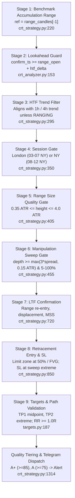

# Candle Range Theory (CRT) Strategy Documentation

This document provides technical documentation of the Candle Range Theory (CRT) trading strategy implemented in QuantView, covering its 9-stage pipeline, scoring engine, risk geometry, session mechanics, and persistence lifecycle as of November 17, 2026.

---

## Table of Contents

1. [D. CRT Deep Dive & The 9-Stage Pipeline](#d-crt-deep-dive--the-9-stage-pipeline)
2. [CRT Submodules Breakdown (`strategies/crt/`)](#crt-submodules-breakdown-strategiescrt)
3. [E. Scoring Audit & Point Breakdown](#e-scoring-audit--point-breakdown)
4. [F. Risk Geometry, Pips & Lot Sizing Math](#f-risk-geometry-pips--lot-sizing-math)
5. [G. Time, Sessions & Timezone Offsets](#g-time-sessions--timezone-offsets)
6. [Lifecycle States, Deduplication & Database Persistence](#lifecycle-states-deduplication--database-persistence)
7. [Production Wiring vs Non-Production Parts](#production-wiring-vs-non-production-parts)

---

## D. CRT Deep Dive & The 9-Stage Pipeline

Candle Range Theory (CRT) models market behavior through the ICT/SMC sequence of **Accumulation (Range) $\to$ Manipulation (Liquidity Sweep) $\to$ Distribution (Expansion)**. The implementation lives primarily in `server/app/services/strategies/crt_strategy.py` (`CRTStrategy`) and `server/app/services/structure/crt_analyzer.py` (`CRTAnalyzer`).



### Detailed Breakdown of the 9 Pipeline Stages

1. **Stage 1: Benchmark Accumulation Range Selection (`crt_strategy.py:220-245`)**:
   - Accumulation is defined by the immediately preceding closed higher-timeframe candle: `ref_candle = range_candles[-1]` (`crt_analyzer.py:85`).
   - Extracts `range_high`, `range_low`, `range_open`, `range_close`, and `range_open_timestamp`.
   - Bullish accumulation occurs when `range_close > range_open`; Bearish accumulation occurs when `range_close < range_open`.
2. **Stage 2: Zero-Lookahead Chronological Guard (`crt_analyzer.py:153-160`)**:
   - Enforces:
     $$\text{confirm\_candle.timestamp} \ge \text{range\_open\_timestamp} + \text{htf\_duration}$$
   - Rejects with `MISSING_TIMESTAMPS` if any candle timestamp is missing or if confirmation candles fall inside the benchmark candle's formation window.
3. **Stage 3: Higher Timeframe Trend Alignment Filter (`crt_strategy.py:295-330`)**:
   - Compares candidate direction against primary HTF trend (1h/4h).
   - If HTF trend is `BEARISH`, BUY setups are vetoed with `TREND_CONFLICT`.
   - If HTF trend is `BULLISH`, SELL setups are vetoed with `TREND_CONFLICT`.
   - If HTF trend is `RANGING`, both BUY and SELL are permitted.
4. **Stage 4: Institutional Session Gate (`crt_strategy.py:62-87, 350-365`)**:
   - Evaluates timestamp against `America/New_York` clock:
     - London Session: 03:00 to 07:00 NY (`crt_strategy.py:77`).
     - New York Session: 08:00 to 12:00 NY (`crt_strategy.py:80`).
     - Asian Session: 18:00 to 24:00 NY (liquidity tracking only; no trade signals allowed) (`crt_strategy.py:85`).
   - Off-session setups receive an 8-point penalty (`score_audit.append({"points": -8.0})`) and are vetoed if `is_session_open=False`.
5. **Stage 5: Range Size Quality Gate (`crt_strategy.py:405-425`)**:
   - Calculates `range_height = range_high - range_low`.
   - Rejects if `range_height < 0.35 * ATR` as `MICRO_ACCUMULATION_RANGE`.
   - Rejects if `range_height > 4.0 * ATR` as `EXCESSIVE_RANGE_SIZE`.
6. **Stage 6: Manipulation Sweep Validation (`crt_strategy.py:455-500`)**:
   - For Bullish setup: Price must wick below `range_low` to `breach_point = min(lows)`.
   - For Bearish setup: Price must wick above `range_high` to `breach_point = max(highs)`.
   - Minimum sweep depth: $\text{sweep\_depth} \ge \max(3 \times \text{spread}, 0.15 \times \text{ATR})$.
   - Minimum manipulation percentage: $\ge 5.0\%$ of range height.
   - Breakout cap: If $\text{manip\_depth\_pct} > 100.0\%$, classified as genuine trend breakout and rejected (`EXCESSIVE_MANIPULATION_DEPTH`).
7. **Stage 7: Lower Timeframe Confirmation (`crt_strategy.py:720-755`)**:
   - Re-entry: Requires 15m candle close back inside `[range_low, range_high]`.
   - Displacement: Requires candle body $\ge 0.20 \times \text{ATR}$ and $\text{body}/\text{range} \ge 0.50$ (`confirmation.py:85-100`).
   - Market Structure Shift (MSS): Requires 15m structural break in reversal direction (`confirmation.py:114-156`).
8. **Stage 8: Retracement Entry Zone & Risk Geometry (`crt_strategy.py:850-930`)**:
   - Entry mode: Limit order placed in retracement entry zone (FVG, Order Block, or 50% equilibrium) (`entry.py:70-110`).
   - Stop Loss placement: Positioned beyond sweep extreme $\pm \max(\text{spread}, 0.10 \times \text{ATR})$ (`crt_strategy.py:860`).
   - Stop Loss shielding: If liquidity pool (EQL/EQH) lies within $1.0\text{ ATR}$ beyond extreme, SL is buffered beyond pool (`crt_strategy.py:875`).
   - Max Risk Distance: Rejects if $| \text{entry} - \text{SL} | > 3.0 \times \text{ATR}$ (`crt_strategy.py:885`).
9. **Stage 9: Target Plan & Path Validation (`crt_strategy.py:935-980`, `targets.py:120-226`)**:
   - $TP_1 = \text{Range Midpoint} = \frac{\text{range\_high} + \text{range\_low}}{2.0}$.
   - $TP_2 = \text{Range Extreme}$ (Range High for BUY, Range Low for SELL).
   - `PathValidator` checks for opposing S/R zones and unmitigated FVGs between entry and $TP_1$. If detected, $TP_1$ is capped before the barrier.
   - Enforces $RR \ge 1.0\text{R}$ to $TP_1$. If capped $RR < 1.0\text{R}$, setup is rejected with `PATH_BLOCKED`.

---

## CRT Submodules Breakdown (`strategies/crt/`)

The 7 submodules under `server/app/services/strategies/crt/` provide specialized analytical components:

```
server/app/services/strategies/crt/
├── __init__.py           (Exports public interface)
├── daily_bias.py         (17:00 NY daily close, PDH/PDL, Asian & London session extremes)
├── confirmation.py       (Range re-entry, displacement, MSS verification)
├── entry.py              (Retracement limit entry zone, equilibrium, 8-bar expiry)
├── targets.py            (Midpoint TP1, extreme TP2, obstacle capping, R:R check)
├── tiers.py              (A+, A, B, C quality tier classification)
├── lifecycle.py          (State transitions, management alerts, DB persistence)
└── backtest_adapter.py   (Converts CRT results to SweepSetup for sweep backtest harness)
```

### 1. `daily_bias.py` (209 lines)
- **Functions**: `calculate_daily_bias(candles_15m, as_of)`, `classify_swept_level(level_type, level_ts)`.
- **Anchor**: Anchored to 17:00 America/New_York daily close (`daily_bias.py:15`).
- **Mechanics**: Segregates bars into trading days starting at 17:00 NY. Tracks Asian Session (18:00–00:00 NY) High/Low and London Session (03:00–07:00 NY) High/Low.
- **Points Awarded**:
  - Swept Previous-Day Low/High (PDL/PDH): $+18.0$ pts (`daily_bias.py:165`).
  - Swept Session High/Low: $+14.0$ pts (`daily_bias.py:170`).
  - Swept Equal Highs/Lows (EQH/EQL): $+12.0$ pts (`daily_bias.py:175`).
  - Swept Major Swing: $+10.0$ pts (`daily_bias.py:180`).
  - Benchmark Range Extreme: $+4.0$ pts (`daily_bias.py:185`).

### 2. `confirmation.py` (238 lines)
- **Functions**: `verify_ltf_confirmation(...) -> LTFConfirmationResult`.
- **Mechanics**: Evaluates 15m candles following manipulation breach.
- **Known Code Defects**:
  - `has_displacement` computed at line 95, but line 158 only checks `if not has_mss:`. Omission of `if not has_displacement:` allows zero-displacement candles to confirm (`confirmation.py:158-179`).
  - Wick breaks qualify as MSS: `_get_val(c, "high") > recent_swing_high` accepts high wicks without candle close (`confirmation.py:120, 154`).
  - Missing timestamp check on `structure.recent_events`: Pre-sweep structural events qualify as post-sweep confirmation (`confirmation.py:105-111`).

### 3. `entry.py` (210 lines)
- **Functions**: `calculate_retracement_entry(...) -> RetracementEntry`.
- **Mechanics**: Identifies displacement leg between breach point and post-sweep extreme. Looks for fresh FVG; falls back to Order Block; falls back to 50% equilibrium level:
  $$\text{ideal\_entry} = \frac{\text{breach\_point} + \text{disp\_extreme}}{2.0}$$
- **Entry Mode**: Sets `entry_mode = "market"` if price is currently inside entry zone; sets `entry_mode = "limit_zone"` if price has displaced away.
- **Expiry**: Default `expiry_bars = 8` (2 hours on 15m) (`entry.py:135`).
- **Missed Setup**: Flags `is_missed = True` if price advances $> 0.5\text{R}$ toward $TP_1$ without pulling back into limit zone (`entry.py:180`).

### 4. `targets.py` (226 lines)
- **Functions**: `calculate_crt_targets(...) -> CRTTargetPlan`.
- **Mechanics**: Evaluates price clearance to $TP_1$ and $TP_2$.
- **Path Validation Integration**: Calls `PathValidator.validate_trade_path()`. If opposing resistance/FVG found, caps $TP_1$ with buffer $\max(0.20, 0.05 \times \text{ATR})$ (`targets.py:140-155`).
- **R:R Gate**: Rejects if capped $RR < 1.0\text{R}$ (`PATH_BLOCKED`) or uncapped $RR < 1.0\text{R}$ (`INSUFFICIENT_RR`) (`targets.py:188`).

### 5. `tiers.py` (75 lines)
- **Functions**: `determine_quality_tier(score, gatekeeper_passed) -> QualityTierResult`.
- **Cutoffs**:
  - **A+ Tier ($\ge 85.0$)**: Highest conviction; dispatches Telegram alert; label `"🏆 A+ Quality (High Conviction)"` (`tiers.py:40-47`).
  - **A Tier ($\ge 75.0$)**: Standard institutional setup; dispatches Telegram alert; label `"🥇 A Quality (Confirmed Institutional)"` (`tiers.py:49-56`).
  - **B Tier ($\ge 65.0$)**: Secondary setup or pending minor gate; displayed on dashboard only; `should_alert_telegram = False` (`tiers.py:28-35, 58-65`).
  - **C Tier ($< 65.0$)**: Sub-threshold; `is_actionable = False`; `should_alert_telegram = False` (`tiers.py:67-74`).

### 6. `lifecycle.py` (189 lines)
- **Classes**: `CRTState`, `StateTransitionResult`.
- **Functions**: `evaluate_lifecycle_state(current_price, high, low, record, ...)` (`lifecycle.py:55-188`).
- **Lifecycle Graph**:
  ```mermaid
  stateDiagram-v2
      [*] --> POTENTIAL
      POTENTIAL --> WAITING_FOR_CONFIRMATION
      WAITING_FOR_CONFIRMATION --> CONFIRMED
      CONFIRMED --> ENTRY_FILLED: Price touches limit zone
      CONFIRMED --> EXPIRED: 8 bars elapse unfilled
      CONFIRMED --> MISSED: Price runs >0.5R without fill
      CONFIRMED --> INVALIDATED: Sweep extreme broken
      ENTRY_FILLED --> TP1_HIT: Midpoint reached (SL to BE)
      TP1_HIT --> TP2_HIT: Range extreme reached
      ENTRY_FILLED --> STOPPED: Stop loss hit
      TP1_HIT --> STOPPED: Break-even stop hit
  ```
- **Alert Throttling**: Restricts Telegram alert dispatch to exactly once per lifecycle state transition via `last_alerted_state` (`lifecycle.py:145-160`).

### 7. `backtest_adapter.py` (112 lines)
- **Functions**: `adapt_crt_result_to_sweep_setup(result, symbol, as_of) -> Optional[SweepSetup]`.
- **Status**: DEAD. Unreferenced by `crt_strategy.py`, scripts, or tests.

---

## E. Scoring Audit & Point Breakdown

The scoring engine evaluates setups on a strict 0–100 scale across three independent pillars plus penalties (`crt_strategy.py:1085-1260`):

```
+-------------------------------------------------------------------------+
|                  CRT CONFLUENCE SCORE MODEL (0 - 100)                   |
+------------------------------------+------------------------------------+
| Pillar 1: Structure & MTF (Max 35) | 1H Alignment:           +12 pts    |
|                                    | 4H Alignment:            +8 pts    |
|                                    | MSS / CHoCH:             +8 pts    |
|                                    | Displacement Strength:   +5 pts    |
|                                    | Premium / Discount:      +4 pts    |
+------------------------------------+------------------------------------+
| Pillar 2: Liquidity & POIs (Max 40)| Swept Level Quality:     +18 pts   |
|                                    | POI Proximity (FVG/OB):  +12 pts   |
|                                    | Path Clearance:          +10 pts   |
+------------------------------------+------------------------------------+
| Pillar 3: Price Action (Max 25)    | Rejection Wick Ratio:    +8 pts    |
|                                    | Range Re-entry Depth:    +7 pts    |
|                                    | Momentum Confirmation:   +6 pts    |
|                                    | Candlestick Bar Quality: +4 pts    |
+------------------------------------+------------------------------------+
| Penalties                          | Off-Session Execution:   -8 pts    |
|                                    | Path Obstacles Nearby:   -5 pts    |
+------------------------------------+------------------------------------+
```

### Detailed Coded Point Allocation

#### Pillar 1: Structure & MTF Alignment (Capped at 35.0 pts)
- **1H Trend Alignment (`crt_strategy.py:1095-1105`)**:
  - Trend aligned with direction: $+12.0$ pts.
  - Trend ranging: $+8.0$ pts.
  - Opposing trend: $+0.0$ pts.
- **4H Trend Alignment (`crt_strategy.py:1108-1118`)**:
  - Trend aligned with direction: $+8.0$ pts.
  - Trend ranging: $+6.0$ pts.
  - Opposing trend: $+0.0$ pts.
- **Market Structure Shift (MSS) (`crt_strategy.py:1120-1128`)**:
  - Confirmed post-sweep MSS: $+8.0$ pts.
  - Baseline/pending MSS: $+4.0$ pts.
- **Displacement Strength (`crt_strategy.py:1130-1140`)**:
  - Strong displacement ($\ge 0.30\text{ ATR}$): $+5.0$ pts.
  - Clean displacement ($\ge 0.20\text{ ATR}$): $+4.0$ pts.
  - Baseline displacement: $+2.0$ pts.
- **Premium / Discount Location (`crt_strategy.py:1142-1150`)**:
  - BUY in Discount ($< 50\%$ of range) or SELL in Premium ($> 50\%$): $+4.0$ pts.
  - Wrong zone: $+0.0$ pts.

#### Pillar 2: Liquidity & Key POIs (Capped at 40.0 pts)
- **Swept Level Quality (`crt_strategy.py:1160-1175`)**:
  - Previous-Day Low/High (PDL/PDH): $+18.0$ pts.
  - Session Low/High (Asia/London): $+14.0$ pts.
  - Equal Lows/Highs (EQL/EQH pool): $+12.0$ pts.
  - Major Swing High/Low: $+10.0$ pts.
  - Benchmark Range Extreme: $+4.0$ pts.
- **Point of Interest (POI) Proximity (`crt_strategy.py:1178-1190`)**:
  - Entry inside fresh unmitigated FVG or Order Block: $+12.0$ pts.
  - Entry at 50% equilibrium level: $+8.0$ pts.
  - Ordinary retracement: $+4.0$ pts.
- **Path Clearance to Target (`crt_strategy.py:1192-1205`)**:
  - Clear path (no obstacles): $+10.0$ pts.
  - Nearest obstacle $\ge 2.0\text{R}$ away: $+8.0$ pts.
  - Nearest obstacle $\ge 1.2\text{R}$ away: $+6.0$ pts.
  - Obstacle $< 1.2\text{R}$ away: $+3.0$ pts.

#### Pillar 3: Price Action Dynamics (Capped at 25.0 pts)
- **Rejection Wick Ratio (`crt_strategy.py:1215-1225`)**:
  - Wick ratio $\ge 50\%$ of candle range: $+8.0$ pts.
  - Wick ratio $\ge 35\%$: $+6.0$ pts.
  - Wick ratio $< 35\%$: $+4.0$ pts.
- **Range Re-entry Depth (`crt_strategy.py:1228-1238`)**:
  - Re-entry $\ge 10\%$ of range height: $+7.0$ pts.
  - Re-entry $\ge 3\%$: $+5.0$ pts.
  - Re-entry $< 3\%$: $+3.0$ pts.
- **Momentum Confirmation (`crt_strategy.py:1240-1248`)**:
  - Displacement body $\ge 0.25\text{ ATR}$: $+6.0$ pts.
  - Displacement body $\ge 0.15\text{ ATR}$: $+5.0$ pts.
  - Standard candle body: $+3.0$ pts.
- **Candlestick Bar Quality (`crt_strategy.py:1250-1254`)**:
  - Clean non-overlapping confirmation bar: $+4.0$ pts.

#### Penalties
- **Off-Session Execution (`crt_strategy.py:1253`)**: $-8.0$ pts.
- **Path Obstacle Nearby (`crt_strategy.py:1256`)**: $-5.0$ pts.

### Threshold Conflict Audit

1. **`MIN_SETUP_SCORE` vs Tier Cutoffs**:
   - `Settings.MIN_SETUP_SCORE` is `75.0` (`config.py:86`).
   - `tiers.py:49` aligns with `75.0` for Tier A.
   - However, `tiers.py:28` allows Tier B setups to qualify at `65.0` for the dashboard, while `ConsensusFilter` in `evaluators.py:572` hard-rejects any setup below `75.0`.
2. **`MIN_RR` Conflict**:
   - `Settings.MIN_RR` and `MIN_RR_TP1` default to `2.0` (`config.py:76`).
   - `CRTStrategy` and `targets.py:187` hardcode `min_rr = 1.0` for $TP_1$ (`crt_strategy.py:120`).
   - Consequence: A CRT trade with $1.2\text{R}$ to $TP_1$ qualifies under CRT rules, but violates the global `MIN_RR=2.0` setting in `config.py`.

---

## F. Risk Geometry, Pips & Lot Sizing Math

### Constants & Instrument Geometry (`XAU/USD`)
- **Pip Size**: $1\text{ pip} = \$0.10$ ($10\text{ pips} = \$1.00$). $1\text{ point} = \$0.01$ (`symbols.py:35`).
- **Contract Size**: $1\text{ standard lot} = 100\text{ oz}$ (`symbols.py:37`).
- **Point Value per Lot**: $100\text{ oz} \times \$0.10 = \$10.00\text{ per pip per standard lot}$ (`symbols.py:36`).
- **Micro Lot ($0.01\text{ lot}$)**: $1\text{ oz}$ ($1\text{ pip} = \$0.10\text{ P&L}$; $\$1.00\text{ move} = \$1.00\text{ P&L}$).

### Position Sizing Mathematical Model (`crt_strategy.py:1275-1310`)
1. **Stop Distance in Dollars**:
   $$\text{stop\_distance} = | \text{effective\_entry} - \text{stop\_loss} |$$
2. **Risk in Pips**:
   $$\text{risk\_pips} = \frac{\text{stop\_distance}}{\text{self.pip\_size}} = \frac{\text{stop\_distance}}{0.10}$$
3. **Risk Budget**:
   $$\text{risk\_budget\_usd} = \text{account\_balance} \times \left(\frac{\text{risk\_percent}}{100.0}\right)$$
4. **Dollar Risk per Standard Lot**:
   $$\text{dollar\_risk\_per\_lot} = \text{stop\_distance} \times 100.0$$
5. **Raw Lot Calculation & Step Quantization**:
   $$\text{raw\_lots} = \frac{\text{risk\_budget\_usd}}{\text{dollar\_risk\_per\_lot}}$$
   $$\text{lots} = \left\lfloor \frac{\text{raw\_lots}}{0.01} \right\rfloor \times 0.01$$

### `RISK EXCEEDS LIMIT` Guard (`crt_strategy.py:1297-1310`)
If the computed `lots < 0.01` or if the dollar risk on a minimum $0.01$ lot exceeds the risk budget:
$$\text{min\_lot\_risk\_dollars} = 0.01 \times \text{dollar\_risk\_per\_lot} > \text{risk\_budget\_usd}$$
- Sets `risk_warning`:
  ```text
  RISK EXCEEDS LIMIT - min lot too large for account: min 0.01 lot risks $X on $Y budget (0.5% of $Z)
  ```
- Clamps `suggested_lots = 0.01`.
- In `message_formatter.py:220-230`, the Telegram formatter detects this string, displays `⚠️ RISK EXCEEDS LIMIT`, and hides the standard lot size recommendation.

### Identified Pip Convention Discrepancies
- `services/signals/risk_manager.py:26`: If symbol resolution fails, falls back to `return 0.0001` (forex 4th decimal).
- `services/paper_trading/order_executor.py:152`: Hardcodes `MIN_SL_DISTANCE_PIPS = 0.0001` ($0.0001 = 0.001\text{ pips}$ on Gold).
- `services/market_data/symbols.py:169`: Fallback in `calculate_pips` divides by `0.01` (treating 1 cent as 1 pip).

---

## G. Time, Sessions & Timezone Offsets

### Session Definitions Across Modules

| Session Name | Module / File | Defined Window | Timezone | Implementation Details |
| :--- | :--- | :--- | :--- | :--- |
| **London** | `crt_strategy.py:77` | 03:00 – 07:00 | America/New_York | Institutional signal generation window |
| **New York** | `crt_strategy.py:80` | 08:00 – 12:00 | America/New_York | Covers 09:30 equity open; signal generation window |
| **Asia** | `crt_strategy.py:85` | 18:00 – 24:00 | America/New_York | Liquidity tracking only; no trade signals emitted |
| **London** | `sweep/pools.py:170` | 03:00 – 07:00 | America/New_York | Pool closed and confirmed at 07:00 NY |
| **Asia** | `sweep/pools.py:166` | 18:00 – 00:00 | America/New_York | Pool closed and confirmed at 00:00 NY |
| **NY Window** | `sweep/pools.py:52` | 09:30 – 10:30 | America/New_York | NY killzone window |
| **London** | `walk_forward_harness.py:32` | 08:00 – 13:00 | **UTC (Raw)** | **Ignores DST**; static UTC hour check |
| **NY** | `walk_forward_harness.py:34` | 13:00 – 21:00 | **UTC (Raw)** | **Ignores DST**; static UTC hour check |
| **Asia** | `walk_forward_harness.py:30` | 00:00 – 08:00 | **UTC (Raw)** | **Ignores DST**; static UTC hour check |

### Timezone Offsets & Discrepancies
1. **America/New_York (DST-Aware)**:
   - Used by `calendar.py`, `crt_strategy.py`, `daily_bias.py`, `sweep/pools.py`, `resample.py`.
   - Correctly shifts between EDT (UTC-4) and EST (UTC-5).
2. **Asia/Bangkok (UTC+7)**:
   - Used in `crt_strategy.py:1324` and `message_formatter.py:124` to display order expiration times in local Bangkok time (`expires_utc7 = expires_at.astimezone(ZoneInfo("Asia/Bangkok"))`).
3. **Static UTC Discrepancy**:
   - `services/backtesting/walk_forward_harness.py:28-36` uses `ts.hour` directly without timezone conversion:
     ```python
     if 0 <= hour < 8: return "Asia"
     elif 8 <= hour < 13: return "London"
     elif 13 <= hour < 21: return "NY"
     ```
   - During US Daylight Saving Time (EDT, UTC-4), London opens at 07:00 UTC and NY opens at 12:00 UTC, causing a 1-hour misalignment in backtest trade session tagging.

---

## Lifecycle States, Deduplication & Database Persistence

### Database Table: `crt_sweep_events`
Defined in `server/app/models/crt_sweep_event.py:11` and created by migration `9d1f3b8e4a2c`.

| Column | Type | Nullable | Description |
| :--- | :--- | :---: | :--- |
| `id` | Integer | No | Primary Key (autoincrement) |
| `sweep_key` | String(255) | No | SHA-256 deduplication key (indexed) |
| `symbol` | String(20) | No | Canonical symbol (e.g. `XAU/USD`) |
| `timeframe` | String(10) | No | HTF timeframe (e.g. `1h`) |
| `direction` | String(10) | No | `BUY` or `SELL` |
| `current_state` | String(30) | No | `POTENTIAL`, `CONFIRMED`, `ENTRY_FILLED`, etc. |
| `quality_tier` | String(10) | Yes | `A+`, `A`, `B`, `C` |
| `last_alerted_state`| String(30) | Yes | Suppresses duplicate Telegram alerts |
| `entry_price` | Float | Yes | Limit retracement entry level |
| `stop_loss` | Float | Yes | Invalidation / Stop Loss price |
| `take_profit_1` | Float | Yes | Primary target (Range midpoint) |
| `take_profit_2` | Float | Yes | Secondary target (Range extreme) |
| `zone_high` | Float | Yes | Retracement zone ceiling |
| `zone_low` | Float | Yes | Retracement zone floor |
| `expires_at` | DateTime(tz=True)| Yes | Limit order expiration timestamp |
| `emitted_at` | DateTime(tz=True)| Yes | Setup qualification timestamp |
| `cooldown_until` | DateTime(tz=True)| Yes | Suppresses re-detection until this time |
| `created_at` | DateTime(tz=True)| No | Record creation time |
| `updated_at` | DateTime(tz=True)| No | Last state update time |

### Deduplication Hash Formula (`crt_strategy.py:1005-1015`)
$$\text{sweep\_key} = \text{SHA256}(\text{symbol} + \text{timeframe} + \text{direction} + \text{range\_open\_ts} + \text{breach\_ts})$$
- If an event with matching `sweep_key` exists in `crt_sweep_events` and `now(UTC) < cooldown_until`, the setup is suppressed with `DUPLICATE_SETUP_SUPPRESSED` (`crt_strategy.py:1025`).

---

## Production Wiring vs Non-Production Parts

### Wired into Production Pipeline
- `CRTStrategy` is registered in `StrategyManager` (`strategy_manager.py:49`).
- `StrategyManager` is called by `ConfluenceEngine.evaluate_consensus()` (`confluence_engine.py:630`).
- `AutomatedMarketScanner` executes `evaluate_consensus` on every 15-minute candle close (`scanner.py:185`).
- `crt/daily_bias.py`, `crt/confirmation.py`, `crt/entry.py`, `crt/targets.py`, `crt/tiers.py`, `crt/lifecycle.py` are executed on every CRT scan cycle.
- Persists to `crt_sweep_events` table and dispatches alerts via `TelegramClient`.

### NOT Wired into Production (Orphaned / Standalone)
- **`app/services/strategies/crt/backtest_adapter.py`**: DEAD. Not imported by `CRTStrategy` or `run_sweep_backtest.py`.
- **`app/services/sweep/` (Entire Phase 2 Engine)**: PARTIAL. Standalone engine used only by `scripts/run_sweep_backtest.py`. It does not feed into `StrategyManager` or `ConfluenceEngine`.
- **`Settings.CRT_*`**: The 6 CRT settings in `app/core/config.py` lines 88–98 (`CRT_MIN_SWEEP_ATR_MULT`, `CRT_MIN_RANGE_ATR_MULT`, `CRT_MAX_RANGE_ATR_MULT`, `CRT_MAX_RISK_ATR_MULT`, `CRT_MIN_RR_TP1`, `CRT_ENTRY_EXPIRY_BARS`) are never read by `CRTStrategy` (hardcoded defaults are used instead).
