# SMC Performance Baseline v1 — Canonical Engine Establishment

**Repository:** `D:\trade`  
**Branch / commit:** `master` @ `c4232a6`  
**Date:** 2026-11-22  
**Mode:** READ-ONLY investigation. No source, test, configuration, database, historical report, or market-data file was modified. This document is the only new file; the working tree was clean at the start and contains only this untracked deliverable at the end (verified with `git status --porcelain`; SQLite `-wal`/`-shm` sidecars created by read-only probes were removed).

> **Guiding principle:** We are not trying to make the backtest profitable. We are trying to make the backtest truthful.

---

## 0. Scope, provenance, and verdict

### 0.1 Canonical engine boundary

The canonical engine for SMC Performance Baseline v1 is:

| Role | Canonical implementation |
| :--- | :--- |
| Signal generation and per-trade simulation | `server/scripts/smc_replay.py` |
| Execution/data/metric primitives shared by the research stack | `server/scripts/replay_harness.py` |
| Portfolio-constrained accounting (headline 2025 window) | `server/scripts/smc_portfolio_2025.py` |
| Portfolio-constrained accounting (full range, C1 variant) | `server/scripts/smc_portfolio.py` |
| Baseline checkpoint artifacts | `reports/exp_2025_smc/checkpoints/*.json` (2025 window) and `reports/smc_replay_extended/checkpoints/*.json` (full range) |

Downstream research scripts (`run_step1.py`, `run_step2.py`, `run_step3.py`, `run_step4.py`, `run_step6.py`, `run_step_c2.py`, `run_step_c3.py`, `run_step_c4.py`, `run_step_c6.py`) read the same checkpoints but are not the canonical performance engine. They produce exploratory analyses and re-simulate candidate variants: `run_step6` includes limit-zone candidates, while `run_step_c6` is market-only.

The following stacks are **not** canonical for this baseline:

| Stack | Location | Why not canonical |
| :--- | :--- | :--- |
| Sweep walk-forward harness | `server/app/services/sweep/backtest/` | Separate strategy/engine; produced no SMC baseline headline. |
| Legacy API backtest | `server/app/services/backtesting/`, `/api/v1/backtest/*` | Separate engine; not wired to the SMC research artifacts. |
| Client dashboard | `client/src/components/PerformanceDashboard.tsx` | Displays paper/live data with a mock fallback, not backtest output. |
| CRT strategy | Removed in `95b3f83` | No longer in the tree; historical audit references only. |

### 0.2 Audit-register provenance

The previous audit findings `BT-001` through `BT-045` are **not committed to this repository**. They were recovered from the prior Milestone 1 audit session (Rayu session transcript / paste cache) and re-checked against the current code where the finding touches the canonical path. The register is reproduced in §3.2 so this document is self-contained.

This provenance gap is itself a risk: future readers of the repository cannot see the register. Recommendation: commit the audit register under `docs/` during Phase 5 (not now; this task is read-only).

### 0.3 Executive verdict

**The canonical pipeline is identified, but the current baseline is NOT ready to be treated as a validated performance baseline.**

The headline artifact is `reports/exp_2025_smc_portfolio/report.md`:

- 2,687 accepted 15m bars → 688 distinct opportunities → **249 portfolio-entered trades**
- Mean **+0.2059R**, profit factor **1.42**, total **+51.26R**, max drawdown **22.45R**
- The report's own pre-registered direction controls **FAIL** (ratio-preserving shuffle: 34.5% validation, 84.8% test; threshold 97.5%).

That number is affected by confirmed simulator defects, not merely presentation issues:

1. **`BT-004` (execution, direct):** market entries evaluate the signal bar itself, whose low/high occurred **before** the entry at that bar's close. A pre-entry wick can stop out or take profit a trade that could not have been managed yet. Reproduced on current code: entry 100, SL 99, signal bar low 90 → `STOP_LOSS -1.0`.
2. **`BT-006` (execution, direct):** stops and targets fill at the exact level even when price gaps through. Reproduced: gap open 95, SL 99 → `STOP_LOSS -1.0` instead of a worse fill.
3. **`BT-039` (friction, direct):** one `$0.40` round-trip is deducted in price units once at the end; no slippage, commission, or per-leg accounting.
4. **`BT-025` (statistics, direct):** expectancy is computed on filled trades only, and the 95% CI is an IID trade-level percentile bootstrap that ignores the day clustering the project itself measures at VIF ≈ 5.1.
5. **`BT-027` (portfolio, direct):** the "portfolio" is an ex-post filter over independently simulated 1R trades. It has no shared capital, margin, or compounding; the 3-slot cap and daily stop do not interact with position paths.
6. **Provenance drift:** the baseline artifacts were generated from an older DB snapshot and an older `simulate_outcome` (exit labels `TIMEOUT_MARK_TO_MARKET`, `bars_held = exit_idx - fill_idx + 1`). Current code emits `TIME_EXPIRY`/`END_OF_DATA` and `bars_held = exit_idx - fill_idx`. Current `backtest.db` has **110,280** 15m rows through **2026-11-19 05:30**, while the reports record **100,408** rows through **2026-11-15 15:00**. Re-running is not currently a reproduction; it is a new experiment.
7. **Zero direct tests:** no test exercises `replay_harness.simulate_outcome` or `smc_replay.replay_chunk`. `test_walk_forward_harness.py` tests a different harness (`app.services.backtesting.walk_forward_harness`). `test_smc_regime_filter.py` imports `smc_replay` only for dataclasses, argument parsing, and `split_of`.

**Verdict:** the engine architecture is sound enough to be the canonical base, but the simulator must be corrected and the baseline re-established before any R, win-rate, profit-factor, or edge claim is cited.

---

## 1. Canonical architecture map (10 stages)

### 1.1 Stage summary

| # | Stage | Entry point | Primary dependencies |
| :---: | :--- | :--- | :--- |
| 1 | Market data source and loading | `replay_harness.load_full_15m_candles` (`server/scripts/replay_harness.py:250-300`) | SQLite `backtest.db`, `CandleCreate`, `calendar.filter_open_market_candles` |
| 2 | Candle validation, timestamps, timezone, closed-candle filtering | `_parse_ts`, `filter_open_market_candles`, `resample_ohlc`, close-time slicing in `smc_replay.replay_chunk` | `calendar.py:21-63`, `resample.py:66-191`, `freshness.filter_closed_candles` (not called by canonical replay) |
| 3 | SMC setup detection and signal generation | `ConfluenceEngine._prepare_market_data` → `SMCStrategy.analyze` | `LiquidityService`, `StructureEngine`, `BOSCHOCHDetector`, `LiquiditySweepDetector`, `SupportResistanceDetector`, `IndicatorService`, `MultiTimeframeStructureEngine`, `LTFConfirmationEngine`, `ConsensusFilter` |
| 4 | Entry execution and fill assumptions | `smc_replay.build_market_trade` → `replay_harness.simulate_outcome` | `RiskManager.calculate_trade_risk`, `SignalRecord` |
| 5 | Stop-loss and take-profit execution | `replay_harness.simulate_outcome` (`:190-225`) | 15m OHLC bars, `max_hold_bars`, `$0.40` friction |
| 6 | TP1 partial, breakeven, TP2 runner | `replay_harness.simulate_outcome` (`:205-234`) | 50% TP1, break-even stop, TP2 runner, time expiry |
| 7 | Position sizing and risk calculation | `RiskManager.calculate_trade_risk` (`server/app/services/signals/risk_manager.py:36-141`) | `symbols.py` instrument spec, ATR, key support/resistance |
| 8 | Portfolio concurrency and capital management | `smc_portfolio_2025.apply_portfolio_rules` (`server/scripts/smc_portfolio_2025.py:237-296`) | Checkpoint trades, ATR(14, 15m), exit times |
| 9 | Performance metric calculations | `replay_harness.trade_metrics`, `smc_replay._metrics`, `smc_portfolio_2025.compute_metrics` | Filled trade R multiples, bootstrap RNG, day clusters (not used) |
| 10 | Report generation and output locations | `smc_replay.build_report`, `smc_portfolio_2025.main`, `smc_portfolio.run_step_c1` | Markdown/CSV writers, checkpoint JSON |

### 1.2 Stage 1 — Market data source and loading

**Path/function:** `server/scripts/replay_harness.py:250-300` `load_full_15m_candles(db_path, symbol, source)`

- Opens SQLite read-only: `sqlite3.connect("file:<path>?mode=ro", uri=True)`.
- Query: `SELECT timestamp, open, high, low, close, volume, source FROM candles WHERE symbol = ? AND timeframe = '15m' AND source = ? ORDER BY timestamp`.
- Deduplicates by parsed timestamp, keeping the first row (no conflict check).
- Converts each row to `CandleCreate` with `timeframe="15m"`, `source` from the row.
- Applies `filter_open_market_candles(deduped)`.
- Returns `(open_market_bars, meta)` where `meta` includes raw rows, duplicates dropped, raw first/last, open-market count, and closed-market dropped.

**Callers:** `smc_replay.main` (`:866-875`), `smc_portfolio_2025.main` (`:570-575`), `smc_portfolio.run_step_c1` (`:58`), and the research steps.

**Truthfulness notes**

- Only 15m bars are read; 1h/4h are always derived, so stored 1h/4h rows (14,510 / 3,704 in the current DB) cannot leak into the canonical path.
- The source filter is strict (`source='twelvedata'`), which is good (contrast `BT-037`).
- There is **no OHLC validation**, **no monotonic-time assertion**, **no duplicate-conflict resolution**, and **no forming-bar drop**. The `ORDER BY timestamp` makes timestamps ordered, but duplicate timestamps are silently collapsed. See `BT-021`/`N-29`.
- `meta["raw_first"]`/`raw_last` are computed before the calendar filter; report "Full range" therefore includes closed-market rows. That is a labeling issue, not a data leak (`N-30`).

### 1.3 Stage 2 — Candle validation, timestamps, timezone, closed-candle filtering

**Path/functions**

- `_parse_ts` (`replay_harness.py:39-47`): replaces space with `T`, maps `Z` to `+00:00`, parses ISO, attaches UTC if naive, converts to UTC.
- `is_market_open` / `filter_open_market_candles` (`server/app/services/market_data/calendar.py:21-63`): DST-aware `America/New_York` rules:
  - Friday closes 17:00 NY.
  - Saturday closed.
  - Sunday opens 18:00 NY.
  - Monday–Thursday daily maintenance break 17:00–18:00 NY.
- `resample_ohlc` (`server/app/services/market_data/resample.py:66-191`): UTC-anchored buckets for 30m/1h/4h; only complete buckets emitted; `calendar_aware=True` computes expected open bars inside the bucket. Daily bars anchored at 17:00 NY (canonical uses 1h/4h only).
- `build_timeframe_series` (`replay_harness.py:53-61`): resamples 1h and 4h with `calendar_aware=True`, precomputes close times (`timestamp + 1h` / `timestamp + 4h`).
- `replay_chunk` (`smc_replay.py:360-366`): for decision time `decision_time = bars[i].timestamp + 15m`, slices:
  - `n15 = bisect_right(bar_close, decision_time)`
  - `n1h = bisect_right(c1h_close, decision_time)`
  - `n4h = bisect_right(c4h_close, decision_time)`
  - then takes the last 200 15m, 200 1h, and 100 4h bars.
- `LTFConfirmationEngine.check_ltf_confirmation` (`server/app/services/structure/ltf_confirmation.py:45-98`): derives `primary_close_time = last_primary.timestamp + primary_delta`, then excludes 15m candles whose open is at/after that close or whose close exceeds it.

**Truthfulness notes**

- Timestamps are bar-open UTC; closes are computed by adding the timeframe delta. This convention is consistent.
- The canonical replay does **not** call `ConfluenceEngine._preflight`, so staleness/news checks are bypassed. That is acceptable for historical replay but means `freshness.filter_closed_candles` (wall-clock `as_of=None` path) is not part of the canonical path. Contrast `BT-003`/`BT-024`.
- The close-time slicing is a genuine zero-lookahead mechanism: only bars closed at or before the decision time are passed. This satisfies the positive `BT-044` pattern, but there is no canonical prefix-invariance test.
- **LTF freeze (`N-02`):** because `primary_close_time` is the last *closed 1h* close, the 15m confirmation set is frozen across the four decisions inside an hour. The LTF verdict itself therefore cannot change intra-hour; the overall strategy result can still change because `MultiTimeframeStructureEngine` receives the full `c15` slice and its 15m trend can advance. The `smc_replay.py:30-32` docstring claim that the LTF filter "genuinely changes per bar" is false. This also creates mixed as-of inputs at intra-hour decisions (`N-01`).
- **No forming-bar rule (`N-29`):** the loader never drops a bar whose close is after the run time. The current DB is historical, but the loader should enforce `timestamp + 15m <= as_of` or reject an open final bar.

### 1.4 Stage 3 — SMC setup detection and signal generation

**Top-level path**

`smc_replay.replay_chunk` (`:370-386`) calls:

```text
ConfluenceEngine._prepare_market_data(symbol, "1h", c_prim, c_4h, c_15m)
    -> structure, indicators, mtf
SMCStrategy.analyze(symbol, "1h", primary, indicators, structure, mtf, candles_15m=c15)
    -> StrategyResult
```

`ConfluenceEngine._prepare_market_data` (`server/app/services/signals/confluence_engine.py:280-318`) runs:

1. **Structure/liquidity** — `LiquidityService.analyze_liquidity_and_structure` (`server/app/services/liquidity/liquidity_service.py:90-171`):
   - `StructureEngine.analyze_structure` (`server/app/services/structure/structure_engine.py:200-278`): `SwingDetector.detect_swings` (`swing_detector.py:39-147`), `classify_swings` (`structure_engine.py:35-106`), `determine_trend` (`:108-198`), key support/resistance.
   - `BOSCHOCHDetector.detect_bos_and_choch` (`bos_choch_detector.py:45-238`): body-close breakouts; swing activation delayed by `settings.SWING_LOOKBACK`.
   - `LiquiditySweepDetector.detect_sweeps` (`server/app/services/liquidity/sweep_detector.py:53-188`): wick sweep with rejection close; swing activation delayed by `SWING_LOOKBACK`.
   - `SupportResistanceDetector.detect_sr_zones_and_pools` (`server/app/services/liquidity/sr_detector.py:75-216`): swing clusters, equal highs/lows, freshness and sweep flags.
2. **Indicators** — `IndicatorService.analyze_indicators` (`server/app/services/indicators/indicator_service.py:150-236`):
   - `EMACalculator` (`ema_calculator.py:11-110`), `RSICalculator` (`rsi_calculator.py:13-203`), `ATRCalculator` (`atr_calculator.py:40-108`), `PriceActionDetector.detect_candlestick_patterns` (`price_action.py:43-137`), `detect_fair_value_gaps` (`:139-222`).
3. **Multi-timeframe structure** — `MultiTimeframeStructureEngine.analyze_multi_timeframe` (`server/app/services/structure/multi_timeframe.py:47-96`), using 4h/1h/15m.

`SMCStrategy.analyze` (`server/app/services/strategies/smc_strategy.py:77-219`):

- Three scoring pillars: Structure 35 pts, Liquidity/SMC 40 pts, Price Action 25 pts.
- Directional conflict is a flat `-15` penalty (`evaluators.py:31`, `:571-579`), never a veto.
- `ConsensusFilter.synthesize` (`evaluators.py:491-598`) computes:
  - PA floor 10.0 and confluence floor 20.0, but only as `is_qualified` metadata (see `N-03`);
  - `penalized_total = raw_total - conflict_penalty`;
  - `is_qualified = total >= threshold and PA floor and confluence floor`.
- LTF confirmation (`SMCStrategy.analyze:147-178`) deducts a flat `LTF_UNCONFIRMED_PENALTY = 5.0` from each failed direction.
- Direction selection (`:180-205`): BUY if `final_buy >= final_sell` and `final_buy >= 60`; SELL if `final_sell > final_buy` and `final_sell >= 60`; otherwise WAIT.
- `SMCStrategy` emits **no gate names and no price levels**. Gates are derived in `smc_replay._classify_smc` (`:240-302`).

**Truthfulness notes**

- Swing/pivot confirmation is conservative: `SwingDetector` only emits pivots with `n_right` future bars inside the supplied history; `BOSCHOCHDetector` and `LiquiditySweepDetector` additionally delay swing activation by `SWING_LOOKBACK`. This is not the `BT-014` sweep-pivot issue.
- FVG mitigation checks only the supplied history (`price_action.py:167-220`), so it cannot see future mitigation.
- `BT-023` session classification is not in the canonical baseline: `SMCStrategy.session_filter_enabled` defaults to `False`.
- **`N-03` (strategy behavior, requires decision):** the PA floor and confluence floor set `is_qualified=False` but do not zero the score, and `SMCStrategy.analyze` ignores `is_qualified` when selecting a direction. Accepted setups can therefore violate the documented floors. Do not "fix" this during simulator remediation; it is a strategy/definition decision frozen by §7.5.
- **`N-04` (dead gate):** `ConsensusFilter.synthesize` always returns `has_fatal_conflict=False` (`evaluators.py:598`), so `_classify_smc`'s `FATAL_CONFLICT` branch is unreachable. No baseline row is attributed to it.
- **`N-02` (LTF freeze):** the LTF filter is as-of the last 1h close, while MTF 15m structure is as-of the decision time. The two inputs are not aligned intra-hour; an intra-hour first acceptance can use newer 15m structure than the LTF confirmation that is meant to validate it.

### 1.5 Stage 4 — Entry execution and fill assumptions

**Path/functions**

- `smc_replay.build_market_trade` (`:160-215`) calls `RiskManager.calculate_trade_risk` with:
  - `entry_price = indicators.current_price` (last closed 1h close),
  - `atr_value = indicators.atr.atr_value`,
  - `key_support_low` / `key_resistance_high` from `structure.base_structure`.
- It validates geometry (entry > 0, risk > 0, SL on the correct side, TP > 0) and constructs a `SignalRecord` with `entry_mode="market"`.
- `smc_replay.replay_chunk` (`:479-496`) calls `_simulate(trade, bars, i, spread, expiry_bars, max_hold_bars)` for accepted trades.
- `replay_harness.simulate_outcome` (`:124-244`) market path (`:176-177`): `fill_idx = signal_index`; `record.fill_time = bars[fill_idx].timestamp`.
- Limit-zone path (`:158-175`) exists for research candidates: scan up to `expiry_bars`, void on stop-before-touch, fill when price trades through `crt_entry`.

**Truthfulness notes**

- **`BT-004` (direct, confirmed):** for a market entry, the trade is filled at the signal bar's close, but the management loop starts at `fill_idx = signal_index` and evaluates that same bar's low/high. Those prices occurred **before** the close. This is an impossible exit. Reproduced: entry 100, SL 99, signal bar low 90 → `STOP_LOSS -1.0`.
- **`N-01` (direct):** `current_price` is the last **1h** close, while the decision is made at a **15m** close. The LTF confirmation is also as-of the 1h close, but the MTF engine's 15m structure uses `c15` through the decision time. At an exact 1h close all three align; at 10:15/10:30/10:45 the signal mixes as-of times (entry price and LTF at 10:00, MTF at 10:15/10:30/10:45). Missing/incomplete 1h buckets can also make a 10:15 decision use a 10:00 price. Because `opportunity_key` keeps the first accepted bar, an intra-hour first acceptance can enter at a stale price while using newer 15m structure. The entry-price/time convention must be made explicit.
- **`BT-002` (direct to engine, not baseline):** for a BUY limit above its stop, any bar that reaches the stop must have crossed the limit first. The code checks the stop first and voids the order. Reproduced: BUY limit 100, SL 99, bar low 97 → `NO_FILL_STOPPED_OUT`, `filled=False`. The baseline is market-only, so headline R is unaffected; `run_step6.py:337,539` limit-zone candidates are affected.
- **`BT-039` (direct):** there is no slippage, commission, or per-leg cost; one round-trip `$0.40` is deducted from the weighted price P&L.

### 1.6 Stage 5 — Stop-loss and take-profit execution

**Path/function:** `simulate_outcome` (`replay_harness.py:190-244`)

Rules implemented:

1. Stop is checked first on every bar (`:196-203`), including the fill bar. Same-bar SL/TP resolves SL-first.
2. If not stopped, TP1 is checked (`:205-215`).
3. If TP1 was hit, TP2 is checked (`:217-225`).
4. If the position survives to `hard_end = min(n, fill_idx + max_hold_bars)`, the remaining position is closed at the last bar's close (`:227-234`); current code labels `TIME_EXPIRY` when `hard_end < n`, otherwise `END_OF_DATA`.

**Truthfulness notes**

- **`BT-006` (direct, confirmed):** exits fill at the exact stop/target level, not at the bar open when the bar gaps through. Reproduced: gap open 95, SL 99 → `STOP_LOSS -1.0`; a truthful fill would be at/near 95, worse than `-1R`.
- The SL-first same-bar rule is conservative and should be preserved (`BT-042`).
- The fill-bar inclusion is wrong in causality: it can stop the trade on a pre-entry adverse wick and can also award a pre-entry favorable TP hit. It is not a lookahead into future data, but it is an impossible sequence.
- `max_hold_bars` is measured in 15m bars (default 500), not wall-clock hours. With weekends/closed market, the same 500-bar limit spans multiple calendar days (C1 reports a maximum wall-clock holding of ~292h).
- Old checkpoints use `TIMEOUT_MARK_TO_MARKET`; current code uses `TIME_EXPIRY`/`END_OF_DATA`. This is artifact drift (`N-08`).

### 1.7 Stage 6 — TP1 partial close, breakeven, TP2 runner

**Path/function:** `simulate_outcome` (`:205-234`)

- On TP1: `size = remaining * 0.5`; book 50%; `stop = entry` (break-even); `tp1_done = True`.
- On TP2: close all remaining.
- If stopped after TP1: `exit_reason="TP1_BE_STOP"`; the TP1 half remains booked and the runner exits at break-even.
- If neither TP1 nor TP2 is hit before the hold limit/end of data: close the remaining position at the last bar close, labeled `TIME_EXPIRY` or `END_OF_DATA`.

**Truthfulness notes**

- The 50% TP1 / BE / runner specification is the canonical reference and is **not** to be changed. `BT-007` says the sweep harness lacks it; that is a parity issue, not a canonical defect.
- TP levels are `TP1 = entry + 2R`, `TP2 = entry + 3R` for BUY (mirrored for SELL), produced by `RiskManager` from `MIN_RR_TP1=2.0` and `MIN_RR_TP2=3.0`. These are frozen strategy parameters.
- The friction model deducts one `$0.40` round trip from the weighted P&L, not per partial exit. If per-leg accounting is adopted, it must be pre-registered (Phase 2).

### 1.8 Stage 7 — Position sizing and risk calculation

**Path/function:** `RiskManager.calculate_trade_risk` (`server/app/services/signals/risk_manager.py:36-141`)

- Defaults: `account_balance=10000.0`, `risk_percent=settings.MAX_RISK_PERCENT` (0.5%).
- Pip spec from `symbols.get_instrument_spec`: XAU/USD `pip_size=0.10`, `point_value_per_lot=10.0`, `contract_size=100.0`.
- SL rules:
  - BUY: if `key_support_low < entry`, SL = support − 0.5 ATR; if the structural distance exceeds `max_sl_pips = 2500` pips, fall back to entry − 1.5 ATR; otherwise fallback SL = entry − 1.5 ATR.
  - SELL: mirror with `key_resistance_high`.
- TP1 = 2R, TP2 = 3R.
- Suggested lots: `risk_amount_usd / (risk_pips * pip_value_per_lot)`, clamped to `[0.01, 100.0]` and rounded to 2 decimals.

**Truthfulness notes**

- The canonical replay **ignores lots** and uses a fixed 1R per trade. The RiskManager's `suggested_lot_size` is computed but not used for R. Therefore `BT-009` (lot rounding, unreachable rejection) does not change the R baseline; it affects monetary claims and the live/legacy paths.
- `BT-010` matters: RiskManager uses `pip_size=0.10`, while ATR/pattern/sweep modules use `0.01` for XAU. The structural SL cap is therefore `2500 × 0.10 = $250`, not `$25`; structural stops beyond it fall back to 1.5 ATR, which can itself exceed $250. C1 reports a maximum stop distance of `$266.72`. Unifying the pip convention would change which setups hit the cap and therefore the canonical geometry. This requires an explicit decision (Phase 2), not a silent cleanup.
- The canonical portfolio's risk is fixed 1R; there is no account balance, margin, or compounding (`BT-008`, `BT-027`, `BT-038`).

### 1.9 Stage 8 — Portfolio concurrency and capital management

**Path/functions**

- `smc_portfolio_2025.load_checkpoint_trades` (`:155-219`): reads accepted trades from checkpoints, finds the decision bar index, computes `ATR(14, 15m)`, stores entry/stop/TPs/risk/exit/R/holding.
- `dedupe_by_key` (`:222-231`): one entry per `opportunity_key` / `sweep_key` (first accepted bar).
- `apply_portfolio_rules` (`:237-296`): decision-time order:
  1. `DAILY_LOSS_STOP = -3.0R` realized per UTC day (exits up to the decision instant).
  2. `MAX_CONCURRENT = 3`.
  3. `MIN_ENTRY_SEPARATION`: skip only if an open same-direction entry is both `< 1h` away and `< 1.0 × ATR(14,15m)` in price.
  4. Otherwise enter.
- `compute_exposure` (`:380-417`): time-weighted concurrency over wall-clock intervals.
- `smc_portfolio.py` (`run_step_c1`, `:48-596`) implements the same rules on the full-range checkpoints and adds a production-scanner comparison and a `$100`-account executability analysis.

**Truthfulness notes**

- **`BT-027` (direct):** this is an **ex-post filter over independently simulated trades**. The simulator has already determined each trade's R and exit time without knowing which other trades were open. The portfolio rules then accept/skip. There is no shared capital, margin, position-size interaction, or compounding. A trade skipped by the cap has no effect on the paths of accepted trades. This is acceptable as a capacity/attrition analysis, but it must not be described as an account-level backtest.
- The daily loss stop uses **realized** R on the exit day, not unrealized drawdown of open positions. That matches the frozen rule but should be stated explicitly.
- The separation rule is per open position, not a global "1h since last same-direction entry" escape. `smc_portfolio_2025.py:35-38` documents this difference.
- `smc_portfolio.py` has two reporting issues: the monthly split fallback uses `distinct_setups[0]["split"]` for months with no setups (`:582-586`), and its exit-description table still expects `TIMEOUT_MARK_TO_MARKET` (`:508-515`). These do not affect the R calculations, but they affect interpretation (`N-16`).

### 1.10 Stage 9 — Performance metric calculations

**Path/functions**

- `replay_harness.trade_metrics` (`:402-413`):
  - `n_candidates`, `n_filled`, `n_no_fill`;
  - win rate = `r > 0`;
  - avg R / expectancy = mean of filled R;
  - **filled-only**; no-fill excluded.
- `smc_replay._metrics` (`:560-587`):
  - calls `trade_metrics`;
  - recomputes profit factor, total R;
  - max drawdown on the R curve **ordered by `signal_time`**, not exit time;
  - bootstrap 95% CI via `_bootstrap_ci` (`:332-344`), 2,000 resamples, seed 12345, **IID trade-level**.
- `smc_portfolio_2025.compute_metrics` (`:306-377`):
  - win rate, avg/median R, profit factor, total R;
  - max drawdown and longest drawdown on the R curve **ordered by exit time**;
  - holding stats (bars and wall-clock hours), exit-reason counts, `flagged_lt30`.
- `control_block` (`:474-528`):
  - Always-BUY, Always-SELL, 50/50 coin, ratio-preserving shuffle over 1,000 seeds;
  - percentile rank of the real mean within each random distribution.
- `_bootstrap_ci` is not used by the portfolio report; the portfolio uses percentile controls.

**Truthfulness notes**

- `BT-020` is direct: metric definitions are not identical across the canonical producers (DD ordering, BE-as-loss, PF-with-zero-loss, CI method). `BT-025` is direct: filled-only expectancy, IID CI, no day-cluster adjustment; the project's own freeze analysis reports VIF ≈ 5.1 for daily clustering. `N-09` records the DD-basis inconsistency. `N-21` records BE-as-loss. `N-22` records no-fill exclusion. `N-23` records the `n<30`-only warning.
- The headline 2025 report already shows controls failing. No "edge" claim should be made until the simulation and statistics are corrected and the control passes on a clean holdout.

### 1.11 Stage 10 — Report generation and output locations

**Canonical outputs**

| Producer | Output | Contents |
| :--- | :--- | :--- |
| `smc_replay.main` (`:1010-1030`) | `reports/smc_replay_extended/smc_replay_report.md` | Funnel, counterfactual vs accepted, LTF penalty, parameter history |
| `smc_replay.main` (`:1015-1030`) | `reports/smc_replay_extended/smc_replay_funnel.csv` | Split/gate/bars/direction/distinct opportunities |
| `smc_replay.main` (`:1015-1030`) | `reports/smc_replay_extended/smc_replay_counterfactual.csv` | Per-group metrics |
| `smc_replay.save_checkpoint` (`:528-536`) | `reports/smc_replay_extended/checkpoints/<YYYY-MM>.json` | One `SmcRecord` per evaluated 15m bar |
| `smc_replay --regime-filter` | `reports/smc_replay_regime_filter/` | Regime-filtered copies |
| `smc_replay --out-dir ... --start-date 2025-01-01` | `reports/exp_2025_smc/` | 23 monthly checkpoints + funnel/counterfactual report |
| `smc_portfolio_2025.main` | `reports/exp_2025_smc_portfolio/report.md` | Portfolio funnel, constrained performance, controls, limits |
| `smc_portfolio_2025.main` | `reports/exp_2025_smc_portfolio/{funnel.csv,controls.csv,equity_curve.csv,trades.csv}` | Machine-readable outputs |
| `smc_portfolio.run_step_c1` | `reports/smc_analysis_v2/stepC1_entries_per_day.{md,csv}` | Full-range portfolio + scanner comparison |
| Research steps | `reports/smc_analysis_v2/step*.{md,csv}` | Score/attribution/capacity/candidate analyses |

**Truthfulness notes**

- The canonical engine never writes to the application database. SQLite is opened read-only; checkpoints and reports are files under `reports/`.
- Checkpoint JSON has no schema version, code version, data hash, parameter hash, or split-protocol identifier. Resume (`smc_replay.main:931-977`) will silently reuse checkpoints from a different code/data version. This is `N-05`.
- When checkpoints are reused, the `SmcStats` gap counters are not accumulated, so a rerun can report `0` warmup/insufficient/error skips even though the original compute had non-zero counts (`N-11`).

---

## 2. Execution flow (Mermaid)

```mermaid
flowchart TD
    A["backtest.db<br/>candles: XAU/USD, 15m, source=twelvedata"] --> B["replay_harness.load_full_15m_candles()<br/>read-only SQL, ORDER BY timestamp, dedupe, UTC parse"]
    B --> C["calendar.filter_open_market_candles()<br/>drop Fri 17:00-Sun 18:00 NY and daily 17:00-18:00 NY placeholders"]
    C --> D["replay_harness.build_timeframe_series()<br/>resample_ohlc 1h/4h, calendar_aware, strict completeness"]

    D --> E["smc_replay.main()<br/>monthly chunks, checkpoints, warmup=100 15m bars"]
    E --> F["replay_chunk(): for each closed 15m decision bar<br/>decision_time = bar.timestamp + 15m"]
    F --> G["close-time slicing<br/>c15 = last 200 15m closes at/before T<br/>c1h = last 200 1h closes at/before T<br/>c4h = last 100 4h closes at/before T"]

    G --> H["ConfluenceEngine._prepare_market_data()"]
    H --> H1["LiquidityService<br/>StructureEngine swings/trend + BOS/CHOCH + sweeps + S/R pools"]
    H --> H2["IndicatorService<br/>EMA, RSI, ATR, candlestick patterns, FVG, divergence"]
    H --> H3["MultiTimeframeStructureEngine<br/>4h / 1h / 15m alignment"]
    H1 --> I["SMCStrategy.analyze()<br/>Structure 35 + Liquidity 40 + Price Action 25<br/>conflict -15, LTF -5, threshold 60"]
    H2 --> I
    H3 --> I

    I --> J{"result.direction<br/>BUY or SELL?"}
    J -->|"No (WAIT)"| K["_classify_smc(): first-failure gate<br/>PA_FLOOR / CONFLUENCE_FLOOR / SCORE_BELOW_THRESHOLD / LTF_PENALTY"]
    K --> K1{"near-miss?"}
    K1 -->|"Yes"| K2["build_market_trade() + simulate_outcome()<br/>counterfactual trade (research only)"]
    K1 -->|"No"| K3["NO_SETUP / invalidated setup<br/>record rejection only"]
    J -->|"Yes (CONFIRMED_SETUP)"| L{"optional --regime-filter<br/>EMA stack aligned?"}
    L -->|"No"| L1["REGIME_FILTER_REJECT<br/>no trade"]
    L -->|"Yes / filter off"| M["RiskManager.calculate_trade_risk()<br/>structural SL +/- 0.5 ATR, TP1=2R, TP2=3R, cap $250"]

    M --> N{"valid geometry?"}
    N -->|"No"| N1["ACCEPTED_GEOMETRY error<br/>no trade"]
    N -->|"Yes"| O["build_market_trade()<br/>entry_mode='market', entry = last 1h close"]
    O --> P["simulate_outcome()"]

    P --> Q{"entry_mode"}
    Q -->|"market (baseline)"| Q1["fill_idx = signal_index<br/>fill_time = signal bar OPEN<br/>management starts on the signal bar (defect BT-004)"]
    Q -->|"limit_zone (research candidates)"| Q2["scan next expiry_bars<br/>stop-before-touch voids order (defect BT-002)<br/>fill when low reaches entry (BUY) / high reaches entry (SELL)"]
    Q2 --> Q2A{"touched within expiry_bars?"}
    Q2A -->|"No"| Q2B["NO_FILL_EXPIRED or NO_FILL_STOPPED_OUT<br/>no trade"]
    Q2A -->|"Yes"| R

    Q1 --> R["management loop: SL first, then TP1, then TP2"]
    R --> S{"bar touches stop?"}
    S -->|"Yes"| S1["STOP_LOSS or TP1_BE_STOP<br/>exact stop price (no gap fill: BT-006)"]
    S -->|"No"| T{"TP1 not done and bar reaches TP1?"}
    T -->|"Yes"| T1["book 50%, move stop to entry"]
    T -->|"No / already done"| U{"TP2 reached?"}
    U -->|"Yes"| U1["TP2: close runner"]
    U -->|"No"| V{"max_hold_bars reached<br/>or end of data?"}
    V -->|"max hold"| V1["TIME_EXPIRY at last close"]
    V -->|"end of data"| V2["END_OF_DATA at last close"]
    V -->|"No"| R
    S1 --> W["r_multiple = (booked price PnL - $0.40) / risk"]
    T1 --> W
    U1 --> W
    V1 --> W
    V2 --> W

    W --> X["SmcRecord + accepted_trade (or counterfactual_trade)"]
    X --> Y["save_checkpoint(): reports/.../checkpoints/[YYYY-MM].json"]
    Y --> Z["replay aggregation:<br/>dedupe by opportunity_key -> funnel + counterfactual metrics + bootstrap CI"]
    Y --> AA["smc_portfolio_2025 / smc_portfolio:<br/>load accepted trades, dedupe by key"]
    AA --> AB["apply_portfolio_rules():<br/>daily -3R stop -> MAX_CONCURRENT=3 -> 1 ATR / 1h separation"]
    AB --> AC["entered trades"]
    AC --> AD["compute_metrics() + compute_exposure() + control_block()<br/>exit-ordered drawdown, PF, hold stats, 1,000-seed controls"]
    AD --> AE["reports/exp_2025_smc_portfolio/report.md + CSVs"]
    Z --> AF["reports/smc_replay_extended/*<br/>reports/exp_2025_smc/*"]
```



---

## 3. Finding-to-engine impact matrix

### 3.1 Classification legend

| Class | Meaning |
| :--- | :--- |
| **D** | Affects the canonical engine directly (code path or artifact). |
| **I** | Affects the canonical engine indirectly (shared module, metric interpretation, monetary claims, documentation, or test coverage). |
| **N** | Does not affect the canonical engine (different engine/path/strategy). |
| **R** | Requires further investigation or an explicit decision before it can be classified/implemented. |
| **D+** | Direct positive control that should be preserved. |

### 3.2 BT-001 … BT-045

Locations are the audited locations. "Canonical impact" is the re-checked effect on `smc_replay.py` + `replay_harness.py` + the portfolio pipeline.

| ID | Severity | Audited location | Class | Canonical impact and required action |
| :--- | :---: | :--- | :---: | :--- |
| **BT-001** | CRITICAL | `sweep/backtest/engine.py:106-245` | **N** | Sweep harness only. Canonical `simulate_outcome` checks the fill bar; its problem is the opposite (pre-entry bar, BT-004). No canonical action. |
| **BT-002** | CRITICAL | `replay_harness.py:158-175` | **D** | Same function the canonical engine uses. Baseline is market-only, so headline R is unaffected; `run_step6` limit-zone candidates are wrongly voided. Fix before citing any limit-zone result. Phase 1. |
| **BT-003** | CRITICAL | `backtesting/backtest_engine.py:461-472` | **N** | Legacy API only. Canonical slices all 4h/1h/15m inputs by close time; no forming HTF bar enters MTF. |
| **BT-004** | HIGH | `replay_harness.py:176-190`; `smc_replay.py:493` | **D** | Every canonical market trade and every control re-simulation includes the signal bar's pre-entry range. Confirmed on current code. Phase 1 blocker. |
| **BT-005** | HIGH | `sweep/backtest/engine.py` (no finalization) | **N** | Canonical closes residual positions at the last bar (`TIME_EXPIRY`/`END_OF_DATA`); open-at-end trades are not dropped. |
| **BT-006** | HIGH | `replay_harness.py:196-225` | **D** | Canonical exits fill at exact levels, so gap-through risk is omitted. Confirmed. Phase 1. |
| **BT-007** | HIGH | `sweep/backtest/engine.py` (TP1 only) | **N** | Canonical implements the full TP1 50% / BE / TP2 50% specification; it is the reference to freeze, not a defect. |
| **BT-008** | HIGH | `sweep/backtest/engine.py:180`; `sweep/detector.py:388-392` | **I** | Canonical P&L is R-only; there is no contract size, lots, or account equity. Monetary claims in C1 are illustrative. Phase 2 decision. |
| **BT-009** | HIGH | `risk_manager.py:121-125`; `confluence_engine.py:411-418` | **I** | Canonical ignores `suggested_lot_size`; R baseline unchanged. Lot rounding and the unreachable "insufficient balance" branch affect live/legacy and monetary reporting. Phase 2 decision. |
| **BT-010** | HIGH | `symbols.py:31-40` vs `atr_calculator.py:11-16` / `sweep_detector.py:45-51` | **R** | Canonical RiskManager uses `pip_size=0.10`, giving a $250 structural SL cap; ATR/pattern/sweep use `0.01`. This affects the canonical cap and all pip labels. Unifying it changes geometry; decide explicitly. Phase 2. |
| **BT-011** | HIGH | `backtesting/backtest_engine.py:481-499` | **N** | Legacy re-derives TPs. Canonical uses RiskManager's TP1/TP2. |
| **BT-012** | HIGH | `backtesting/backtest_service.py:69-82` | **N** | Legacy feeds stored HTF placeholders. Canonical reads 15m only, filters placeholders, and resamples. |
| **BT-013** | HIGH | `schemas/backtesting.py:19-20`; `backtest_engine.py:79` | **N** | Legacy friction defaults. Canonical uses $0.40 round trip. |
| **BT-014** | MEDIUM | `sweep/pivots.py:55-83`; `pools.py:96-109` | **N** | Sweep pivot confirmation. Canonical uses `SwingDetector` right-side confirmation and BOS/sweep activation delay; no 1h pivot pool gate. |
| **BT-015** | MEDIUM | `sweep/backtest/engine.py:190-245` | **N** | Canonical has no pending-order book; market entries are immediate. |
| **BT-016** | MEDIUM | `sweep/backtest/engine.py:288-315` | **N** | Canonical dedupes accepted trades by `opportunity_key` before metrics and portfolio rules. |
| **BT-017** | MEDIUM | `sweep/backtest/engine.py:205-208` | **N** | Strict limit-fill inequality; canonical baseline is market. |
| **BT-018** | MEDIUM | `sweep/backtest/engine.py:75,211-212` | **N** | Canonical charges one round-trip once; no double count. |
| **BT-019** | MEDIUM | `sweep/backtest/engine.py:320-390` | **N** | Canonical counterfactuals use the same `RiskManager` geometry and `simulate_outcome`, not fabricated 1R/2R targets. |
| **BT-020** | MEDIUM | `metrics.py:49-58`; `replay_harness.py:363-399`; `walk_forward_harness.py:296-339`; `performance_metrics.py:64-147` | **D** | Canonical has at least two metric definitions (replay `_metrics` vs portfolio `compute_metrics`) with different DD ordering and BE/PF handling. Phase 3. |
| **BT-021** | MEDIUM | `sweep/backtest/engine.py` | **R** | Canonical loader normalizes/dedupes/filters source and calendar, but does not validate OHLC, monotonic time, duplicate conflicts, or forming bars. Scope decision in Phase 1. |
| **BT-022** | MEDIUM | `sweep/backtest/engine.py:78-79`; `sweep/engine.py:41` | **N** | Canonical passes 4h into MTF and uses it. |
| **BT-023** | MEDIUM | `sweep/backtest/engine.py:30-36`; `pools.py:36-56` | **N** | Canonical SMC session filter is disabled by default; not part of baseline. |
| **BT-024** | MEDIUM | `backtesting/backtest_engine.py:464-472` | **N** | Canonical never calls `_preflight`; no wall-clock `as_of=None` path in the replay loop. `datetime.now()` is used only for elapsed time. |
| **BT-025** | MEDIUM | `replay_harness.py:363-399`; `smc_replay.py:560-587` | **D** | Canonical expectancy is filled-only and the CI is IID trade-level. Baseline is all-market-fill, but counterfactual/limit no-fills are excluded; day clustering is ignored. Phase 3. |
| **BT-026** | MEDIUM | `tuning.py:24-75`; `replay_harness.py:303-316`; `smc_replay.py:892-897` | **D** | Canonical uses fixed dates for the full range, half-years for the 2025 portfolio, and `walk_forward_bounds()` as a fallback. One pre-registered protocol is required. Phase 3. |
| **BT-027** | MEDIUM | portfolio scripts | **D** | Canonical portfolio is an ex-post filter over independent 1R simulations; no shared capital/margin/compounding. Phase 2 decision. |
| **BT-028** | MEDIUM | `test_control_random_walk.py` | **N** | Tests a different harness. Canonical controls live in the portfolio scripts. Suite status remains a validation gate. |
| **BT-029** | MEDIUM | `test_sweep_backtest.py:136` | **I** | Canonical has no equivalent harness-level prefix-invariance test; add one. Phase 4. |
| **BT-030** | MEDIUM | `test_production_parity.py:51-117` | **I** | Legacy parity test is tautological. Canonical has no loop-level parity test; add one. Phase 4. |
| **BT-031** | MEDIUM | `run_sweep_backtest.py:145-163` | **N** | Sweep report config selection. Canonical reports label contamination and do not select a config on the test split. |
| **BT-032** | MEDIUM | `client/src/components/PerformanceDashboard.tsx` | **N** | UI/paper-trading display; not a canonical backtest output. |
| **BT-033** | LOW | `sweep/backtest/engine.py:114-122` | **N** | Canonical does not report MFE/MAE. |
| **BT-034** | LOW | `sweep/backtest/engine.py:220`; `replay_harness.py:180-181` | **D** | Canonical stores fill/exit times as bar **open**, and `bars_held` changed by one in the extraction. C1 reports a negative minimum holding time (−0.2h). Phase 2. |
| **BT-035** | LOW | `pools.py:25`; `sweep_cooldown_bars`; `candles_4h` | **N** | Sweep dead code/config. |
| **BT-036** | LOW | `RAYU.md`, `REPORT.md` | **I** | Docs drift. `RAYU.md` still describes a branch/CRT history that does not match the current tree; `SMC_FREEZE_V2.md` line references are partly stale. Phase 5 documentation update. |
| **BT-037** | LOW | `run_sweep_backtest.py:47-78` | **N** | Canonical loader enforces `source='twelvedata'` and dedupes. |
| **BT-038** | LOW | `symbols.py` | **I** | Canonical is R-only; no min/max/volume step/margin. Monetary claims need the missing spec. Phase 2 decision. |
| **BT-039** | LOW | `replay_harness.py:236-238` | **D** | One $0.40 round-trip in price units, no slippage/commission/per-leg. Phase 1/2 decision. |
| **BT-040** | INFO | `test_sweep_engine.py:327-403`; `test_window_invariance.py` | **N** | Positive sweep tests; canonical needs its own prefix-invariance suite. |
| **BT-041** | INFO | `test_random_walk_control_slow.py` | **N** | Different harness; positive. |
| **BT-042** | INFO | `sweep/backtest/engine.py:129-160` | **D+** | Canonical also resolves same-bar SL/TP as SL-first. Preserve. It does not fix BT-004. |
| **BT-043** | INFO | `tests/conftest.py:5-12,46-69` | **D+** | Hermetic SQLite/offline/XAU-only guards protect the canonical tests as well. Preserve. |
| **BT-044** | INFO | `sweep/engine.py:56-80` | **D+** | Canonical replicates close-time exclusion via `bisect_right` on close arrays. Preserve and test. |
| **BT-045** | INFO | read-only `backtest.db` | **D+** | Current DB has 110,280 15m rows, 0 duplicate timestamps, 0 invalid OHLC. Data quality is good; snapshot drift makes the old reports non-reproducible without pinning. Phase 5. |

### 3.3 New canonical findings (not in BT-001…BT-045)

These were found during this investigation. They are numbered `N-` to avoid conflating them with the prior register.

| ID | Area | Evidence (current code) | Class | Canonical effect / recommendation |
| :--- | :--- | :--- | :---: | :--- |
| **N-01** | Entry timing | `smc_replay.py:360-366,479-496`; `replay_harness.py:176-180` | **D** | Intra-hour decisions use the last **1h** close as entry price but manage from the 15m decision bar. At an exact 1h close the price aligns; otherwise it can be stale by up to 45m, and missing 1h buckets can make a 10:15 decision use a 10:00 price. Decide and document the entry convention. Phase 1. |
| **N-02** | Detection cadence | `ltf_confirmation.py:45-98`; `smc_replay.py:30-32` | **D** | The LTF filter freezes 15m data at the last 1h close, so the LTF verdict is unchanged across the four 15m decisions in an hour; the overall result can still change because MTF 15m structure uses the full `c15` slice. The docstring claim that LTF changes per bar is false. This creates mixed as-of inputs at intra-hour decisions; `opportunity_key` dedupe retains the first accepted bar. Align the cadence/as-of or document it. Phase 1. |
| **N-03** | Strategy floors | `evaluators.py:531-584`; `smc_strategy.py:180-205`; `smc_replay.py:255-267` | **R** | PA floor 10 and confluence floor 20 set `is_qualified=False` but do not veto; `SMCStrategy` ignores `is_qualified`. Accepted setups can violate the floors. This is strategy behavior and must **not** be changed during simulator remediation. Characterize it in the baseline report and decide separately. |
| **N-04** | Dead gate | `evaluators.py:598`; `smc_replay.py:280-291` | **D** | `buy_fatal`/`sell_fatal` are always `False`; the `FATAL_CONFLICT` gate and near-miss branch are unreachable. Remove or document; no baseline row is affected. |
| **N-05** | Provenance | `smc_replay.py:524-541,931-977` | **D** | Checkpoints contain no code version, data hash, parameter hash, or split ID. Resume silently accepts stale artifacts. Add a provenance header and reject mismatches. Phase 3/5. |
| **N-06** | Verification gate | `smc_portfolio_2025.py:92-95,596-604` | **D** | Hard-coded `EXPECTED_TRADES=688` / `EXPECTED_TOTAL_R=136.45` will fail after any correct simulator fix. Replace with a versioned baseline manifest; do not edit it silently. Phase 5. |
| **N-07** | Holding time | `replay_harness.py:180-181,243`; C1 report line 61 | **D** | `fill_time`/`exit_time` are bar **open** times; `bars_held` differs by one from the old extraction. C1 reports a negative minimum holding time (−0.2h). Fix time semantics in Phase 2. |
| **N-08** | Artifact drift | `replay_harness.py:227-234`; `smc_portfolio.py:508-515` | **D** | Current simulator emits `TIME_EXPIRY`/`END_OF_DATA`; old checkpoints and C1 labels use `TIMEOUT_MARK_TO_MARKET`. Report text and exit descriptions can be wrong. Regenerate and align. Phase 1/5. |
| **N-09** | Drawdown basis | `smc_replay.py:573-579`; `smc_portfolio_2025.py:317-345` | **D** | Replay DD orders by signal time; portfolio DD orders by exit time. With overlapping trades, neither is an account drawdown. Use one documented convention. Phase 3. |
| **N-10** | Split boundary | `smc_replay.py:95-101`; `replay_harness.py:310-316` | **D** | `smc_replay.split_of` uses `ts <= b1`; harness `split_of` uses `ts < b1`. Tests assert the replay behavior; unify or document. Phase 3. |
| **N-11** | Resume stats | `smc_replay.py:931-999` | **D** | Cached chunks do not contribute warmup/insufficient/error counters, so a resumed run can report zeros for skips. Phase 3/5. |
| **N-12** | Portfolio semantics | `smc_portfolio_2025.py:237-296` | **R** | The "portfolio" is a post-hoc filter, not an account simulator. Decide whether to rename it as a capacity filter or implement event-driven capital/margin. Do not silently substitute one for the other. Phase 2. |
| **N-13** | Control bias | `smc_portfolio_2025.py:423-453` | **D** | Controls call the same `simulate_outcome` with the same pre-entry-bar bug. Real and control R are internally consistent but both biased. Fix both together. Phase 1. |
| **N-14** | Snapshot drift | reports vs current DB | **R** | Reports: 100,408 rows, end 2026-11-15 15:00. Current DB: 110,280 rows, end 2026-11-19 05:30. The old artifacts cannot be reproduced from the current DB. Pin a snapshot/hash. Phase 5. |
| **N-15** | Checkpoint assumptions | `smc_portfolio_2025.py:179` | **D** | `exit_time` is assumed present; a no-fill or `INVALID_RISK` record would crash. Baseline market fills all, but limit research can produce no-fills. Phase 2. |
| **N-16** | C1 reporting | `smc_portfolio.py:508-515,582-586` | **D** | Exit descriptions are keyed to `TIMEOUT_MARK_TO_MARKET`; monthly split fallback uses `distinct_setups[0]`. Cosmetic but misleading. Phase 2/3. |
| **N-17** | Warmup | `smc_replay.py:830,357-359` | **R** | `warmup_bars=100` (15m) gives ~25 1h bars; EMA200 is unavailable early. The 3-pillar score does not use EMA200, but the optional regime filter would be `NEUTRAL`/rejecting early. Decide warmup per indicator window. Phase 1/5. |
| **N-18** | Gate attribution | `smc_replay.py:255-267`; `evaluators.py:531-584` | **D** | Accepted results return `CONFIRMED_SETUP` before floor checks, so the funnel's floor gates apply only to WAIT results. Document that accepted setups are exempt from the floors (N-03), or change the gate derivation; do not change strategy scoring. Phase 3. |
| **N-19** | Entry price convention | `indicator_service.py:177-178`; `smc_replay.py:445-450` | **R** | `current_price` is the last closed 1h close. If the canonical decision is a 15m close, the entry price and time must be explicitly defined. Prefer evaluating at 1h closes or using the decision bar close; this is a definition decision, not a profitability tune. Phase 1. |
| **N-20** | CI clustering | `replay_harness.py:332-344` | **D** | IID percentile bootstrap; no day-cluster resampling. The project's own freeze analysis reports VIF ≈ 5.1. Phase 3. |
| **N-21** | Breakeven definition | `replay_harness.py:405-412`; `smc_portfolio_2025.py:312-313` | **D** | `r <= 0` is counted as a loss, so breakeven trades are losses. Document or separate BE. Phase 3. |
| **N-22** | No-fill exclusion | `replay_harness.py:403-413` | **D** | Expectancy is filled-only. Baseline market fills all; limit candidates can no-fill. Report no-fill rate. Phase 3. |
| **N-23** | Sample warnings | `smc_replay.py:684-686`; `smc_portfolio_2025.py:140-141` | **D** | Only `n<30` is flagged; there is no minimum-n/CI verdict for an edge claim. Phase 3. |
| **N-24** | Control inference | `smc_portfolio_2025.py:474-528` | **D** | Percentile rank only; no CI for the real mean and no cluster adjustment. Phase 3. |
| **N-25** | Candidate limit path | `run_step6.py:337,539` | **D** | These candidates use `entry_mode="limit_zone"` with `expiry_bars=4`; BT-002 directly changes their results. `run_step_c6` is market-only (`:217,227`) and is not affected by BT-002. Do not mix limit and market results. Phase 1. |
| **N-26** | Volume confirmation | not implemented | **N** | Separate future milestone per the task constraints. Do not add it. |
| **N-27** | Session filter | `smc_strategy.py:91-114` | **N** | Default `False`; not part of the baseline. |
| **N-28** | Test suite status | prior audit §D3 | **R** | Prior full-suite run was 270 passed / 5 failed. A baseline cannot be declared on a red suite. Phase 5 gate. |
| **N-29** | Forming bar | `replay_harness.py:250-300` | **D** | Loader does not drop a bar whose close is after the run time. Add the timestamp rule (`timestamp + 15m <= as_of`) or explicitly require a closed historical snapshot. Phase 1. |
| **N-30** | Range labeling | `replay_harness.py:290-299`; `smc_replay.py:704` | **D** | `raw_first`/`raw_last` are computed before the calendar filter; the report's "Full range" includes closed-market rows. Label "raw range" vs "open-market range". Phase 3. |

### 3.4 Summary counts

| Class | Count (BT rows) |
| :--- | ---: |
| Direct (D/D+) | 13 |
| Indirect (I) | 6 |
| None (N) | 24 |
| Requires decision/investigation (R) | 2 |
| **Total** | **45** |

Direct canonical findings (BT + N) that gate the baseline: `BT-002`, `BT-004`, `BT-006`, `BT-020`, `BT-025`, `BT-026`, `BT-027`, `BT-034`, `BT-039`, plus new `N-01`, `N-05`, `N-06`, `N-12`, `N-14`, `N-20`, `N-22`.

### 3.5 Canonical-relevant findings in detail

**BT-004 — market entry evaluates the pre-entry bar (confirmed).**  
`simulate_outcome` sets `fill_idx = signal_index` for market entries and then loops from `fill_idx`. The entry price is the close of the signal bar, but the bar's high/low occurred before that close. In-memory probe on current HEAD:

```text
market pre-entry low -> STOP_LOSS -1.0 fill 2025-01-06 10:00:00+00:00
```

The trade was filled at 10:00 (bar open label) at the bar close, then stopped by a low inside the same bar. A truthful simulator must begin management at `signal_index + 1` for a market close fill.

**BT-002 — limit orders voided when they should fill and stop (confirmed).**  
Probe:

```text
limit fill-then-stop -> NO_FILL_STOPPED_OUT False None
```

For a BUY limit at 100 with SL 99, a bar with `low=97` must have traded through 100 before reaching 99. The code checks the stop first and voids the order. This deletes the worst limit-zone outcomes.

**BT-006 — exact-level exit fills (confirmed).**  
Probe with gap open 95 and SL 99:

```text
gap through stop -> STOP_LOSS -1.0
```

A gap-through stop should fill at/near the open, producing R worse than −1. Gold gap risk is understated.

**BT-025 / N-20 — statistics.** The baseline uses filled-only expectancy and an IID bootstrap. The freeze analysis itself estimates VIF ≈ 5.1 from daily clustering, so the reported CI is too narrow. Any edge verdict must use a day-cluster bootstrap or cluster-robust SE, report the no-fill rate, and require an adequate n.

**BT-027 / N-12 — portfolio semantics.** The 249-trade headline is a filtered set of independently simulated trades. The 3-slot cap explains 422 of the 439 portfolio skips in the 2025 report; it is a capacity constraint, not a capital/margin simulation. Either label it accurately or implement an event-driven portfolio.

**N-03 — floors are metadata, not vetoes.** `ConsensusFilter` computes `pa_floor_blocked` and `confluence_blocked` and sets `is_qualified=False`, but `SMCStrategy.analyze` selects BUY/SELL on `final_*_score >= 60` alone. Accepted setups can therefore violate the documented PA floor (10) or confluence floor (20). This is strategy behavior. Do not change it in the simulator phase; document it and decide separately.

**N-14 / N-05 — reproducibility.** The old artifacts were produced from a 100,408-row DB and an older simulator. The current DB has 110,280 rows through 2026-11-19. Checkpoints carry no provenance. A truthful baseline needs a pinned snapshot, code version, parameter hash, and split protocol.

---

## 4. Remediation roadmap

The roadmap follows the required phase order. No phase changes SMC detection rules, setup definitions, entry conditions, TP1/BE/TP2 parameters, volume confirmation, or strategy parameters. The target is simulator truthfulness, not a better strategy.

### Phase 1 — Execution correctness

| Task | Findings | Files likely to change | Required tests | Depends on | Acceptance criteria |
| :--- | :--- | :--- | :--- | :--- | :--- |
| **1.1 Market-entry lifecycle** | `BT-004`, `N-01`, `N-19`, `BT-034` | `server/scripts/replay_harness.py` (`simulate_outcome`), `server/scripts/smc_replay.py` (`replay_chunk`, `_simulate`, `build_market_trade` calls) | Signal bar low below SL must not stop; fill timestamp equals decision time (bar close); management starts at the next 15m bar; `bars_held` and exit time are consistent; normal trades unchanged where no pre-entry excursion exists. | None | Probe BT-004 returns no stop; deterministic fixture yields the correct first-manageable bar; no strategy files changed. |
| **1.2 Limit fill-then-stop** | `BT-002`, `N-25` | `replay_harness.py` (limit branch) | BUY limit above stop with bar low below stop → filled then `STOP_LOSS` ≈ −1R; SELL mirror; no-fill expiry unchanged; stop-before-fill only when the bar opens beyond the stop without trading the limit. | 1.1 shared loop semantics | Probe returns `filled=True`, `STOP_LOSS`, `r≈−1`. |
| **1.3 Gap-through fills** | `BT-006` | `replay_harness.py` | Bar opens beyond SL → fill at open (adverse), R worse than −1; TP gap policy documented; same-bar SL-first retained. | 1.1 | Gap fixture yields the documented adverse fill and R. |
| **1.4 Friction model** | `BT-039`, `BT-013` (reference) | `replay_harness.py`, `smc_replay.py` CLI, `smc_portfolio_2025.py` constants | One round-trip vs per-leg; optional slippage/commission only if pre-registered; no double count; report the exact model. | 1.1 | Friction accounting test; report states the model and per-trade cost. |
| **1.5 Data validity and forming bars** | `BT-021`, `N-29` | `replay_harness.py` loader | Reject invalid OHLC; reject duplicate timestamps with conflicting values; enforce monotonic; drop/reject bar with `timestamp + 15m > as_of`; keep source filter and calendar filter. | None | Injected forming/invalid/duplicate rows fail or are excluded deterministically. |
| **1.6 Entry cadence decision** | `N-01`, `N-02` | `smc_replay.py` (decision loop), tests | Characterize: run at 1h closes only vs all 15m bars; prove the deduplicated trade set is unchanged (or record the delta); LTF filter test. | 1.1 | Approved cadence documented; 15m repetitions no longer inflate funnel counts. |
| **1.7 Report/exit labels** | `N-08`, `N-16` | `smc_replay.py`, `smc_portfolio.py` | Exit-reason fixture; report mapping; remove `TIMEOUT_MARK_TO_MARKET` assumptions or version them. | 1.1 | Report labels match simulator output. |

**Phase 1 exit gate:** all execution probes pass; the only behavioral change is removal of impossible exits and correction of limit/gap semantics. No SMC signal rule is changed; any change in the accepted-bar set is limited to the explicitly decided cadence/deduplication (N-01/N-02) and is recorded as a delta.

### Phase 2 — Trade and portfolio accounting

| Task | Findings | Files likely to change | Required tests | Depends on | Acceptance criteria |
| :--- | :--- | :--- | :--- | :--- | :--- |
| **2.1 Portfolio semantics** | `BT-027`, `N-12`, `N-13` | `smc_portfolio_2025.py`, `smc_portfolio.py` | Concurrency timeline; daily stop at decision time; one entry per key; separation rule; no double-count; if event-driven, shared capital/margin tests. | 1.1 | Either (a) report clearly labeled "post-hoc capacity filter", or (b) event-driven simulator reproduces the accepted set and accounts for capital. |
| **2.2 Stop cap / pip convention** | `BT-010`, `BT-009`, `BT-038` | `risk_manager.py`, `symbols.py` (only if approved), portfolio reports | Cap boundary test ($25 vs $250); pip label consistency; lot-step test if monetary sizing is added. | Decision in §6 | One documented convention; no silent change to live strategy defaults. |
| **2.3 Time semantics** | `BT-034`, `N-07` | `replay_harness.py`, `smc_portfolio_2025.py` loader | Exit time ≥ decision time; no negative holding; `bars_held` definition; bar-open/bar-close labeling. | 1.1 | No negative holdings; report labels open vs close consistently. |
| **2.4 No-fill/invalid handling** | `N-15`, `N-22` | `smc_portfolio_2025.py` loader, metrics | No-fill and `INVALID_RISK` records do not crash; no-fill rate reported; limit candidates separated from market baseline. | 1.2 | Baselines either report no-fill or explicitly exclude it with a label. |
| **2.5 Monetary claims** | `BT-008`, `BT-009`, `BT-038` | C1 executability section, portfolio report | Contract size 100, lot step, min/max, risk budget; or relabel as R-only. | 2.2 | Every dollar figure is traceable to a spec or removed. |

**Phase 2 exit gate:** the portfolio is either truthfully an ex-post filter or a capital-aware simulator; time semantics and monetary claims are internally consistent.

### Phase 3 — Metrics and statistical reliability

| Task | Findings | Files likely to change | Required tests | Depends on | Acceptance criteria |
| :--- | :--- | :--- | :--- | :--- | :--- |
| **3.1 Single metrics module** | `BT-020`, `N-09`, `N-21`, `N-16` | `server/scripts/replay_harness.py` (or a small shared `replay_metrics.py`), `smc_replay.py`, `smc_portfolio_2025.py` | Golden trade set → identical win rate, avg R, PF, total R, DD (exit-ordered), holding stats from every producer. | 1.1, 2.3 | One definition, one output. |
| **3.2 Cluster-robust inference** | `BT-025`, `N-20`, `N-24` | Metrics module, reports | Day-cluster bootstrap; fixed seed; SE/VIF report; CI wider than IID on synthetic clustered data; deterministic. | 3.1 | Any edge claim requires `n >= 100` and CI lower > 0 on a pre-registered holdout. |
| **3.3 Split protocol** | `BT-026`, `N-10` | `smc_replay.py`, `smc_portfolio_2025.py`, research steps | Boundary tests; one protocol; warmup from prior data without trading it; purge/embargo documented. | 1.6 | Calibration/validation/test dates and membership are identical across producers. |
| **3.4 Provenance and resume** | `N-05`, `N-11`, `N-14` | Checkpoint writer/reader, report metadata | Data hash, code version, param hash, split ID; resume mismatch fails; cached vs computed stats identical. | 1.1 | Artifacts are traceable and reproducible. |
| **3.5 Sample-size and control reporting** | `N-23`, `N-24`, `BT-025` | Reports | `n<30` plus minimum-n verdict; no-fill rate; control distribution and percentile; descriptive-only labels. | 3.1, 3.2 | No metric is presented as an edge without the required evidence. |

**Phase 3 exit gate:** metrics are comparable across producers, CIs account for clustering, and every report is traceable to a data/code snapshot.

### Phase 4 — Deterministic regression tests

| Task | Findings | Files likely to change | Required tests | Depends on | Acceptance criteria |
| :--- | :--- | :--- | :--- | :--- | :--- |
| **4.1 Execution fixtures** | `BT-002`, `BT-004`, `BT-006`, `BT-034`, `BT-042` | New `server/tests/test_smc_replay_engine.py`, `server/tests/test_replay_harness.py` | Normal TP, normal SL, same-bar SL-first, pre-entry-bar non-stop, limit fill-then-stop, gap-through, no-fill expiry, end-of-data, invalid geometry, bars_held/time. | Phase 1 | Tests fail on the old behavior and pass on the corrected behavior. |
| **4.2 Lookahead/prefix invariance** | `BT-029`, `BT-044`, `N-02` | New test file or `test_smc_replay_engine.py` | Run `as_of=T` with a truncated series vs the full series; assert identical records/trades; 15m data after the 1h close is ignored by LTF; forming-bar exclusion. | Phase 1 | Bit-identical outputs for truncated vs padded future. |
| **4.3 Portfolio rules** | `BT-027`, `N-12` | New `server/tests/test_smc_portfolio_rules.py` | Dedupe, concurrency cap, separation, daily stop, exit-ordered DD, deterministic controls. | Phase 2 | Deterministic fixture reproduces the rule funnel. |
| **4.4 Metrics golden set** | `BT-020`, `BT-025`, `N-20`, `N-21` | New `server/tests/test_replay_metrics.py` | Known R sequence → exact metrics; BE definition; PF with zero losses; day-cluster CI; seed reproducibility. | Phase 3 | Golden values stable. |
| **4.5 Data loader integrity** | `BT-021`, `N-29`, `BT-045` | New `server/tests/test_data_loader_validation.py` | Invalid OHLC, duplicate conflict, forming bar, source filter, calendar filter, empty dataset. | Phase 1 | Deterministic pass/fail. |
| **4.6 Strategy characterization** | `N-03`, `N-04`, `N-18` | New characterization test | Accepted trades may violate PA/confluence floors; `FATAL_CONFLICT` is unreachable; document current behavior without changing it. | None | Test locks current behavior so a future change is deliberate. |

**Phase 4 exit gate:** the canonical engine has deterministic coverage for every execution branch and every statistic; tests are hermetic.

### Phase 5 — Baseline validation and reproducibility

| Task | Findings | Files likely to change | Required tests | Depends on | Acceptance criteria |
| :--- | :--- | :--- | :--- | :--- | :--- |
| **5.1 Pin the snapshot** | `N-14`, `BT-045` | Baseline manifest, loader metadata | Data hash/row counts; DB snapshot; end timestamp. | Phase 3 | Every report names the exact snapshot. |
| **5.2 Version the verification gate** | `N-06` | `smc_portfolio_2025.py` | Manifest-based expected values; explicit baseline bump. | 5.1 | No hard-coded unversioned 688/+136.45. |
| **5.3 Regenerate artifacts** | All direct findings | `reports/...` (new versioned directory), checkpoints | Full-range and 2025 runs; compare deltas; explain every change. | Phases 1–4 | New artifacts reproducible on a clean checkout. |
| **5.4 Re-run controls** | `BT-025`, `N-24`, `N-28` | Reports | Ratio-preserving and 50/50 controls with cluster-robust inference; random-walk control at adequate n. | 3.2 | Controls pass on the pre-registered holdout, or the baseline is declared "no edge". |
| **5.5 One-shot holdout** | `N-14`, `BT-036` | Holdout report | Data strictly after the pre-registered cut (currently 2026-11-15 15:00 or later); no tuning. | 5.3, 5.4 | One-pass report; no re-runs after seeing results. |
| **5.6 Documentation** | `BT-036`, this document | `docs/SMC_FREEZE_V2.md`, `RAYU.md`, `REPORT.md`, baseline manifest | Line-reference check; canonical path described; audit register committed. | 5.3 | Docs match code and artifacts. |

**Phase 5 exit gate:** a clean checkout plus the pinned snapshot reproduces every published number; controls and the holdout determine whether an edge claim is allowed.

### Phase ordering and gates

1. **Phase 1 is a hard blocker.** Do not regenerate or cite any R metric before BT-004, BT-002, BT-006, and the data/forming-bar rules are fixed.
2. **Phase 2 follows Phase 1** because portfolio accounting consumes corrected exit times and R.
3. **Phase 3 follows Phase 2** because cluster inference must operate on corrected, consistently timed trades.
4. **Phase 4 can begin in parallel with Phase 1** (tests first), but must be green before Phase 5.
5. **Phase 5 is the only phase allowed to regenerate published artifacts.** It must record pre/post deltas and must not tune strategy parameters.

---

## 5. Proposed test plan

### 5.1 Deterministic execution tests

| # | Scenario | Fixture | Expected |
| :---: | :--- | :--- | :--- |
| 1 | Market entry, normal TP2 | Entry 100, SL 99, TP1 102, TP2 103; next bars reach TP1 then TP2 | `TP2`, R = 2.5 − friction/risk |
| 2 | Market entry, normal SL | Next bar low below SL | `STOP_LOSS`, R ≈ −1 |
| 3 | Same-bar SL and TP | One bar low below SL and high above TP1 | SL-first (`BT-042`) |
| 4 | Pre-entry bar excursion | Signal bar low below SL, entry at its close | No stop on the signal bar (`BT-004`) |
| 5 | Limit fill-then-stop | BUY limit 100, SL 99, bar low 97 | Filled then `STOP_LOSS` (`BT-002`) |
| 6 | Limit no-fill expiry | No touch within `expiry_bars` | `NO_FILL_EXPIRED` |
| 7 | Limit stopped before touch on an opening gap | Bar opens below SL without trading the limit | `NO_FILL_STOPPED_OUT` (documented exception) |
| 8 | Gap through SL | Bar opens beyond SL | Fill at open; R worse than −1 (`BT-006`) |
| 9 | TP1 partial / BE / runner | TP1 then reversal to entry | `TP1_BE_STOP`, R = 0.5 × TP1-distance / risk |
| 10 | End of data | Position still open at the last bar | `END_OF_DATA` at last close; trade included |
| 11 | Time expiry | `max_hold_bars` reached | `TIME_EXPIRY` at last close |
| 12 | Invalid geometry | SL on the wrong side / zero risk | `INVALID_RISK` or geometry error, no fill |
| 13 | Time semantics | Any filled trade | Exit time ≥ decision time; non-negative holding |
| 14 | Determinism | Same fixture twice | Bit-identical output |

### 5.2 Lookahead and prefix invariance

- **Truncation invariance:** run the replay with data truncated at `T` and with the full series but an `as_of=T` guard; records/trades must be identical. This is the canonical equivalent of `BT-029`/`BT-044`.
- **Future padding:** append garbage or extreme future bars to the input; results up to `T` must be unchanged.
- **LTF freeze:** assert that 15m bars opening at/after the last 1h close do not affect the LTF decision (`N-02`).
- **Forming bar:** a bar whose close is after `as_of` must be excluded (`N-29`).
- **Split boundaries:** assert membership at `b1`/`b2` exactly (`N-10`).

### 5.3 Portfolio and metrics tests

- Dedupe one entry per `opportunity_key`.
- `MAX_CONCURRENT=3` never exceeded; same-direction separation `<1h` and `<1 ATR` skips; daily loss stop at exactly `-3.0R`.
- Exit-ordered drawdown is invariant to entry order; signal-ordered drawdown is not used.
- Golden R sequence: win rate, avg R, median R, PF, total R, DD, holding stats.
- No-fill rate reported; no-fill records do not crash the loader.
- `n<30` and minimum-n/CI verdict behavior.
- Deterministic 1,000-seed controls: same seeds → same percentile.

### 5.4 Statistical controls

- Ratio-preserving shuffle and 50/50 coin, both with the corrected simulator.
- Day-cluster bootstrap (cluster = UTC calendar day); report SE, VIF, and CI.
- Pre-registered pass rule: percentile ≥ 97.5 on both later periods, or a cluster-robust CI lower bound > 0 on the holdout.
- Random-walk control at adequate n (not the under-powered n=2 case in `BT-028`).

### 5.5 Data-integrity tests

- OHLC validity: `high >= max(open, close)`, `low <= min(open, close)`, `high >= low`, positive prices.
- Duplicate timestamps: conflicting duplicates rejected; identical duplicates collapsed.
- Source filter: only `twelvedata` accepted for the baseline.
- Calendar filter: Friday 17:00 NY → Sunday 18:00 NY and daily 17:00–18:00 NY placeholders removed.
- Resampling: incomplete 1h/4h buckets omitted; `calendar_aware` expected-bar counts.
- Snapshot manifest: row counts/hash match.

### 5.6 CI gates

- `python -m pytest tests/` green (currently 5 prior failures; triage them first).
- Targeted canonical tests green: execution, prefix invariance, portfolio, metrics, loader.
- `git status` clean after generation (reports are intentional artifacts).
- No live API calls; no Postgres/Neon; hermetic SQLite only.

---

## 6. Risks and unresolved decisions

| # | Decision / risk | Why it matters | Options | Recommended default | Blocking phase |
| :---: | :--- | :--- | :--- | :--- | :---: |
| **R1** | Which artifact is "Baseline v1"? | The full-range funnel and the 2025 portfolio report are different windows/populations (1,491 vs 688 distinct opportunities; 538 vs 249 entered). | (a) 2025 portfolio headline; (b) full-range calibration; (c) both, clearly separated. | Declare the 2025 portfolio window as the headline and the full range as the funnel/context; never mix them. | 5 |
| **R2** | Entry price/time convention at intra-hour decisions | `N-01`: 1h close price vs 15m decision time; affects entry timing and holding stats. | (a) Evaluate at 1h closes only; (b) use the decision bar close; (c) keep 1h close and document. | Evaluate at primary closes only, preserving the strategy's market-entry definition; prove the deduped trade set is unchanged. | 1 |
| **R3** | LTF cadence (`N-02`) | LTF is frozen at the 1h close while MTF 15m advances; intra-hour decisions mix as-of times and inflate funnel bars. | (a) Evaluate at 1h closes; (b) keep 15m but document; (c) fix LTF to use 15m up to decision time (changes strategy behavior). | (a) or (b); do not change detection behavior. | 1 |
| **R4** | PA/confluence floors are metadata (`N-03`) | Accepted setups can violate documented floors. Fixing it changes strategy behavior, which is forbidden in this phase. | (a) Document current behavior; (b) change strategy separately; (c) treat floors as advisory. | (a) Document and freeze; open a separate strategy decision. | 3 |
| **R5** | Gap/slippage/commission model (`BT-006`, `BT-039`) | Any choice changes R. | (a) Adverse gap fills + $0.40 roundtrip; (b) add fixed slippage; (c) per-leg bid/ask. | (a) plus a pre-registered slippage sensitivity analysis; no tuning on results. | 1 |
| **R6** | Portfolio: filter vs capital simulator (`BT-027`, `N-12`) | The current 249-trade result is a capacity filter, not an account. | (a) Rename/label as filter; (b) implement event-driven capital/margin. | (a) for Baseline v1; (b) only as a separate milestone. | 2 |
| **R7** | Pip convention (`BT-010`) | `0.10` vs `0.01` changes the $250 cap and pip labels. | (a) Canonical `0.10` (current RiskManager); (b) canonical `0.01` (current ATR/sweep); (c) separate `pip` vs `point`. | (c) explicit pip/point split; do not silently change live defaults. | 2 |
| **R8** | Data snapshot (`N-14`) | Current DB has 110,280 rows; reports used 100,408. Old numbers are not reproducible. | (a) Pin the old snapshot; (b) regenerate on current data; (c) both, versioned. | (c) versioned snapshots; publish a manifest. | 5 |
| **R9** | Hard-coded verification gate (`N-06`) | Any correct fix breaks 688/+136.45. | (a) Remove; (b) move to a versioned manifest; (c) keep and manually bump. | (b). | 5 |
| **R10** | Checkpoint provenance (`N-05`/`N-11`) | Resume can mix code/data versions. | (a) Add metadata and reject mismatches; (b) always recompute. | (a). | 3 |
| **R11** | Metric definitions (`BT-020`, `N-09`, `N-21`) | Reports disagree on DD, BE, PF. | (a) One module; (b) keep separate but label. | (a). | 3 |
| **R12** | Statistical inference (`BT-025`, `N-20`, `N-24`) | IID CI overstates confidence; controls already fail. | (a) Day-cluster bootstrap; (b) cluster-robust SE; (c) both. | (a)/(b) and require a pre-registered holdout. | 3 |
| **R13** | Warmup (`N-17`) | EMA200/regime filter early behavior. | (a) Warm up by indicator window; (b) keep 100 bars and document. | (a) for regime-filter runs; (b) for baseline if EMA is not scored. | 1/5 |
| **R14** | Test suite red (`N-28`) | Cannot declare a validated baseline on a red suite. | (a) Fix/triage the 5 failures; (b) exclude with documented reasons. | (a). | 5 |
| **R15** | BT register not in repo | Future readers cannot audit. | (a) Commit under `docs/`; (b) keep external. | (a). | 5 |
| **R16** | `smc_portfolio.py` vs `smc_portfolio_2025.py` | Two portfolio implementations; drift risk. | (a) Make one the single source imported by the other; (b) keep separate with a parity test. | (a) or (b) with a parity test. | 2 |
| **R17** | Limit-zone candidates (`N-25`) | Mixing them with market baseline hides BT-002. | (a) Separate report sections; (b) exclude until fixed. | (a) after Phase 1. | 1 |

**Risk of inaction:** the current headline `+0.2059R` / 249 trades is a number produced by a simulator that can stop a trade on a bar before it was entered, ignores gap risk, and evaluates a 3-slot filter as if it were an account. It should be treated as provisional, not as a baseline.

---

## 7. Files expected to change during implementation

### 7.1 Core simulator and research pipeline

| File | Expected change |
| :--- | :--- |
| `server/scripts/replay_harness.py` | `simulate_outcome` market/limit/gap/time semantics; loader validation/forming-bar rule; metrics helpers; provenance hooks. **Primary file.** |
| `server/scripts/smc_replay.py` | Entry timing/cadence; `_classify_smc` attribution; checkpoint provenance; report labels; metrics wiring; resume behavior. |
| `server/scripts/smc_portfolio_2025.py` | Hard-coded gate → manifest; portfolio semantics/labels; control re-simulation; metrics/exposure; no-fill handling. |
| `server/scripts/smc_portfolio.py` | Align with the canonical rule/metric implementation; fix exit-reason/monthly split reporting; or delegate to a shared module. |
| `server/scripts/run_step1.py`, `run_step4.py`, `run_step_c2.py`, `run_step_c4.py` | Update imports/metrics if the shared signatures change; keep exploratory semantics unchanged. |
| `server/scripts/run_step6.py` | Re-run/relabel limit-zone candidates after BT-002; do not mix with market baseline. |
| `server/scripts/run_step_c6.py` | Market-only candidate analysis; update only if the shared simulation/metric signatures change. |
| `server/scripts/replay_metrics.py` (new, if justified) | Single shared metric definitions used by replay and portfolio. Keep it small; do not build a framework. |

### 7.2 Tests

| File | Expected change |
| :--- | :--- |
| `server/tests/test_smc_replay_engine.py` (new) | Market/limit/gap/TP1/BE/TP2/end-of-data/time tests; prefix invariance; LTF cadence characterization. |
| `server/tests/test_smc_portfolio_rules.py` (new) | Dedupe, concurrency, separation, daily stop, DD, controls. |
| `server/tests/test_replay_metrics.py` (new) | Golden metrics, BE/PF definitions, cluster bootstrap, seed determinism. |
| `server/tests/test_data_loader_validation.py` (new) | OHLC, duplicates, forming bars, source, calendar, snapshot. |
| `server/tests/test_smc_regime_filter.py` | Update expectations only if the decision cadence/entry timing changes; do not change strategy behavior. |
| `server/tests/test_walk_forward_harness.py` | No canonical change; it tests a different harness. Do not conflate. |

### 7.3 Artifacts (regenerated, never hand-edited)

| Path | Action |
| :--- | :--- |
| `reports/smc_replay_extended/*` | Regenerate into a versioned directory after Phase 1; keep old artifacts for comparison. |
| `reports/exp_2025_smc/*` | Regenerate 23 monthly checkpoints after Phase 1. |
| `reports/exp_2025_smc_portfolio/*` | Regenerate report/funnel/controls/equity/trades after Phase 1–3. |
| `reports/smc_analysis_v2/*` | Regenerate C1–C6 only if their inputs/metrics change; label exploratory. |
| `reports/smc_replay_regime_filter/*` | Regenerate only if the regime-filter path is retained. |

### 7.4 Documentation

| File | Action |
| :--- | :--- |
| `establish.md` | This document. |
| `docs/SMC_FREEZE_V2.md` | Update stale line references and add the canonical engine/baseline manifest pointer. |
| `docs/` audit register | Commit BT-001…BT-045 and this impact matrix (R15). |
| `RAYU.md` / `REPORT.md` | Update stale branch/CRT/phase descriptions. |

### 7.5 Explicitly unchanged (strategy protection)

The following must **not** change in this remediation, except through a separate, explicit strategy decision:

- `server/app/services/strategies/smc_strategy.py`: detection/scoring logic, `DEFAULT_MIN_SCORE=60`, `LTF_UNCONFIRMED_PENALTY=5`.
- `server/app/services/signals/evaluators.py`: pillar weights (35/40/25), `DIRECTIONAL_CONFLICT_PENALTY=15`, PA floor 10, confluence floor 20, consensus logic.
- `server/app/services/structure/`, `server/app/services/liquidity/`, `server/app/services/indicators/`: swing, BOS/CHOCH, sweep, S/R, EMA/RSI/ATR/pattern/FVG rules.
- Entry conditions, market-entry definition, SL/TP geometry, TP1 = 2R, TP2 = 3R, 50% TP1, break-even, 500-bar max hold.
- Volume confirmation (not implemented; future milestone).
- Any parameter change for the purpose of improving profitability.

If a correction appears to require one of these changes, stop and escalate; it is a strategy decision, not a simulator fix.

---

## Appendix A — Evidence log

### A.1 Repository state

- Branch: `master`; HEAD: `c4232a6`.
- Working tree clean at the start; only this new `establish.md` is added.
- No source/test/config/DB/report writes were performed.
- Read-only SQLite probes created `backtest.db-shm`/`backtest.db-wal` sidecars; they were removed. The harness-modified `.rayu/settings.local.json` entry was restored from `HEAD`.

### A.2 Current database (read-only)

```text
15m XAU/USD twelvedata rows: 110,280
1h rows: 14,510
4h rows: 3,704
15m sources: twelvedata only
15m range: 2023-03-01 00:00:00.000000 -> 2026-11-19 05:30:00
duplicate timestamps: 0
invalid OHLC: 0
```

Report metadata records 100,408 raw rows and an end of 2026-11-15 15:00. This is the snapshot drift in `N-14`.

### A.3 Execution probes (current `replay_harness.py`)

```text
market pre-entry low -> STOP_LOSS -1.0 fill 2025-01-06 10:00:00+00:00
limit fill-then-stop -> NO_FILL_STOPPED_OUT False None
gap through stop -> STOP_LOSS -1.0
tp ladder -> TP2 2.1
```

The first three confirm `BT-004`, `BT-002`, and `BT-006`. The TP ladder probe confirms the 50% TP1 + 50% TP2 + $0.40 friction arithmetic: `2.5R − 0.4/risk`.

### A.4 Checkpoint sample (baseline artifact)

From `reports/smc_replay_extended/checkpoints/2023-03.json` (first accepted record):

```text
decision_time: 2023-03-06T17:00:00+00:00
opportunity_key: XAU/USD_1h_SELL_2023-03-06T16:00:00+00:00
direction: SELL
entry: 1851.73999
stop_loss: 1860.07909
take_profit_1: 1835.06179
take_profit_2: 1826.72269
fill_time: 2023-03-06T16:45:00+00:00
exit_time: 2023-03-07T15:00:00+00:00
exit_reason: TP2
r_multiple: 2.452
bars_held: 86
score: 67.0 (pre-LTF 72.0, LTF penalty 5.0)
```

The decision is at 17:00; `fill_time` is 16:45, the **open** of the bar that closed at 17:00. Management includes that bar (`BT-004`/`N-07`). The R arithmetic is consistent: `0.5×2R + 0.5×3R − 0.4/8.339 ≈ 2.452`.

### A.5 Report symptoms

- `reports/smc_analysis_v2/stepC1_entries_per_day.md:61` reports a minimum holding time of **−0.2h**, impossible for a real entry. This is the visible symptom of the fill/exit time and pre-entry-bar defects.
- The same report's exit breakdown uses `TIMEOUT_MARK_TO_MARKET` (line 68), while current `simulate_outcome` emits `TIME_EXPIRY`/`END_OF_DATA` (`N-08`).
- `reports/exp_2025_smc_portfolio/report.md` reports 249 trades, +0.2059R, PF 1.42, and controls **FAIL** (34.5% validation, 84.8% test vs the 97.5% threshold). This is descriptive, not an edge.

### A.6 Test coverage

- `server/tests/test_smc_regime_filter.py` imports `smc_replay` but tests only the regime-filter helper/CLI/split boundary.
- `server/tests/test_walk_forward_harness.py` tests `app.services.backtesting.walk_forward_harness`, not `server/scripts/replay_harness.py`.
- No test calls `replay_harness.simulate_outcome`, `load_full_15m_candles`, `smc_replay.replay_chunk`, `smc_portfolio_2025.apply_portfolio_rules`, or `control_block`.
- Prior audit: full suite 270 passed / 5 failed; sweep subset 18 passed; slow control passed. Suite not green.

---

## Appendix B — Stage-to-symbol quick reference

| Stage | Symbol(s) | File:line |
| :--- | :--- | :--- |
| Load | `load_full_15m_candles` | `server/scripts/replay_harness.py:250-300` |
| Timestamp parse | `_parse_ts` | `server/scripts/replay_harness.py:39-47` |
| Calendar | `is_market_open`, `filter_open_market_candles` | `server/app/services/market_data/calendar.py:21-63` |
| Resample | `resample_ohlc` | `server/app/services/market_data/resample.py:66-191` |
| Timeframes | `build_timeframe_series` | `server/scripts/replay_harness.py:53-61` |
| Decision/slice | `replay_chunk` | `server/scripts/smc_replay.py:331-518` |
| Data prep | `ConfluenceEngine._prepare_market_data` | `server/app/services/signals/confluence_engine.py:280-318` |
| Structure | `LiquidityService.analyze_liquidity_and_structure` | `server/app/services/liquidity/liquidity_service.py:90-171` |
| Swings/trend | `StructureEngine.analyze_structure` | `server/app/services/structure/structure_engine.py:200-278` |
| BOS/CHOCH | `BOSCHOCHDetector.detect_bos_and_choch` | `server/app/services/structure/bos_choch_detector.py:45-238` |
| Sweeps | `LiquiditySweepDetector.detect_sweeps` | `server/app/services/liquidity/sweep_detector.py:53-188` |
| S/R pools | `SupportResistanceDetector.detect_sr_zones_and_pools` | `server/app/services/liquidity/sr_detector.py:75-216` |
| Indicators | `IndicatorService.analyze_indicators` | `server/app/services/indicators/indicator_service.py:150-236` |
| MTF | `MultiTimeframeStructureEngine.analyze_multi_timeframe` | `server/app/services/structure/multi_timeframe.py:47-96` |
| Strategy | `SMCStrategy.analyze` | `server/app/services/strategies/smc_strategy.py:77-219` |
| Consensus/floors | `ConsensusFilter.synthesize` | `server/app/services/signals/evaluators.py:491-598` |
| LTF | `LTFConfirmationEngine.check_ltf_confirmation` | `server/app/services/structure/ltf_confirmation.py:21-160` |
| Gate derivation | `_classify_smc` | `server/scripts/smc_replay.py:240-302` |
| Risk geometry | `RiskManager.calculate_trade_risk` | `server/app/services/signals/risk_manager.py:36-141` |
| Trade build | `build_market_trade` | `server/scripts/smc_replay.py:160-215` |
| Simulation | `simulate_outcome` | `server/scripts/replay_harness.py:124-244` |
| Checkpoints | `save_checkpoint`, `load_checkpoint` | `server/scripts/smc_replay.py:524-541` |
| Replay metrics | `trade_metrics`, `_metrics`, `_bootstrap_ci` | `server/scripts/replay_harness.py:332-413`; `smc_replay.py:560-587` |
| Portfolio | `load_checkpoint_trades`, `apply_portfolio_rules` | `server/scripts/smc_portfolio_2025.py:155-296` |
| Portfolio metrics | `compute_metrics`, `compute_exposure`, `control_block` | `server/scripts/smc_portfolio_2025.py:306-528` |
| Full-range portfolio | `run_step_c1` | `server/scripts/smc_portfolio.py:48-596` |
| Reports | `build_report`, `main` | `server/scripts/smc_replay.py:590-808,855-1037` |

---

## Appendix C — Baseline manifest template (Phase 5)

A reproducible baseline should publish, at minimum:

```yaml
baseline_id: smc-v1
engine_commit: <git sha>
created_utc: <timestamp>
data:
  path: backtest.db
  sha256: <hash>
  symbol: XAU/USD
  source: twelvedata
  timeframe: 15m
  raw_rows: <n>
  open_market_rows: <n>
  first_bar_open_utc: <timestamp>
  last_bar_open_utc: <timestamp>
strategy:
  smc_strategy_sha: <hash or commit>
  default_min_score: 60.0
  ltf_penalty: 5.0
  conflict_penalty: 15.0
  pa_floor: 10.0
  confluence_floor: 20.0
  tp1_rr: 2.0
  tp2_rr: 3.0
  tp1_fraction: 0.5
  breakeven: true
  max_hold_bars: 500
execution:
  entry_mode: market
  entry_price_convention: <1h_close | decision_bar_close>
  fill_timing: <next_bar_after_decision | same_bar_with_subbar_order>
  gap_fill: <adverse_open>
  friction_usd_roundtrip: 0.40
  slippage_model: <none | fixed>
splits:
  calibration: [<start>, <end>]
  validation: [<start>, <end>]
  test: [<start>, <end>]
  holdout_after: <timestamp>
metrics:
  drawdown_basis: exit_time
  breakeven_definition: <loss | separate>
  bootstrap: day_cluster
  seed: <seed>
  min_n_for_verdict: 100
artifacts:
  checkpoints: <path>
  report: <path>
  controls: <path>
```

---

## Appendix D — Read-only integrity statement

This investigation:

- read source and documentation;
- ran read-only SQLite queries (`mode=ro`);
- ran in-memory probes importing the existing modules (no files written by the probes);
- did **not** run `smc_replay.py`, `smc_portfolio_2025.py`, or any `run_step*.py` (they write reports/checkpoints);
- did **not** modify source, tests, configs, database schema/rows, historical reports, or market data;
- removed the SQLite `-wal`/`-shm` sidecars created by read-only probes;
- restored the harness-modified `.rayu/settings.local.json` permission entry from `HEAD`.

The only persisted change is this `establish.md` deliverable.
